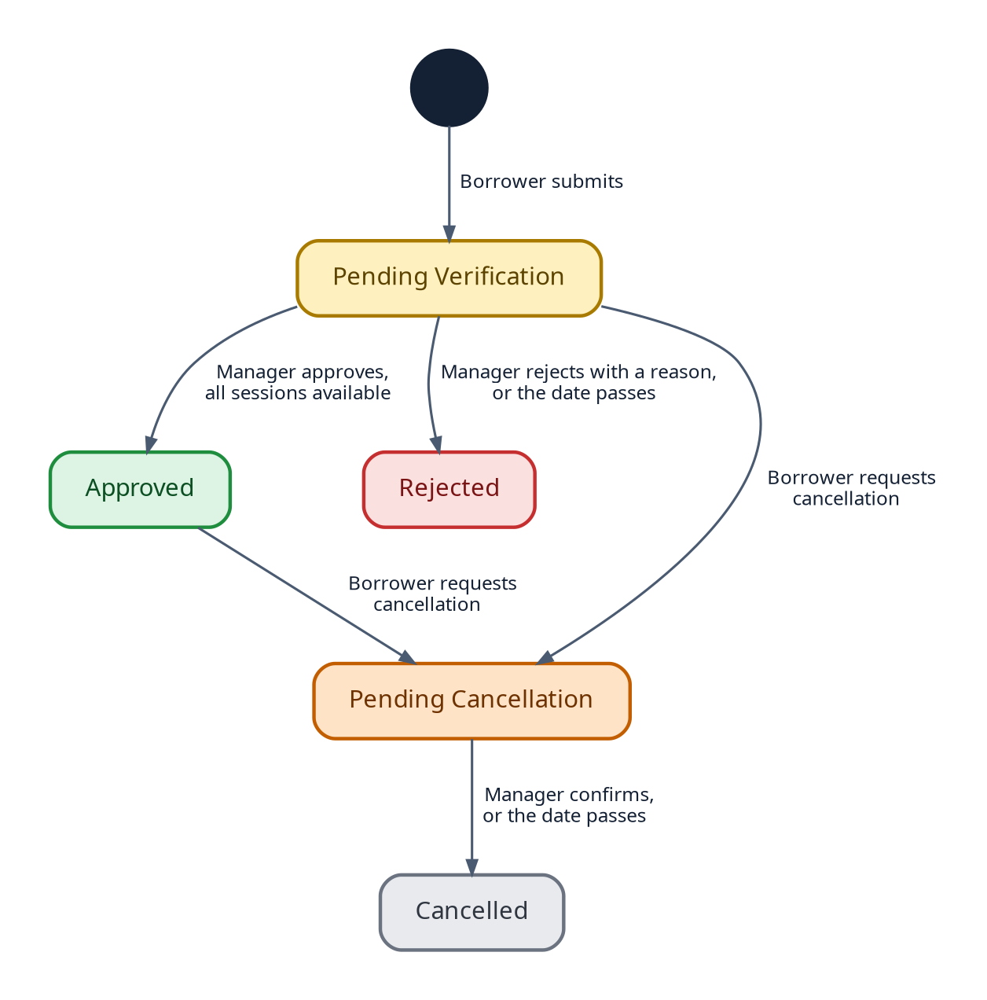

# Fasor Hub

Book campus sports facilities without chasing anyone for a schedule.


## Overview

Fasor Hub is a web application for requesting and managing court sessions at a campus sports complex. Borrowers pick a facility and a date, request up to four sessions, and follow the decision. Facility managers verify each request, keep the schedule accurate, and handle cancellations.

The system treats a session as a shared resource: two requests can never end up holding the same session, even when managers act at the same moment.

> [!NOTE]
> Fasor Hub is under active development. The data layer and the approve and reject logic are in place; the web interface is being built. See the [project board](https://github.com/users/musyaree/projects/4) for what is next.

## Features

| Feature | Status |
|---|---|
| Database schema, seed data, and message catalog | Available |
| Approve a booking and occupy all of its sessions, or none | Available |
| Reject a booking with a reason | Available |
| Register, log in, and role-based access | Planned |
| Facility calendar and session availability | Planned |
| Request one to four sessions | Planned |
| Booking status and history | Planned |
| Cancellation requests and confirmation | Planned |
| Open and close sessions | Planned |
| Automatic handling of overdue bookings and session generation | Planned |
| Usage reports and list filters | Planned |
| Facility management | Planned |

## How a booking works

<p align="center">
  
</p>

- A request does not hold any session until a manager approves it.
- Approval occupies every session of the booking together. If one session is no longer available, nothing changes.
- Cancelling an approved booking releases its sessions. Cancelling a pending one has no effect on the schedule.
- Rejected and cancelled bookings are final. A borrower who still wants the court submits a new request.

## Tech stack

| Layer | Technology |
|---|---|
| Language | Java 21 |
| Web | Jakarta Servlet 6, JSP 3.1, JSTL 3 on Tomcat 10.1 |
| Data access | JDBC with HikariCP |
| Database | MySQL 8 |
| Security | BCrypt password hashing |
| Build and test | Maven, JUnit 5 |

## Getting started

### Prerequisites

- JDK 21 and Maven 3.9 or later
- Docker, or a MySQL 8 server you can reach

### Start MySQL

```bash
docker run -d --name fasor-mysql -p 3308:3306 \
  -e MYSQL_ROOT_PASSWORD=fasor -e MYSQL_DATABASE=fasor_hub \
  -e MYSQL_USER=fasor -e MYSQL_PASSWORD=fasor \
  mysql:8.0 --default-time-zone=+07:00
```

### Build and run

```bash
mvn package
docker build -t fasor-hub .
docker run --rm --network host -e SEED_ON_START=true fasor-hub
```

The schema is created on startup. With `SEED_ON_START=true`, an empty database is filled with demo data: four accounts, four facilities, 35 days of sessions, and 13 sample bookings.

> [!NOTE]
> There are no web pages yet, so the application starts and prepares the database but has nothing to open in a browser.

### Demo accounts

All demo accounts use the password `password`.

| Email | Role |
|---|---|
| `pengguna@contoh.id` | Borrower |
| `budi@contoh.id` | Borrower |
| `citra@contoh.id` | Borrower |
| `pengelola@contoh.id` | Manager |

> [!WARNING]
> Never seed demo data on a public deployment.

### Run the tests

The tests use a real MySQL database, not SQLite, because conflict tests need row locking. Create it once:

```bash
docker exec fasor-mysql mysql -uroot -pfasor -e \
  "CREATE DATABASE IF NOT EXISTS fasor_hub_test CHARACTER SET utf8mb4; GRANT ALL ON fasor_hub_test.* TO 'fasor'@'%';"
mvn test
```

## Configuration

Settings come from environment variables. Copy `.env.example` as a starting point and never commit real values.

| Variable | Default | Purpose |
|---|---|---|
| `DB_URL` | built from the values below | Full JDBC URL, takes precedence when set |
| `DB_HOST` | `127.0.0.1` | Database host |
| `DB_PORT` | `3308` | Database port |
| `DB_NAME` | `fasor_hub` | Database name |
| `DB_USER` | `fasor` | Database user |
| `DB_PASSWORD` | `fasor` | Database password |
| `DB_POOL` | `8` | Maximum pooled connections |
| `SEED_ON_START` | unset | Set to `true` to seed an empty database |

## Project structure

```text
src/main/java/app/fasorhub/
  dao/        SQL access, one class per table
  exception/  Errors that map to user-facing messages
  model/      Records and coded enums
  service/    Transactions and locking rules
  util/       Connection pool, transactions, clock, messages, seeder
src/main/resources/
  schema.sql              Table definitions
  messages_en.properties  All user-facing text
src/test/java/            Constraint, seed, verification, and concurrency tests
```

## Design notes

- All booking changes run in one transaction. The booking row is locked first, then its sessions in ascending id order, so concurrent actions cannot deadlock.
- "Today" always means the Asia/Jakarta time zone.
- User-facing text lives only in the message catalog, never in code.
