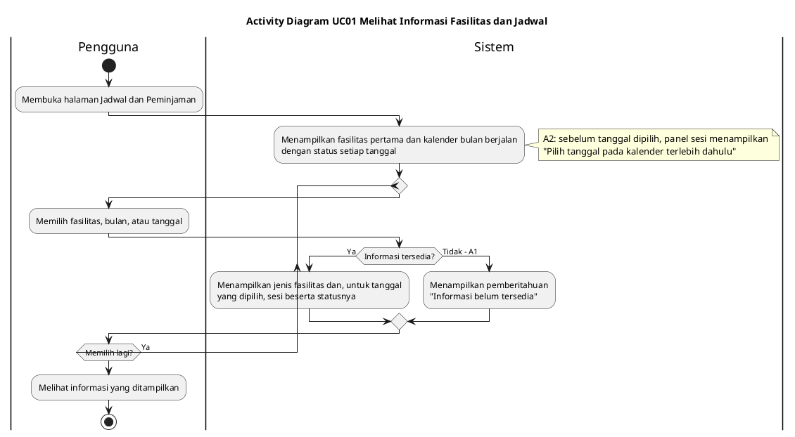

[Kembali ke daftar isi](../README.md)

**UC01**  
**MELIHAT INFORMASI FASILITAS DAN JADWAL**

1. **Use case Spesifikasi**

| Kode Usecase | UC01 |  |
| ----- | :---- | :---- |
| Nama Usecase | Melihat Informasi Fasilitas dan Jadwal |  |
| Deskripsi | Pengguna dapat melihat informasi fasilitas olahraga dan mengetahui jadwal ketersediaannya melalui sistem |  |
| Aktor | Pengguna |  |
| Relasi | \- |  |
| Kondisi Awal | Pengguna sudah masuk ke sistem dan berada pada halaman Jadwal dan Peminjaman (halaman yang sama dengan UC02) |  |
| Kondisi Akhir | Sistem menampilkan informasi fasilitas dan jadwal yang dipilih sehingga pengguna dapat mengetahui informasi serta ketersediaan jadwal |  |
| Alur Normal | Aktor | Sistem |
|  | 1\. Pengguna membuka halaman Jadwal dan Peminjaman | 1.1 A2 Sistem menampilkan fasilitas pertama beserta kalender bulanan bulan berjalan dengan status setiap tanggal (“Tersedia”, “Sebagian”, “Penuh”, atau “Ditutup”) |
|  | 2\. Pengguna memilih fasilitas, bulan, atau tanggal yang ingin dilihat | 2.1 A1 Sistem memproses pilihan pengguna |
|  | 3\. Pengguna melihat informasi yang ditampilkan | 3.1 Sistem menampilkan jenis fasilitas dan, untuk tanggal yang dipilih, sesi beserta statusnya (“Tersedia”, “Terisi”, atau “Ditutup”) |
|  | 4\. Selesai | 4.1 Sistem tetap menampilkan halaman informasi agar pengguna dapat memeriksa informasi yang diperlukan |
| Alur Alternatif |  |  |
|  | A1. Informasi Fasilitas atau Jadwal Tidak Tersedia (*dari langkah 2.1*) \- A1.1 Sistem menampilkan pemberitahuan “Informasi belum tersedia”. \- A1.2 Pengguna kembali ke daftar fasilitas atau jadwal. \- A1.3 Kembali ke alur normal langkah 2. A2. Pengguna Belum Memilih Fasilitas atau Jadwal (*dari langkah 1.1*) \- A2.1 Sistem tetap menampilkan fasilitas pertama dan kalender bulan berjalan, dan panel sesi menampilkan “Pilih tanggal pada kalender terlebih dahulu”. \- A2.2 Pengguna memilih tanggal pada kalender. \- A2.3 Kembali ke alur normal langkah 2. |  |

2. Activity Diagram

*(Kode PlantUML di bawah dipakai sebagai acuan urutan dan label; belum digambar ulang di Miro. Jalur: Pengguna | Sistem.)*

3. User Story  
   Sebagai pengguna, saya ingin melihat informasi fasilitas olahraga dan jadwal ketersediaannya, sehingga saya dapat mengetahui fasilitas yang tersedia sebelum mengajukan peminjaman.  

   Kriteria diterima:  
* Pengguna dapat membuka halaman Jadwal dan Peminjaman.  
* Sistem menampilkan informasi fasilitas yang tersedia.  
* Pengguna dapat memilih fasilitas atau jadwal untuk melihat informasi yang berkaitan.  
* Sistem menampilkan informasi jadwal sesuai pilihan pengguna, beserta status setiap sesi (“Tersedia”, “Terisi”, atau “Ditutup”).  
* Kalender bulanan menampilkan status setiap tanggal (“Tersedia”, “Sebagian”, “Penuh”, atau “Ditutup”), dan tanggal sebelum hari ini serta tanggal yang belum punya sesi tidak dapat dipilih.  
* Jika informasi tidak tersedia atau gagal ditampilkan, sistem menampilkan pemberitahuan “Informasi belum tersedia” kepada pengguna.

4. EARS

1. **Pola Dasar**  
   Sistem harus menampilkan informasi fasilitas olahraga dan jadwal ketersediaannya pada halaman Jadwal dan Peminjaman.

Kriteria Penerimaan:

* Halaman informasi dapat diakses oleh pengguna.  
* Informasi fasilitas dan jadwal ditampilkan dalam halaman yang sesuai.  
* Informasi yang ditampilkan berkaitan dengan fasilitas olahraga pada sistem.  
* Kalender bulanan menampilkan status setiap tanggal (“Tersedia”, “Sebagian”, “Penuh”, atau “Ditutup”) yang diturunkan dari status sesinya.  
* Tanggal sebelum hari ini dan tanggal yang belum punya sesi tidak dapat dipilih.  
  Penjelasan: Pola dasar digunakan karena sistem diharapkan menampilkan informasi fasilitas dan jadwal setiap kali pengguna membuka halaman tersebut. Kebutuhan ini terletak pada langkah 1.1 di alur normal.  
2. **Pola When (Event-Driven)**  
   Ketika pengguna memilih fasilitas atau jadwal tertentu, sistem harus menampilkan informasi yang sesuai dengan pilihan pengguna.

Kriteria Penerimaan:

* Sistem menerima pilihan fasilitas atau jadwal dari pengguna.  
* Sistem menampilkan informasi yang sesuai dengan pilihan tersebut.  
* Informasi yang ditampilkan dapat dibaca pengguna untuk mengetahui jadwal yang tersedia, termasuk status setiap sesi (“Tersedia”, “Terisi”, atau “Ditutup”).  
  Penjelasan: Pola When (Event-Driven) digunakan karena respons sistem terjadi setelah pengguna memilih fasilitas atau jadwal. Kebutuhan ini terletak pada langkah 2 dan langkah 2.1–3.1 di alur normal.

3. **Pola If-Then (Unwanted Behaviour)**  
   Jika informasi fasilitas atau jadwal tidak tersedia atau gagal ditampilkan, maka sistem harus menampilkan pemberitahuan “Informasi belum tersedia” dan tidak menampilkan informasi yang menyesatkan.

Kriteria Penerimaan:

* Sistem menampilkan pemberitahuan “Informasi belum tersedia” ketika informasi tidak dapat ditampilkan.  
* Sistem tidak menampilkan data yang tidak sesuai sebagai informasi yang valid.  
* Pengguna dapat kembali ke daftar fasilitas atau mencoba memilih kembali.  
  Penjelasan: Pola If-Then dipakai karena kebutuhan ini menangani keadaan yang tidak diinginkan, yaitu informasi fasilitas atau jadwal tidak tersedia atau gagal ditampilkan. Sistem melakukan *error handling* dengan memberikan pemberitahuan dan tidak menampilkan informasi yang menyesatkan. Kebutuhan ini terletak pada alur alternatif A1, yang berasal dari langkah 2.1 di alur normal.

**Catatan rancangan UC01 (keputusan)**

* UC01 (melihat jadwal) dan UC02 (mengajukan peminjaman) tampil dalam satu halaman “Jadwal dan Peminjaman”, mengikuti PIPTP UNAIR; kedua use case tetap terpisah.  
* Jadwal ditampilkan sebagai kalender bulanan. Status tanggal diturunkan dari status sesi (Tersedia, Sebagian, Penuh, Ditutup) dan tidak disimpan; aturannya ada di [wireframe.md](../03-desain/wireframe.md), bagian 1.3.  
* Tanggal sebelum hari ini dan tanggal yang belum punya sesi tidak dapat dipilih; sesi pada tanggal lampau otomatis tidak tersedia oleh sistem tanpa pengaturan pengelola (keputusan).
