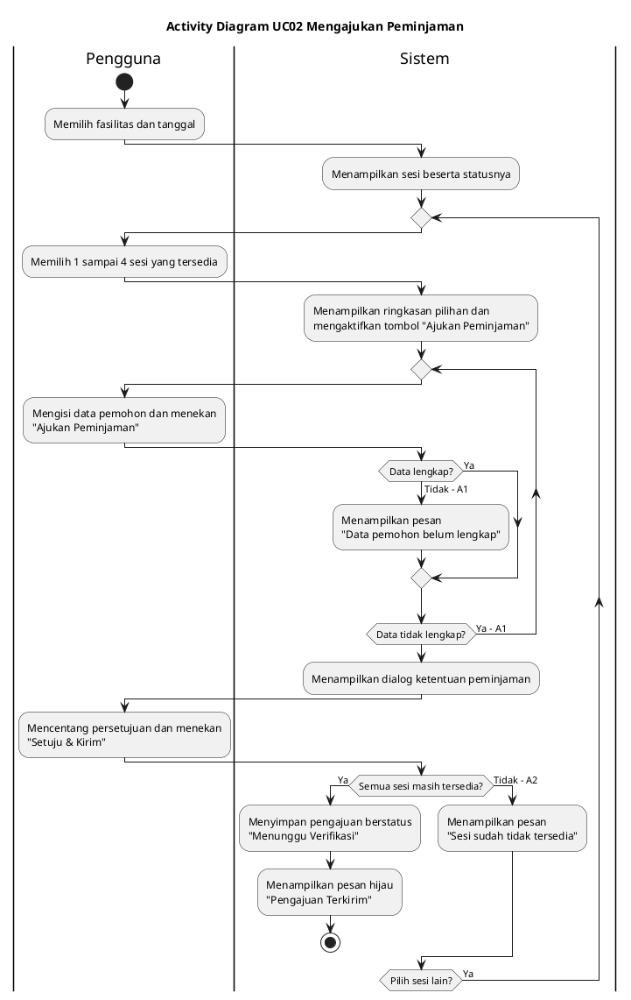

[Kembali ke daftar isi](../README.md)

**UC02**  
**MENGAJUKAN PEMINJAMAN**

1. **Use case Spesifikasi**

| Kode Usecase | UC02 |  |
| :---- | :---- | :---- |
| Nama Usecase | Mengajukan Peminjaman |  |
| Deskripsi | Pengguna memilih fasilitas, tanggal, dan satu sampai empat sesi yang tersedia, mengisi data pemohon, lalu mengajukan peminjaman untuk diverifikasi pengelola. |  |
| Aktor | Pengguna |  |
| Relasi | \- |  |
| Kondisi Awal | Pengguna sudah masuk ke sistem dan berada pada halaman Jadwal dan Peminjaman (halaman yang sama dengan UC01). |  |
| Kondisi Akhir | Pengajuan tersimpan dengan status “Menunggu Verifikasi” dan sistem menampilkan pesan hijau “Pengajuan Terkirim”. |  |
| Alur Normal | Aktor | Sistem |
|  | 1\. Pengguna memilih fasilitas dan mengklik satu tanggal pada kalender bulanan (tanggal sebelum hari ini tidak dapat dipilih) | 1.1 Sistem menampilkan sesi waktu pada tanggal tersebut beserta statusnya (“Tersedia”, “Terisi”, atau “Ditutup”) |
|  | 2\. Pengguna memilih satu sampai empat sesi yang tersedia | 2.1 Sistem menampilkan ringkasan pilihan (fasilitas, tanggal, sesi), mengaktifkan tombol “Ajukan Peminjaman”, dan menonaktifkan pilihan sesi lain setelah 4 sesi terpilih |
|  | 3\. Pengguna mengisi data pemohon dan menekan tombol “Ajukan Peminjaman” | 3.1 A1 Sistem memeriksa kelengkapan data pemohon |
|  |  | 3.2 Sistem menampilkan dialog ketentuan peminjaman |
|  | 4\. Pengguna mencentang pernyataan persetujuan dan menekan tombol “Setuju & Kirim” | 4.1 A2 Sistem memeriksa ketersediaan seluruh sesi yang dipilih |
|  |  | 4.2 Sistem menyimpan pengajuan dengan status “Menunggu Verifikasi” |
|  |  | 4.3 Sistem menampilkan pesan hijau “Pengajuan Terkirim” |
|  | 5\. Selesai |  |
| Alur Alternatif |  |  |
|  | A1. Data Pemohon Tidak Lengkap (*dari langkah 3.1*) \- A1.1 Sistem menampilkan pesan “Data pemohon belum lengkap, harap dilengkapi”. \- A1.2 Pengguna melengkapi data pemohon. \- A1.3 Kembali ke alur normal langkah 3. A2. Sesi Sudah Tidak Tersedia (*dari langkah 4.1*) \- A2.1 Sistem tidak menyimpan pengajuan (satu sesi atau lebih sudah terisi, ditutup, atau tanggalnya sudah lewat), menampilkan pesan “Sesi sudah tidak tersedia, silakan pilih sesi lain”, dan memperbarui status sesi. \- A2.2 Pengguna memilih sesi lain. \- A2.3 Kembali ke alur normal langkah 2. |  |

2. Activity Diagram

*(Belum digambar di Miro. Kode PlantUML di bawah dipakai sebagai acuan urutan dan label. Jalur: Pengguna | Sistem.)*

3. User Story  
   Sebagai pengguna (mahasiswa, dosen, atau organisasi mahasiswa), saya ingin mengajukan peminjaman fasilitas melalui sistem dengan memilih jadwal yang tersedia, sehingga saya tidak perlu menghubungi pengelola untuk mengetahui jadwal kosong dan mengajukan peminjaman.  

   Kriteria diterima:  
1. Pengguna dapat memilih fasilitas, tanggal, dan satu sampai empat sesi yang tersedia.  
2. Sesi yang berstatus “Terisi” atau “Ditutup” tidak dapat dipilih, dan setelah 4 sesi terpilih sesi lain tidak dapat dipilih. Tanggal sebelum hari ini tidak dapat dipilih.  
3. Pengguna wajib mengisi data pemohon. Jika belum lengkap, sistem menampilkan pesan dan pengajuan tidak dikirim.  
4. Pengajuan baru dikirim setelah pengguna menyetujui ketentuan peminjaman.  
5. Pengajuan yang berhasil tersimpan dengan status “Menunggu Verifikasi” dan muncul pesan hijau “Pengajuan Terkirim”.  
6. Jika ada sesi yang sudah tidak tersedia saat pengajuan dikirim, pengajuan tidak disimpan, sistem menampilkan pesan, dan pengguna harus memilih sesi lain.

4. EARS

1. **Pola Dasar**  
   Sistem harus hanya mengizinkan pemilihan sesi yang berstatus “Tersedia”, dengan paling banyak 4 sesi dalam satu pengajuan.  
   Kriteria Penerimaan:

* Sesi berstatus “Terisi” atau “Ditutup” tidak dapat dipilih.  
* Setiap sesi pada tanggal yang dipilih menampilkan statusnya (“Tersedia”, “Terisi”, atau “Ditutup”).  
* Sesi berstatus “Tersedia” dapat dipilih.  
* Pengguna dapat memilih paling banyak 4 sesi; setelah 4 sesi terpilih, sesi lain tidak dapat dipilih.  
* Tanggal sebelum hari ini dan tanggal yang belum punya sesi tidak dapat dipilih pada kalender; sesi pada tanggal lampau otomatis tidak tersedia oleh sistem.  
  Penjelasan: Pola dasar dipakai karena aturan ini selalu berlaku tanpa syarat atau pemicu tambahan, yaitu hanya sesi yang tersedia yang boleh dipilih, sehingga mencegah bentrokan jadwal sejak tahap pemilihan. Kebutuhan ini terletak pada langkah 1.1 dan langkah 2 di alur normal.

2. **Pola When (Event-Driven)**  
   Ketika pengguna menekan tombol “Setuju & Kirim” dan semua sesi yang dipilih masih tersedia, sistem harus menyimpan pengajuan dengan status “Menunggu Verifikasi” dan menampilkan pesan hijau “Pengajuan Terkirim”.  
   Kriteria Penerimaan:

* Pengajuan tersimpan dengan status “Menunggu Verifikasi”.  
* Pesan hijau “Pengajuan Terkirim” muncul setelah pengajuan tersimpan.  
* Sesi yang diajukan tetap berstatus “Tersedia” bagi pengguna lain sampai pengelola menyetujuinya.  
* Pengajuan tidak tersimpan jika pengguna belum menyetujui ketentuan.  
  Penjelasan: Pola When dipakai karena respons sistem dipicu oleh suatu kejadian, yaitu pengguna menekan tombol “Setuju & Kirim”. Penyimpanan pengajuan dan pesan keberhasilan terjadi setelah kejadian itu dan hanya jika sesi masih tersedia. Kebutuhan ini terletak pada langkah 4 dan langkah 4.2–4.3 di alur normal.

3. **Pola If-Then (Unwanted Behaviour)**  
   Jika satu sesi atau lebih yang dipilih sudah tidak tersedia (sudah terisi, ditutup, atau tanggalnya sudah lewat) ketika pengguna menekan tombol “Setuju & Kirim”, maka sistem harus membatalkan pengiriman dan menampilkan pesan “Sesi sudah tidak tersedia, silakan pilih sesi lain”.  
   Kriteria Penerimaan:

* Pengajuan tidak tersimpan.  
* Pesan “Sesi sudah tidak tersedia, silakan pilih sesi lain” ditampilkan.  
* Status sesi diperbarui sehingga sesi yang tidak tersedia tampil sesuai status terkininya (“Terisi” atau “Ditutup”).  
* Pengguna dapat memilih sesi lain dan mengajukan kembali.  
  Penjelasan: Pola If-Then dipakai karena kebutuhan ini menangani keadaan yang tidak diinginkan, yaitu sesi yang dipilih sudah terisi karena disetujui untuk pengajuan lain, sudah ditutup pengelola, atau tanggalnya sudah lewat sebelum pengajuan ini dikirim. Sistem melakukan *error handling* dengan membatalkan pengiriman dan mengarahkan pengguna memilih sesi lain. Kebutuhan ini terletak pada alur alternatif A2, yang berasal dari langkah 4.1 di alur normal.

**Catatan rancangan UC02 (keputusan dan asumsi)**

* Status pengajuan memakai lima nilai: Menunggu Verifikasi, Disetujui, Ditolak, Menunggu Konfirmasi Pembatalan, Dibatalkan.  
* Pemilihan jadwal mengikuti pola UNAIR: pilih fasilitas dan tanggal, pilih sesi (sesi terisi tidak dapat dipilih), isi data pemohon, setujui ketentuan, lalu kirim.  
* Pengajuan berstatus “Menunggu Verifikasi” tidak mengunci sesi. Sesi baru terkunci saat pengajuan Disetujui (UC07), sehingga beberapa pengguna dapat mengajukan sesi yang sama dan pengelola yang memutuskan.  
* Keputusan: pengguna melihat tiga label status sesi, sama seperti pengelola (UC06): “Tersedia”, “Terisi” (sudah Disetujui), dan “Ditutup” (ditutup pengelola). Hanya “Tersedia” yang dapat dipilih.  
* Keputusan: satu pengajuan memuat satu sampai empat sesi pada satu fasilitas dan satu tanggal, tidak harus berurutan (batas 4 sama dengan UNAIR). Pengajuan disetujui atau ditolak untuk seluruh sesinya sekaligus; bila ada satu sesi yang tidak tersedia, pengajuan tidak dapat disetujui.  
* Asumsi: tombol “Batal” pada dialog ketentuan tidak dimodelkan, konsisten dengan keputusan menghapus A4 di UC07.  
* Data pemohon: nama, unit/organisasi, jumlah peserta, kontak aktif, dan keperluan (mengikuti form UNAIR; sebagian dapat terisi otomatis dari akun).  
* Teks pesan mengikuti katalog di [pesan-sistem.md](../03-desain/pesan-sistem.md).
* Halaman “Jadwal dan Peminjaman” dipakai bersama UC01 (mengikuti PIPTP UNAIR): langkah 1 memilih fasilitas dan tanggal pada kalender bulanan, langkah 2 memilih sesi dan mengisi data pemohon. Sesi pada tanggal sebelum hari ini otomatis tidak tersedia oleh sistem dan tidak dapat dipilih (keputusan).
* Keputusan aturan isian: isian yang hanya berisi spasi dianggap kosong, jumlah peserta adalah bilangan bulat 1 atau lebih, dan batas panjang (unit 50, kontak 20, keperluan 200, alasan 255 karakter) ditegakkan dengan batas karakter di formulir tanpa pesan baru (lihat [pesan-sistem.md](../03-desain/pesan-sistem.md), bagian 4).
