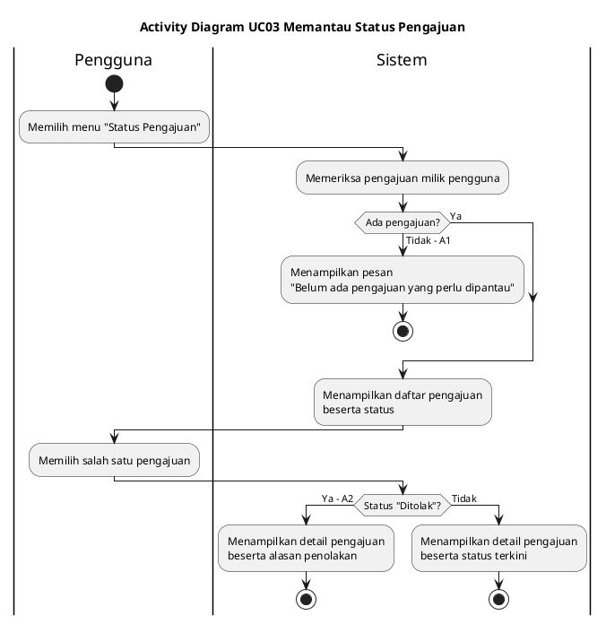

[Kembali ke daftar isi](../README.md)

**UC03**  
**MEMANTAU STATUS PENGAJUAN**

1. **Use case Spesifikasi**

| Kode Usecase | UC03 |  |
| :---- | :---- | :---- |
| Nama Usecase | Memantau Status Pengajuan |  |
| Deskripsi | Pengguna melihat daftar pengajuan peminjamannya yang jadwalnya belum lewat beserta status terkini, dan membuka detail untuk melihat hasil verifikasi pengelola. |  |
| Aktor | Pengguna |  |
| Relasi | \- |  |
| Kondisi Awal | Pengguna sudah masuk ke sistem. |  |
| Kondisi Akhir | Sistem menampilkan status terkini pengajuan milik pengguna, beserta alasan penolakan jika pengajuan ditolak. |  |
| Alur Normal | Aktor | Sistem |
|  | 1\. Pengguna memilih menu “Status Pengajuan” | 1.1 A1 Sistem memeriksa pengajuan milik pengguna yang tanggal peminjamannya hari ini atau mendatang |
|  |  | 1.2 Sistem menampilkan daftar pengajuan (fasilitas, tanggal, sesi, status) diurutkan dari waktu pengajuan terbaru |
|  | 2\. Pengguna memilih salah satu pengajuan | 2.1 A2 Sistem memeriksa status pengajuan yang dipilih |
|  |  | 2.2 Sistem menampilkan detail pengajuan (fasilitas, tanggal, sesi, keperluan, waktu pengajuan, status terkini) |
|  | 3\. Selesai |  |
| Alur Alternatif |  |  |
|  | A1. Belum Ada Pengajuan (*dari langkah 1.1*) \- A1.1 Sistem menampilkan pesan “Belum ada pengajuan yang perlu dipantau”. \- A1.2 Selesai. A2. Pengajuan Ditolak (*dari langkah 2.1*) \- A2.1 Sistem menampilkan detail pengajuan beserta alasan penolakan dari pengelola. \- A2.2 Kembali ke alur normal langkah 3. |  |

2. Activity Diagram

*(Belum digambar di Miro. Kode PlantUML di bawah dipakai sebagai acuan urutan dan label. Jalur: Pengguna | Sistem.)*

3. User Story  
   Sebagai pengguna, saya ingin memantau status pengajuan peminjaman saya melalui sistem, sehingga saya dapat mengetahui apakah pengajuan sudah disetujui atau ditolak beserta alasannya tanpa harus menghubungi pengelola.  

   Kriteria diterima:  
1. Pengguna dapat membuka menu “Status Pengajuan”.  
2. Daftar hanya memuat pengajuan milik pengguna dengan tanggal peminjaman hari ini atau mendatang.  
3. Setiap pengajuan menampilkan fasilitas, tanggal, sesi, dan status terkini.  
4. Status berupa salah satu dari: Menunggu Verifikasi, Disetujui, Ditolak, Menunggu Konfirmasi Pembatalan, atau Dibatalkan.  
5. Detail pengajuan berstatus “Ditolak” menampilkan alasan penolakan dari pengelola.  
6. Jika belum ada pengajuan, sistem menampilkan pesan “Belum ada pengajuan yang perlu dipantau”.

4. EARS

1. **Pola Dasar**  
   Sistem harus menampilkan status terkini setiap pengajuan milik pengguna dengan salah satu dari lima status: “Menunggu Verifikasi”, “Disetujui”, “Ditolak”, “Menunggu Konfirmasi Pembatalan”, atau “Dibatalkan”.  
   Kriteria Penerimaan:

* Status yang tampil sesuai dengan status yang tersimpan di sistem.  
* Status hanya memakai lima nilai di atas.  
* Pengajuan milik pengguna lain tidak tampil.  
  Penjelasan: Pola dasar dipakai karena penampilan status selalu berlaku tanpa syarat atau pemicu tambahan, dan menjadi isi tetap halaman status pengajuan. Kebutuhan ini terletak pada langkah 1.2 dan langkah 2.2 di alur normal.

2. **Pola When (Event-Driven)**  
   Ketika pengguna memilih menu “Status Pengajuan”, sistem harus menampilkan daftar pengajuan milik pengguna dengan tanggal peminjaman hari ini atau mendatang, diurutkan berdasarkan waktu pengajuan dari yang terbaru.  
   Kriteria Penerimaan:

* Daftar hanya memuat pengajuan milik pengguna yang sedang masuk.  
* Pengajuan dengan tanggal peminjaman yang sudah lewat tidak tampil.  
* Pengajuan yang paling baru diajukan berada paling atas.  
* Setiap entri menampilkan fasilitas, tanggal, sesi, dan status.  
  Penjelasan: Pola When dipakai karena respons sistem dipicu oleh suatu kejadian, yaitu pengguna memilih menu “Status Pengajuan”. Daftar baru ditampilkan setelah kejadian tersebut. Kebutuhan ini terletak pada langkah 1 dan langkah 1.1–1.2 di alur normal.

3. **Pola While (State-Driven)**  
   Selama pengajuan berstatus “Ditolak”, sistem harus menampilkan alasan penolakan dari pengelola pada detail pengajuan.  
   Kriteria Penerimaan:

* Alasan penolakan yang tampil sama dengan yang diberikan pengelola saat menolak (UC07.1).  
* Alasan penolakan tidak tampil pada pengajuan dengan status selain “Ditolak”.  
* Alasan penolakan tampil pada detail pengajuan, bukan pada daftar.  
  Penjelasan: Pola While dipakai karena perilaku sistem ini berlaku selama pengajuan berada dalam suatu keadaan tertentu, yaitu berstatus “Ditolak”, bukan dipicu oleh satu kejadian. Selama keadaan itu bertahan, alasan penolakan harus tampil pada detail. Kebutuhan ini terletak pada alur alternatif A2, yang berasal dari langkah 2.1 di alur normal.

**Catatan rancangan UC03 (keputusan dan asumsi)**

* Batas dengan UC05: UC03 hanya menampilkan pengajuan dengan tanggal peminjaman hari ini atau mendatang (yang masih perlu dipantau), sedangkan UC05 mencakup seluruh riwayat termasuk yang sudah lewat.  
* Pola EARS ketiga memakai While (State-Driven) karena alasan penolakan terkait keadaan status; alternatifnya If-Then untuk A1 (belum ada pengajuan).  
* Pembatalan dari halaman ini tidak dimodelkan; pembatalan tetap lewat UC04.  
* Tidak ada notifikasi; pengguna melihat hasil dengan membuka menu sendiri (sesuai keputusan UC07).  
* Login dianggap sudah terpenuhi di Kondisi Awal, tidak dimodelkan sebagai alur alternatif.  
* Teks pesan mengikuti katalog di [pesan-sistem.md](../03-desain/pesan-sistem.md).
* Pengajuan yang ditolak otomatis atau dibatalkan otomatis karena tanggalnya terlewat tidak tampil di UC03 (hanya tanggal hari ini atau mendatang) dan dapat dilihat di UC05 (riwayat).
