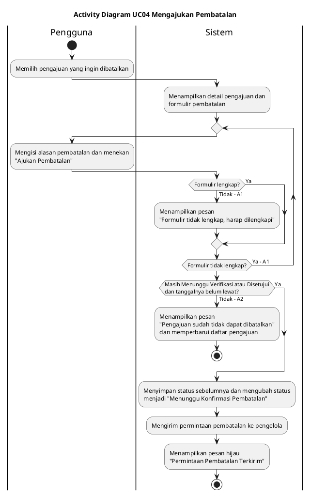

[Kembali ke daftar isi](../README.md)

**UC04**  
**MENGAJUKAN PEMBATALAN**

1. **Use case Spesifikasi**

| Kode Usecase | UC04 |  |
| :---- | :---- | :---- |
| Nama Usecase | Mengajukan Pembatalan |  |
| Deskripsi | Pengguna dapat mengajukan pembatalan peminjaman fasilitas melalui sistem. |  |
| Aktor | Pengguna |  |
| Relasi | \- |  |
| Kondisi Awal | Pengguna berada pada halaman pengajuan pembatalan yang menampilkan daftar pengajuan miliknya yang berstatus “Menunggu Verifikasi” atau “Disetujui” dan bertanggal peminjaman hari ini atau mendatang (bila tidak ada, sistem menampilkan pemberitahuan “Tidak ada pengajuan yang dapat dibatalkan”) |  |
| Kondisi Akhir | Sistem mengirim permintaan pembatalan ke pengelola, status pengajuan menjadi “Menunggu Konfirmasi Pembatalan”, dan sistem menampilkan pesan hijau “Permintaan Pembatalan Terkirim”. |  |
| Alur Normal | Aktor | Sistem |
|  | 1\. Pengguna memilih pengajuan yang ingin dibatalkan | 1.1 Sistem menampilkan detail pengajuan |
|  |  | 1.2 Sistem menampilkan formulir pembatalan |
|  | 2\. Pengguna mengisi alasan pembatalan |  |
|  | 3\. Pengguna menekan tombol “Ajukan Pembatalan” | 3.1 A1 Sistem memeriksa kelengkapan formulir pembatalan |
|  |  | 3.2 A2 Sistem memeriksa pengajuan masih berstatus “Menunggu Verifikasi” atau “Disetujui” dan tanggal peminjamannya belum lewat |
|  |  | 3.3 Sistem menyimpan status sebelumnya (“Menunggu Verifikasi” atau “Disetujui”) dan mengubah status pengajuan menjadi “Menunggu Konfirmasi Pembatalan” |
|  |  | 3.4 Sistem mengirim permintaan pembatalan ke pengelola |
|  |  | 3.5 Sistem menampilkan pesan hijau “Permintaan Pembatalan Terkirim” |
|  | 4\. Selesai |  |
| Alur Alternatif |  |  |
|  | A1. Formulir Tidak Lengkap (*dari langkah 3.1*) \- A1.1 Sistem menampilkan pesan “Formulir tidak lengkap, harap dilengkapi”. \- A1.2 Pengguna melengkapi kembali formulir pembatalan. \- A1.3 Kembali ke alur normal langkah 3. A2. Pengajuan Sudah Tidak Dapat Dibatalkan (*dari langkah 3.2*) \- A2.1 Sistem tidak mengubah apa pun, menampilkan pesan “Pengajuan sudah tidak dapat dibatalkan”, dan memperbarui daftar pengajuan. \- A2.2 Pengguna memilih pengajuan lain. \- A2.3 Kembali ke alur normal langkah 1. |  |

2. Activity Diagram

*(Kode PlantUML di bawah dipakai sebagai acuan urutan dan label; belum digambar ulang di Miro. Jalur: Pengguna | Sistem.)*

3. User Story  
   Sebagai pengguna, saya ingin mengajukan pembatalan secara mandiri melalui sistem, sehingga saya tidak perlu menghubungi pengelola setiap kali saya ingin mengajukan pembatalan.  

   Kriteria diterima:  
* Pengguna dapat mengajukan pembatalan melalui sistem tanpa menghubungi pengelola secara langsung   
* Pengguna dapat mengisi alasan pembatalan pada formulir.  
* Sistem menampilkan daftar pengajuan milik pengguna yang dapat dipilih untuk dibatalkan, yaitu yang berstatus “Menunggu Verifikasi” atau “Disetujui” dan bertanggal peminjaman hari ini atau mendatang.  
* Jika formulir belum lengkap, sistem menampilkan pesan dan pengguna harus melengkapinya sebelum menekan tombol “Ajukan Pembatalan” kembali   
* Jika tidak ada pengajuan yang dapat dibatalkan, sistem menampilkan pemberitahuan “Tidak ada pengajuan yang dapat dibatalkan”.
* Jika pengajuan sudah berubah status sejak dipilih (misalnya sudah ditolak pengelola atau sistem, atau tanggalnya sudah lewat), pembatalan tidak diproses dan sistem menampilkan pesan “Pengajuan sudah tidak dapat dibatalkan”.
* Setelah mengirim permintaan pembatalan, status pengajuan berubah menjadi “Menunggu Konfirmasi Pembatalan”, permintaan diteruskan ke pengelola, dan muncul pesan hijau “Permintaan Pembatalan Terkirim”

4. EARS

1. Sistem harus menampilkan daftar pengajuan milik pengguna pada halaman permintaan pembatalan.

Kriteria Penerimaan:

* Daftar pengajuan yang tampil hanya daftar pengajuan milik pengguna yang sedang menggunakan sistem.  
* Setiap pengajuan pada daftar dapat dipilih untuk mengajukan permintaan pembatalan.  
* Pengajuan milik pengguna lain tidak boleh tampil di daftar pengajuan.  
* Jika tidak ada pengajuan yang memenuhi syarat, sistem menampilkan pemberitahuan “Tidak ada pengajuan yang dapat dibatalkan”.  
* Hanya pengajuan berstatus “Menunggu Verifikasi” atau “Disetujui” yang tampil pada daftar; pengajuan berstatus “Ditolak”, “Menunggu Konfirmasi Pembatalan”, atau “Dibatalkan” tidak tampil.  
* Pengajuan yang tanggal peminjamannya sudah lewat tidak tampil pada daftar, sehingga peminjaman yang sudah terjadi tidak dapat dibatalkan.  
  Penjelasan: Pola dasar dipakai untuk kebutuhan yang akan selalu muncul tanpa perlu syarat atau kondisi sebelumnya. Kebutuhan tersebut sangat cocok untuk pola dasar karena daftar pengajuan milik pengguna merupakan isi tetap untuk halaman pengajuan pembatalan dan bukan respons atas tindakan yang dilakukan pengguna. Kebutuhan ini terletak pada kondisi awal di bagian use case spesifikasi.

2. Ketika pengguna menekan tombol “Ajukan Pembatalan” dengan formulir yang sudah lengkap, sistem harus mengirim permintaan pembatalan ke pengelola, mengubah status pengajuan menjadi “Menunggu Konfirmasi Pembatalan”, dan menampilkan pesan hijau “Permintaan Pembatalan Terkirim”.

Kriteria Penerimaan:

* Sistem harus mengecek formulir pengajuan pembatalan yang diisi oleh pengguna dan mengirimkan permintaan pengajuan hanya jika formulir sudah terisi dengan lengkap  
* Pesan hijau harus muncul sesaat setelah pesan berhasil terkirim dan status juga harus berubah setelah pengguna menekan tombol “Ajukan Pembatalan”  
* Status sebelum pembatalan (“Menunggu Verifikasi” atau “Disetujui”) tersimpan agar penanganan pembatalan (UC08) mengetahui apakah pengajuan sempat mengunci sesi.  
* Pengguna tidak boleh mengirim pengajuan pembatalan jika formulir tidak diisi dengan lengkap.  
  Penjelasan: Pola yang digunakan adalah pola *When* (*Event-Driven*) yang mana respons sistem dipicu oleh suatu kejadian tertentu. Kebutuhan ini sangat cocok dengan pola tersebut karena pengiriman permintaan, perubahan status, dan kemunculan pesan hijau terjadi setelah pengguna menekan tombol “Ajukan Pembatalan” dengan formulir yang diisi lengkap. Kebutuhan ini terletak pada langkah ke-3 di alur normal.

3. Jika formulir pembatalan tidak lengkap, maka sistem harus menampilkan pesan “Formulir tidak lengkap, harap dilengkapi” dan tidak mengirim permintaan pembatalan ke pengelola.

Kriteria Penerimaan:

* Pesan “Formulir tidak lengkap, harap dilengkapi” akan tampil jika formulir belum lengkap.  
* Permintaan pembatalan tidak diterima oleh pengelola jika formulir belum lengkap.  
* Status pengajuan tidak berubah menjadi “Menunggu Konfirmasi Pembatalan”  
  Penjelasan: Pola yang digunakan pada pola ini yaitu pola *if-then* (*Unwanted Behaviours*) di mana suatu keadaan yang tidak diinginkan terjadi, yang dalam hal ini adalah ketidaklengkapan formulir karena pengguna tidak mengisi formulir dengan lengkap. Kebutuhan ini sangat cocok dengan pola tersebut karena sistem akan melakukan error handling jika pengguna tidak melengkapi formulir dengan mengeluarkan pesan kepada pengguna. Kebutuhan ini terletak pada alur alternatif A1, yang berasal dari langkah 3.1 di alur normal.

4. Jika pengajuan yang akan dibatalkan sudah tidak berstatus “Menunggu Verifikasi” atau “Disetujui”, atau tanggal peminjamannya sudah lewat, ketika pengguna menekan tombol “Ajukan Pembatalan”, maka sistem harus membatalkan permintaan itu dan menampilkan pesan “Pengajuan sudah tidak dapat dibatalkan”.

Kriteria Penerimaan:

* Status pengajuan tidak berubah dan tidak ada permintaan pembatalan yang diteruskan ke pengelola.  
* Pesan “Pengajuan sudah tidak dapat dibatalkan” ditampilkan.  
* Daftar pengajuan diperbarui sehingga pengajuan itu tidak lagi tampil.  
  Penjelasan: Pola *if-then* (*Unwanted Behaviours*) dipakai karena pengajuan dapat berubah status setelah pengguna memilihnya, misalnya ditolak pengelola (UC07) atau ditolak otomatis karena tanggalnya lewat. Sistem melakukan error handling dengan tidak menimpa status yang baru. Kebutuhan ini terletak pada alur alternatif A2, yang berasal dari langkah 3.2 di alur normal.

**Catatan rancangan UC04 (keputusan)**

* Hanya pengajuan berstatus “Menunggu Verifikasi” atau “Disetujui” yang dapat dibatalkan.  
* Status sebelum pembatalan disimpan (kolom `previous_status`) agar UC08 hanya melepas sesi bila pengajuan sebelumnya “Disetujui” (hanya pengajuan itu yang mengunci sesi).
* Umpan balik keberhasilan memakai pesan hijau (toast) tanpa popup, sama seperti use case lain; teks pesan mengikuti katalog di [pesan-sistem.md](../03-desain/pesan-sistem.md).
* Bila tanggal peminjaman terlewat sebelum pengelola mengonfirmasi, permintaan pembatalan dikonfirmasi otomatis oleh sistem dan statusnya menjadi “Dibatalkan” (lihat UC08).
* Keputusan: permintaan pembatalan hanya diproses bila pengajuan masih berstatus “Menunggu Verifikasi” atau “Disetujui” saat diproses (A2). Pemeriksaan dilakukan dalam transaksi yang mengunci baris `bookings`, dan pesan memakai P31.
* Keputusan: hanya pengajuan bertanggal peminjaman hari ini atau mendatang yang dapat dibatalkan. Peminjaman yang sudah lewat tidak dapat dibatalkan, supaya riwayat (UC05) dan laporan (UC09) tidak berubah setelah peminjaman terjadi. Pemeriksaan tanggal dilakukan lagi saat pembatalan diproses (A2, pesan P31).
* Keputusan aturan isian: isian yang hanya berisi spasi dianggap kosong, jumlah peserta adalah bilangan bulat 1 atau lebih, dan batas panjang (unit 50, kontak 20, keperluan 200, alasan 255 karakter) ditegakkan dengan batas karakter di formulir tanpa pesan baru (lihat [pesan-sistem.md](../03-desain/pesan-sistem.md), bagian 4).
