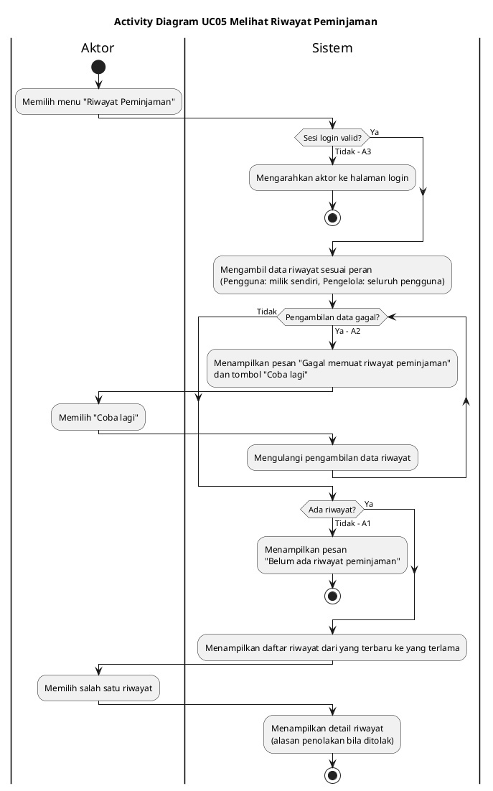

[Kembali ke daftar isi](../README.md)

**UC05**  
**MELIHAT RIWAYAT PEMINJAMAN**

1. **Use case Spesifikasi**

| Kode Usecase | UC05 |  |
| :---- | :---- | :---- |
| Nama Usecase | Melihat Riwayat Peminjaman |  |
| Deskripsi | Memungkinkan aktor melihat daftar dan detail riwayat peminjaman fasilitas olahraga. Pengguna melihat riwayat miliknya dan Pengelola melihat seluruh riwayat. Riwayat mencakup seluruh pengajuan, termasuk yang tanggal peminjamannya sudah lewat.  |  |
| Aktor | Pengguna (mahasiswa, dosen, organisasi mahasiswa) dan Pengelola  |  |
| Relasi | \- |  |
| Kondisi Awal | Aktor sudah login ke sistem.  |  |
| Kondisi Akhir | Sistem menampilkan riwayat peminjaman sesuai peran aktor. Data riwayat tidak berubah.  |  |
| Alur Normal | Aktor | Sistem |
|  | 1\. Aktor memilih menu “Riwayat Peminjaman” | 1.1 A3 Sistem memeriksa sesi login dan peran aktor |
|  |  | 1.2 A2 Sistem mengambil data riwayat sesuai peran (Pengguna: milik sendiri, Pengelola: seluruh pengguna) |
|  |  | 1.3 A1 Sistem memeriksa ketersediaan data riwayat |
|  |  | 1.4 Sistem menampilkan daftar riwayat berdasarkan waktu pengajuan dari yang terbaru ke terlama (fasilitas, tanggal, sesi waktu, dan status) |
|  | 2\. Aktor memilih salah satu riwayat | 2.1 Sistem menampilkan detail riwayat (fasilitas, tanggal, sesi waktu, keperluan, status, waktu pengajuan, alasan penolakan jika ditolak)  |
|  | 3\. Selesai |  |
| Alur Alternatif |  |  |
|  | A1. Belum ada riwayat (cabang dari 1.3) A1.1 Sistem menampilkan pesan “Belum ada riwayat peminjaman”. A1.2 Use case selesai. A2. Gagal memuat data (cabang dari 1.2) A2.1 Sistem menampilkan pesan kesalahan “Gagal memuat riwayat peminjaman” dan tombol “Coba lagi”. A2.2 Aktor memilih “Coba lagi”. A2.3 Kembali ke alur normal 1.2. A3. Sesi tidak valid (cabang dari 1.1) A3.1 Sistem mengarahkan aktor ke halaman login. A3.2 Use case selesai. A4. Aktor Menyaring Riwayat (opsional, dari langkah 1.4) A4.1 Aktor memilih status, rentang tanggal peminjaman, dan (khusus Pengelola) fasilitas pada filter, lalu menekan “Terapkan”. A4.2 A5 Sistem memeriksa rentang tanggal. A4.3 A6 Sistem memeriksa ada tidaknya riwayat yang sesuai dengan semua filter. A4.4 Sistem menampilkan hanya riwayat yang sesuai, tetap berurutan dari yang terbaru ke terlama, dan menutup detail yang terbuka. A4.5 Aktor menekan “Atur Ulang” untuk menampilkan seluruh riwayat, atau kembali ke alur normal langkah 2. A5. Rentang Tanggal Tidak Valid (cabang dari A4.2) A5.1 Sistem menampilkan pesan “Tanggal awal tidak boleh setelah tanggal akhir” dan tidak mengubah daftar. A5.2 Aktor memperbaiki rentang tanggal. A5.3 Kembali ke A4.1. A6. Tidak Ada Riwayat yang Sesuai (cabang dari A4.3) A6.1 Sistem menampilkan pesan “Tidak ada pengajuan yang sesuai dengan filter”. A6.2 Aktor mengubah atau mengatur ulang filter. A6.3 Kembali ke A4.1. |  |

2. **Activity Diagram**  

*Catatan: alur opsional A4–A6 (filter riwayat) belum digambar pada diagram di bawah.*

*(Kode PlantUML di bawah dipakai sebagai acuan urutan dan label; belum digambar ulang di Miro. Jalur: Aktor | Sistem.)*

3. **User Story**  
   Story 1 (Pengguna) : Sebagai pengguna (mahasiswa/dosen/organisasi mahasiswa), saya ingin melihat riwayat peminjaman fasilitas olahraga milik saya, sehingga saya dapat memantau status dan rekam jejak peminjaman tanpa harus menghubungi pengelola.  

   Kriteria diterima dari story 1:  
- Pengguna yang sudah login dapat membuka menu Riwayat Peminjaman.   
- Daftar hanya berisi peminjaman milik pengguna tersebut, termasuk yang tanggal peminjamannya sudah lewat.   
- Setiap entri menampilkan fasilitas, tanggal, sesi waktu, dan status pengajuan.   
- Detail entri berstatus ditolak menampilkan alasan penolakan.   
- Jika belum ada riwayat, sistem menampilkan pesan “Belum ada riwayat peminjaman”.   
- Halaman riwayat termuat dalam ≤ 3 detik.   
- Pengguna dapat menyaring riwayat miliknya menurut status dan rentang tanggal peminjaman.  
- Jika tidak ada riwayat yang sesuai filter, sistem menampilkan pesan “Tidak ada pengajuan yang sesuai dengan filter”.  

  Story 2 (Pengelola) : Sebagai pengelola fasilitas, saya ingin melihat seluruh riwayat peminjaman dari semua pengguna, sehingga saya dapat memantau penggunaan fasilitas dan memiliki data dasar untuk penyusunan laporan.

	Kriteria diterima dari story 2:

- Pengelola dapat melihat riwayat dari seluruh pengguna.   
- Setiap entri menampilkan identitas peminjam, fasilitas, tanggal, sesi waktu, dan status.   
- Riwayat tersusun dari yang terbaru.   
- Hanya pengelola yang dapat melihat riwayat milik orang lain. 
- Pengelola dapat menyaring riwayat menurut fasilitas, status, dan rentang tanggal peminjaman, dan semua filter berlaku bersamaan.  

4. **EARS**

1. **Pola 1 : Ubiquitous (Kebutuhan Dasar)**  
   Sistem harus menampilkan setiap entri pada daftar riwayat peminjaman dengan fasilitas, tanggal peminjaman, sesi waktu, dan status pengajuan.

   Penjelasan:   
   Kebutuhan ini berlaku setiap kali sistem menampilkan daftar riwayat peminjaman, tanpa bergantung pada pemicu atau kondisi khusus. Oleh karena itu, pola *Ubiquitous* digunakan untuk mendefinisikan perilaku dasar yang harus selalu dipenuhi sistem. Status pengajuan yang ditampilkan harus sesuai dengan data peminjaman yang tercatat di sistem, yaitu “Menunggu Verifikasi”, “Disetujui”, “Ditolak”, “Menunggu Konfirmasi Pembatalan”, atau “Dibatalkan”.

   Kriteria Penerimaan :

* Setiap entri pada daftar riwayat menampilkan fasilitas, tanggal peminjaman, sesi waktu, dan status pengajuan.  
* Status yang ditampilkan sesuai dengan status peminjaman yang tersimpan di sistem.  
* Status pengajuan hanya menggunakan nilai “Menunggu Verifikasi”, “Disetujui”, “Ditolak”, “Menunggu Konfirmasi Pembatalan”, atau “Dibatalkan”.  
* Informasi yang ditampilkan pada setiap entri sesuai dengan data peminjaman yang bersangkutan.

2. **Pola 2 : Event-Driven (Kebutuhan Berdasarkan Pemicu)**  
   Ketika pengguna yang telah login memilih menu “Riwayat Peminjaman”, sistem harus menampilkan daftar riwayat peminjaman yang tercatat atas nama pengguna tersebut, diurutkan berdasarkan waktu pengajuan dari yang terbaru ke yang terlama, dalam waktu maksimal 3 detik pada kondisi jaringan normal.

   Penjelasan:   
   Kebutuhan ini dipicu oleh tindakan pengguna ketika memilih menu “Riwayat Peminjaman”. Oleh karena itu, pola *Event-Driven* digunakan karena sistem harus memberikan respons terhadap suatu peristiwa yang dilakukan aktor. Sistem mengambil data yang berkaitan dengan akun pengguna yang sedang login, bukan riwayat seluruh pengguna. Pengurutan berdasarkan waktu pengajuan membantu pengguna menemukan pengajuan terbaru. Batas waktu pemuatan maksimal 3 detik mengacu pada kebutuhan nonfungsional *performance* dalam tugas kelompok, dengan kondisi pengujian berupa jaringan normal.

   Kriteria Penerimaan :

* Pengguna yang telah login dapat membuka menu “Riwayat Peminjaman”.  
* Daftar hanya memuat riwayat peminjaman milik pengguna yang sedang login, termasuk pengajuan yang tanggal peminjamannya sudah lewat.  
* Pengguna tidak dapat melihat riwayat peminjaman milik pengguna lain.  
* Daftar riwayat diurutkan berdasarkan waktu pengajuan dari yang terbaru ke yang terlama.  
* Setiap entri menampilkan fasilitas, tanggal peminjaman, sesi waktu, dan status pengajuan.  
* Pada kondisi jaringan normal dan lingkungan pengujian yang ditetapkan di [rencana-uji.md](../03-desain/rencana-uji.md), daftar riwayat selesai dimuat dalam waktu maksimal 3 detik.

3. **Pola 3 : Event-Driven (Menampilkan Detail Riwayat)**  
   Ketika aktor memilih salah satu entri pada daftar riwayat peminjaman, sistem harus menampilkan detail peminjaman yang dipilih, meliputi fasilitas, tanggal, sesi waktu, keperluan peminjaman, status pengajuan, waktu pengajuan, dan alasan penolakan apabila pengajuan berstatus ditolak.

   Penjelasan:  
   Kebutuhan ini dipicu oleh tindakan aktor ketika memilih salah satu entri riwayat. Oleh karena itu, pola *Event-Driven* digunakan untuk mendefinisikan respons sistem terhadap tindakan tersebut. Informasi pada daftar riwayat dibatasi pada atribut ringkas yang diperlukan untuk mengenali peminjaman, sedangkan informasi yang lebih lengkap ditampilkan setelah aktor memilih entri tertentu. Alasan penolakan ditempatkan pada detail riwayat agar konsisten dengan alur normal UC05, khususnya langkah 2.1.

   Kriteria Penerimaan:

* Aktor dapat memilih salah satu entri pada daftar riwayat peminjaman.  
* Sistem menampilkan detail sesuai dengan entri yang dipilih.  
* Detail peminjaman memuat fasilitas, tanggal, sesi waktu, keperluan, status pengajuan, dan waktu pengajuan.  
* Jika pengajuan berstatus ditolak, sistem menampilkan alasan penolakan yang tercatat.  
* Daftar riwayat tidak menampilkan alasan penolakan; alasan hanya tampil pada detail.  
* Sistem tidak menampilkan detail dari entri lain yang tidak dipilih oleh aktor.

4. **Pola 4 : If (Kondisi yang Tidak Diinginkan: Gagal Memuat Data)**  
   Jika sistem gagal mengambil data riwayat peminjaman, sistem harus menampilkan pesan kesalahan “Gagal memuat riwayat peminjaman” dan menyediakan opsi “Coba lagi”.

   Penjelasan:  
   Kebutuhan ini menangani kondisi ketika proses pengambilan data tidak berhasil. Pola *If* digunakan karena kegagalan pemuatan merupakan kondisi yang tidak diinginkan dan bukan tindakan normal aktor yang memicu suatu fungsi. Kebutuhan ini berkaitan langsung dengan alur alternatif A2 pada spesifikasi UC05, yaitu kegagalan memuat data. Ketika pemuatan gagal, sistem harus memberikan informasi kepada aktor dan menyediakan mekanisme untuk mengulangi pengambilan data. Target performa maksimal 3 detik pada Pola 2 tetap menjadi tolok ukur kinerja dan bukan penyebab kegagalan; “gagal” berarti pengambilan data menghasilkan kesalahan (kueri atau koneksi), tanpa batas waktu tunggu terpisah.

   Kriteria Penerimaan:

* Jika pengambilan data gagal, sistem menampilkan pesan kesalahan “Gagal memuat riwayat peminjaman”.   
* Sistem menyediakan opsi “Coba lagi” setelah terjadi kegagalan pemuatan.  
* Ketika aktor memilih “Coba lagi”, sistem mengulangi proses pengambilan data riwayat.  
* Jika pengambilan data berhasil, sistem menampilkan daftar riwayat sesuai dengan peran aktor.  
* Jika pengambilan data kembali gagal, sistem menampilkan pesan kesalahan “Gagal memuat riwayat peminjaman” dan opsi “Coba lagi”.  
* Kegagalan pemuatan tidak mengubah atau menghapus data peminjaman yang tersimpan.
5. **Pola 5 : Event-Driven (Riwayat Pengelola)**  
   Ketika pengelola memilih menu “Riwayat Peminjaman”, sistem harus menampilkan riwayat peminjaman dari seluruh pengguna, diurutkan berdasarkan waktu pengajuan dari yang terbaru ke yang terlama.
   Penjelasan:  
   Pola *Event-Driven* dipakai karena respons sistem dipicu oleh pengelola yang memilih menu. Berbeda dengan pengguna, pengelola membutuhkan riwayat semua pengguna dan identitas peminjam untuk memantau penggunaan fasilitas. Kebutuhan ini berkaitan dengan langkah 1.2 dan 1.4 di alur normal.
   Kriteria Penerimaan:
* Daftar memuat riwayat dari seluruh pengguna, termasuk pengajuan yang tanggal peminjamannya sudah lewat.  
* Setiap entri menampilkan identitas peminjam, fasilitas, tanggal peminjaman, sesi waktu, dan status pengajuan.  
* Daftar diurutkan berdasarkan waktu pengajuan dari yang terbaru ke yang terlama.  
* Hanya pengelola yang dapat melihat riwayat milik pengguna lain; pengguna hanya melihat riwayat miliknya.
6. **Pola 6 : If (Belum Ada Riwayat)**  
   Jika belum ada riwayat peminjaman yang dapat ditampilkan untuk aktor, sistem harus menampilkan pesan “Belum ada riwayat peminjaman”.
   Penjelasan:  
   Pola *If* dipakai karena belum adanya riwayat adalah keadaan yang tidak diinginkan tetapi wajar, dan sistem harus memberi informasi alih-alih menampilkan halaman kosong. Kebutuhan ini berkaitan dengan alur alternatif A1, yang berasal dari langkah 1.3 di alur normal.
   Kriteria Penerimaan:
* Pesan “Belum ada riwayat peminjaman” ditampilkan.  
* Tidak ada entri riwayat yang ditampilkan.  
* Use case selesai tanpa kesalahan.
7. **Pola 7 : If (Sesi Tidak Valid)**  
   Jika sesi login aktor tidak valid ketika aktor memilih menu “Riwayat Peminjaman”, sistem harus mengarahkan aktor ke halaman login dan tidak menampilkan data riwayat.
   Penjelasan:  
   Pola *If* dipakai karena sesi yang tidak valid adalah keadaan yang tidak diinginkan dan berkaitan dengan kebutuhan non-fungsional Security. Kebutuhan ini berkaitan dengan alur alternatif A3, yang berasal dari langkah 1.1 di alur normal.
   Kriteria Penerimaan:
* Aktor diarahkan ke halaman login.  
* Tidak ada data riwayat yang ditampilkan sebelum aktor masuk kembali.
8. **Pola 8 : Event-Driven (Menyaring Riwayat)**  
   Ketika aktor memilih filter lalu menekan “Terapkan”, sistem harus menampilkan hanya riwayat yang sesuai dengan semua filter yang dipilih, diurutkan berdasarkan waktu pengajuan dari yang terbaru ke yang terlama.
   Penjelasan:  
   Pola *Event-Driven* dipakai karena respons dipicu oleh tindakan aktor. Filter bersifat opsional dan tidak mengubah data peminjaman. Filter fasilitas hanya tersedia bagi pengelola; bagi pengguna, filter selalu dibatasi pada riwayat miliknya. Kebutuhan ini berkaitan dengan alur alternatif A4.
   Kriteria Penerimaan:
* Filter yang tersedia: status (kelima status pengajuan), tanggal awal dan tanggal akhir peminjaman (batas awal dan akhir termasuk), dan fasilitas (hanya pengelola).  
* Semua filter yang diisi berlaku bersamaan; filter yang dikosongkan tidak membatasi hasil.  
* Daftar tetap berurutan dari yang terbaru ke yang terlama dan memuat kolom yang sama seperti tanpa filter.  
* Detail yang sedang terbuka ditutup ketika filter diterapkan.  
* “Atur Ulang” menghapus semua filter dan menampilkan seluruh riwayat.  
* Pengguna tidak dapat melihat riwayat milik pengguna lain lewat filter atau parameter di alamat halaman.
9. **Pola 9 : If (Rentang Tanggal Tidak Valid)**  
   Jika tanggal awal filter berada setelah tanggal akhir ketika aktor menekan “Terapkan”, sistem harus menampilkan pesan “Tanggal awal tidak boleh setelah tanggal akhir” dan tidak mengubah daftar.
   Penjelasan:  
   Pola *If* dipakai karena rentang terbalik adalah masukan yang tidak diinginkan. Pesan yang sama dipakai oleh laporan (UC09), sehingga tidak ada teks baru. Kebutuhan ini berkaitan dengan alur alternatif A5.
   Kriteria Penerimaan:
* Pesan “Tanggal awal tidak boleh setelah tanggal akhir” ditampilkan.  
* Daftar riwayat tidak berubah.  
* Pesan hilang begitu aktor mengubah isian filter.
10. **Pola 10 : If (Tidak Ada Riwayat yang Sesuai Filter)**  
   Jika terdapat riwayat tanpa filter tetapi tidak ada yang sesuai dengan filter yang dipilih, sistem harus menampilkan pesan “Tidak ada pengajuan yang sesuai dengan filter” dan bukan pesan “Belum ada riwayat peminjaman”.
   Penjelasan:  
   Pola *If* dipakai karena hasil kosong akibat filter berbeda artinya dengan belum adanya riwayat sama sekali; pesan yang berbeda mencegah aktor mengira datanya hilang. Kebutuhan ini berkaitan dengan alur alternatif A6.
   Kriteria Penerimaan:
* Pesan “Tidak ada pengajuan yang sesuai dengan filter” ditampilkan.  
* Pesan “Belum ada riwayat peminjaman” hanya tampil bila tidak ada riwayat sama sekali tanpa filter.  
* Aktor dapat mengubah atau mengatur ulang filter.
