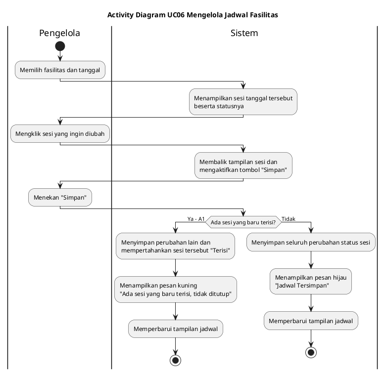

[Kembali ke daftar isi](../README.md)

**UC06**  
**MENGELOLA JADWAL FASILITAS**

1. **Use case Spesifikasi**

| Kode Usecase | UC06 |  |
| :---- | :---- | :---- |
| Nama Usecase | Mengelola Jadwal Fasilitas |  |
| Deskripsi | Pengelola membuka atau menutup beberapa sesi fasilitas sekaligus pada kalender bulanan, lalu menyimpan perubahan sehingga ketersediaan yang tampil kepada pengguna sesuai kondisi fasilitas. |  |
| Aktor | Pengelola |  |
| Relasi | \- |  |
| Kondisi Awal | Pengelola sudah masuk ke sistem dan berada pada halaman kelola jadwal fasilitas. |  |
| Kondisi Akhir | Perubahan status sesi tersimpan sebagai “Tersedia” atau “Ditutup”. |  |
| Alur Normal | Aktor | Sistem |
|  | 1\. Pengelola memilih fasilitas dan mengklik satu tanggal pada kalender bulanan | 1.1 Sistem menampilkan sesi pada tanggal tersebut beserta statusnya (“Tersedia” hijau, “Terisi” merah, “Ditutup” abu-abu). Sesi “Terisi” tidak dapat diklik, dan tanggal sebelum hari ini tidak dapat dipilih. |
|  | 2\. Pengelola mengklik sesi yang ingin diubah (dapat lebih dari satu, dan dapat berpindah ke tanggal lain sebelum menyimpan) | 2.1 Sistem membalik tampilan setiap sesi yang diklik antara “Tersedia” dan “Ditutup” |
|  |  | 2.2 Sistem mengaktifkan tombol “Simpan” |
|  | 3\. Pengelola menekan tombol “Simpan” | 3.1 A1 Sistem memeriksa apakah ada sesi yang akan ditutup ternyata sudah terisi |
|  |  | 3.2 Sistem menyimpan seluruh perubahan status sesi dari semua tanggal yang diubah |
|  |  | 3.3 Sistem menampilkan pesan hijau “Jadwal Tersimpan” |
|  |  | 3.4 Sistem memperbarui tampilan jadwal |
|  | 4\. Selesai |  |
| Alur Alternatif |  |  |
|  | A1. Sesi Berubah Menjadi Terisi Saat Disimpan (*dari langkah 3.1*) \- A1.1 Sistem menyimpan perubahan lain dan mempertahankan sesi tersebut berstatus “Terisi”. \- A1.2 Sistem menampilkan pesan kuning “Jadwal tersimpan. Ada sesi yang baru terisi, tidak ditutup.” \- A1.3 Sistem memperbarui tampilan jadwal sehingga sesi tersebut tampil merah. \- A1.4 Selesai. |  |

2. Activity Diagram

*(Belum digambar di Miro. Kode PlantUML di bawah dipakai sebagai acuan urutan dan label. Jalur: Pengelola | Sistem.)*

3. User Story  
   Sebagai pengelola fasilitas, saya ingin membuka atau menutup beberapa sesi fasilitas sekaligus pada kalender bulanan, sehingga jadwal yang tampil kepada pengguna selalu sesuai dengan kondisi fasilitas.  

   Kriteria diterima:  
1. Pengelola dapat memilih fasilitas dan tanggal pada kalender bulanan untuk melihat status setiap sesi pada tanggal tersebut.  
2. Status sesi berupa “Tersedia” (hijau), “Terisi” (merah), atau “Ditutup” (abu-abu).  
3. Pengelola dapat membalik status beberapa sesi, pada satu atau beberapa tanggal, sebelum menyimpan.  
4. Sesi berstatus “Terisi” tidak dapat diubah.  
5. Tombol “Simpan” menyimpan seluruh perubahan sekaligus, dan sesi yang ditutup tidak dapat dipilih oleh pengguna.  
6. Jika ada sesi yang akan ditutup ternyata sudah terisi saat menyimpan, sesi itu tetap berstatus “Terisi”, perubahan lain tetap tersimpan, dan sistem menampilkan pesan.

4. EARS

1. **Pola Dasar**  
   Sistem harus menampilkan setiap sesi pada tanggal yang dipilih pengelola dengan status “Tersedia”, “Terisi”, atau “Ditutup”, disertai indikator warna hijau, merah, atau abu-abu.  
   Kriteria Penerimaan:

* Setiap sesi menampilkan salah satu dari tiga status beserta warnanya.  
* Status juga ditulis sebagai label teks pada sel, tidak hanya warna.  
* Kalender bulanan menampilkan status setiap tanggal (“Tersedia”, “Sebagian”, “Penuh”, atau “Ditutup”) yang diturunkan dari status sesinya.  
* Hanya sesi berstatus “Tersedia” atau “Ditutup” yang dapat diklik. Sesi “Terisi” tidak dapat diubah.  
* Tanggal sebelum hari ini dan tanggal yang belum punya sesi tidak dapat dipilih, sehingga sesi pada tanggal lampau tidak dapat diubah.  
* Sebelum tanggal dipilih, panel sesi menampilkan pemberitahuan “Pilih tanggal pada kalender terlebih dahulu”.  
  Penjelasan: Pola dasar dipakai karena penampilan status sesi merupakan perilaku tetap halaman kelola jadwal, tanpa syarat atau pemicu tambahan. Kebutuhan ini terletak pada langkah 1.1 di alur normal.

2. **Pola While (State-Driven)**  
   Selama belum ada sesi yang diubah, sistem harus menonaktifkan tombol “Simpan”.  
   Kriteria Penerimaan:

* Tombol “Simpan” nonaktif sebelum pengelola mengubah status sesi apa pun.  
* Tombol “Simpan” aktif setelah minimal satu sesi diubah, pada tanggal mana pun; perubahan dari beberapa tanggal terkumpul dan dihitung bersama.  
* Membalik sesi kembali ke status awalnya membatalkan perubahan itu; bila tidak ada lagi sesi yang berbeda dari status tersimpan, tombol “Simpan” kembali nonaktif.  
  Penjelasan: Pola While dipakai karena perilaku sistem ini berlaku selama suatu keadaan bertahan, yaitu belum ada perubahan sesi, bukan dipicu oleh satu kejadian. Kebutuhan ini terletak pada langkah 2.1–2.2 di alur normal.

3. **Pola When (Event-Driven)**  
   Ketika pengelola menekan tombol “Simpan” dan tidak ada sesi yang akan ditutup yang sudah terisi, sistem harus menyimpan seluruh perubahan status sesi dan menampilkan pesan hijau “Jadwal Tersimpan”.  
   Kriteria Penerimaan:

* Seluruh perubahan status sesi dari semua tanggal yang diubah tersimpan sekaligus.  
* Sesi yang berstatus “Ditutup” tidak dapat dipilih oleh pengguna.  
* Sesi yang dibuka kembali berstatus “Tersedia” dan dapat dipilih oleh pengguna.  
* Pesan hijau “Jadwal Tersimpan” muncul setelah tombol “Simpan” ditekan.  
* Tampilan jadwal diperbarui sesuai perubahan yang tersimpan.  
  Penjelasan: Pola When dipakai karena respons sistem dipicu oleh suatu kejadian, yaitu pengelola menekan tombol “Simpan”. Penyimpanan, pesan, dan pembaruan tampilan terjadi setelah kejadian tersebut dan hanya jika tidak ada sesi terisi yang akan ditutup. Kebutuhan ini terletak pada langkah 3 dan langkah 3.2–3.4 di alur normal.

4. **Pola If-Then (Unwanted Behaviour)**  
   Jika ada sesi yang akan ditutup ternyata sudah terisi ketika pengelola menekan tombol “Simpan”, maka sistem harus tetap menyimpan perubahan lainnya, mempertahankan sesi tersebut berstatus “Terisi”, dan menampilkan pesan kuning “Jadwal tersimpan. Ada sesi yang baru terisi, tidak ditutup.”  
   Kriteria Penerimaan:

* Perubahan pada sesi lain tersimpan.  
* Sesi yang baru terisi tetap berstatus “Terisi” dan tidak menjadi “Ditutup”.  
* Pesan kuning “Jadwal tersimpan. Ada sesi yang baru terisi, tidak ditutup.” ditampilkan.  
* Tampilan jadwal diperbarui sehingga sesi tersebut tampil merah.  
  Penjelasan: Pola If-Then dipakai karena kebutuhan ini menangani keadaan yang tidak diinginkan, yaitu sesi yang disetujui untuk pengajuan lain antara saat jadwal ditampilkan dan saat perubahan disimpan. Sistem melakukan *error handling* dengan mempertahankan sesi tersebut berstatus “Terisi” dan tetap menyimpan perubahan lainnya, sehingga pengajuan yang sudah disetujui tidak tertimpa dan perubahan pengelola tidak hilang. Kebutuhan ini terletak pada alur alternatif A1, yang berasal dari langkah 3.1 di alur normal.

**Catatan rancangan UC06 (keputusan dan asumsi)**

* Cakupan UC06 adalah membuka dan menutup sesi (bukan CRUD fasilitas atau pola sesi); data fasilitas dan sesi dianggap sudah ada.  
* Tampilan berupa kalender bulanan untuk memilih tanggal, dengan panel sesi untuk tanggal yang dipilih. Status sesi memakai tiga indikator (hijau “Tersedia”, merah “Terisi”, abu-abu “Ditutup”) dan status tanggal diturunkan darinya (Tersedia, Sebagian, Penuh, Ditutup; lihat [wireframe.md](../03-desain/wireframe.md), bagian 1.3). Status juga ditulis sebagai label teks.  
* Perubahan dari beberapa tanggal terkumpul dan disimpan sekaligus dengan satu tombol “Simpan”. Sesi pada tanggal sebelum hari ini otomatis tidak tersedia oleh sistem: pengelola tidak dapat memilih tanggal tersebut dan tidak perlu mengaturnya (keputusan)  
* Pengelola membalik status sesi satu per satu dengan klik, lalu “Simpan” menyimpan seluruh perubahan sekaligus. Tidak ada mode pilih terpisah.  
* Sesi “Terisi” (merah) tidak dapat diklik atau diubah.  
* Tidak ada alasan penutupan dan tidak ada dialog konfirmasi; tombol “Simpan” menjadi titik komit.  
* Tampilan tidak real-time. Ketersediaan diperiksa ulang saat “Simpan”; jika sesi yang akan ditutup ternyata sudah terisi, aturan “yang sudah terisi menang”: sesi tetap “Terisi”, perubahan lain tetap tersimpan, dan pengelola diberi pesan kuning singkat.  
* Teks pesan mengikuti katalog di [pesan-sistem.md](../03-desain/pesan-sistem.md).  
* Pengguna juga melihat tiga label yang sama di UC01 dan UC02 (“Tersedia”, “Terisi”, “Ditutup”); hanya sesi “Tersedia” yang dapat dipilih pengguna (keputusan).  
* Pengajuan yang masih menunggu pada sesi yang kemudian ditutup tetap berada di antrian UC07 dan ditangani oleh alur A3 UC07 saat diverifikasi ("tidak tersedia" mencakup sesi terisi dan sesi ditutup); UC06 tidak menolak pengajuan tersebut dan tidak melarang penutupan (keputusan).
