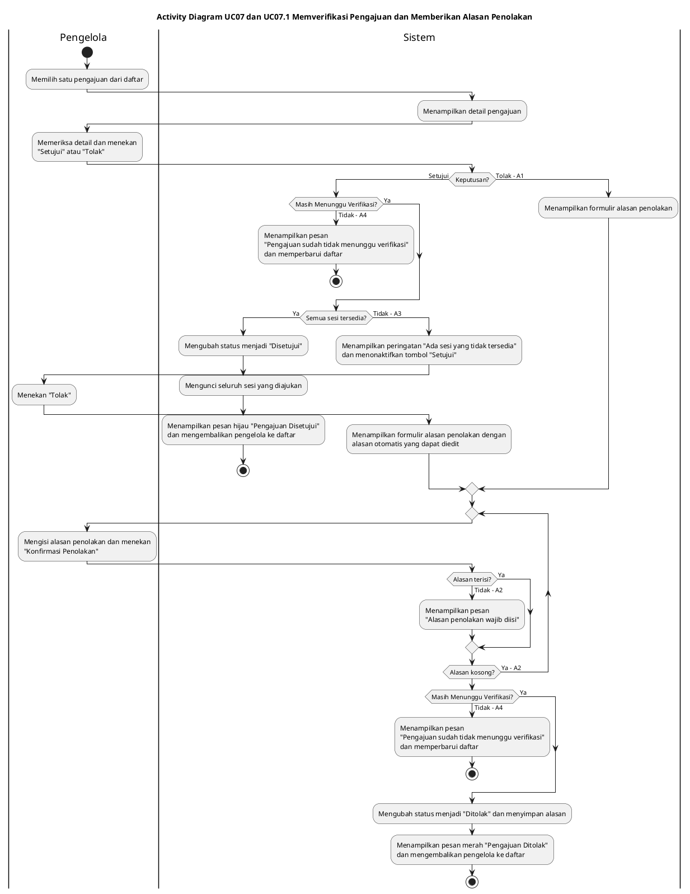

[Kembali ke daftar isi](../README.md)

**UC07 dan UC07.1**  
**MEMVERIFIKASI PENGAJUAN DAN MEMBERIKAN ALASAN PENOLAKAN**

1. **Use case Spesifikasi**

| Kode Usecase | UC07 dan UC07.1 |  |
| :---- | :---- | :---- |
| Nama Usecase | Memverifikasi Pengajuan dan Memberikan Alasan Penolakan |  |
| Deskripsi | Pengelola memeriksa pengajuan peminjaman fasilitas yang masuk, lalu menyetujui atau menolaknya. Jika menolak, pengelola memberikan alasan penolakan. |  |
| Aktor | Pengelola |  |
| Relasi | «extend» UC07.1 Memberikan Alasan Penolakan, dengan extension point: pengelola memilih tombol “Tolak” |  |
| Kondisi Awal | Pengelola sudah masuk ke sistem dan berada pada halaman verifikasi pengajuan yang menampilkan daftar pengajuan berstatus “Menunggu Verifikasi”, diurutkan berdasarkan waktu pengajuan (bila tidak ada, sistem menampilkan pemberitahuan “Tidak ada pengajuan yang menunggu verifikasi”). |  |
| Kondisi Akhir | Pengajuan berstatus “Disetujui” dan seluruh sesinya terkunci, atau berstatus “Ditolak” dengan alasan yang dapat dilihat pengguna. |  |
| Alur Normal | Aktor | Sistem |
|  | 1\. Pengelola memilih satu pengajuan dari daftar | 1.1 Sistem menampilkan detail pengajuan (pemohon, fasilitas/lapangan, tanggal, sesi, kegiatan) |
|  | 2\. Pengelola memeriksa detail pengajuan | 2.1 Sistem menampilkan tombol “Setujui” dan “Tolak” |
|  | 3\. Pengelola menekan tombol “Setujui” atau “Tolak” | 3.1 A1 Sistem memeriksa keputusan yang dipilih pengelola |
|  |  | 3.2 A4 Sistem memeriksa pengajuan masih berstatus “Menunggu Verifikasi” |
|  |  | 3.3 A3 Sistem memeriksa ketersediaan seluruh sesi yang diajukan |
|  |  | 3.4 Sistem mengubah status pengajuan menjadi “Disetujui” |
|  |  | 3.5 Sistem mengunci seluruh sesi yang diajukan |
|  |  | 3.6 Sistem menampilkan pesan hijau “Pengajuan Disetujui” |
|  |  | 3.7 Sistem mengembalikan pengelola ke daftar pengajuan |
|  | 4\. Selesai |  |
| Alur Alternatif |  |  |
|  | A1. Pengelola Menolak Pengajuan (*dari langkah 3.1*) \- A1.1 Pengelola menekan tombol “Tolak”. \- A1.2 Sistem menampilkan formulir alasan penolakan. \- A1.3 Pengelola mengisi alasan penolakan, lalu menekan tombol “Konfirmasi Penolakan”. \- A1.4 A2 Sistem memeriksa kolom alasan penolakan. \- A1.5 A4 Sistem memeriksa pengajuan masih berstatus “Menunggu Verifikasi”. \- A1.6 Sistem mengubah status pengajuan menjadi “Ditolak” dan menyimpan alasan penolakan. \- A1.7 Sistem menampilkan pesan merah “Pengajuan Ditolak” dan mengembalikan pengelola ke daftar pengajuan. \- A1.8 Selesai. A2. Alasan Penolakan Kosong (*dari langkah A1.4*) \- A2.1 Sistem menampilkan pesan “Alasan penolakan wajib diisi”. \- A2.2 Pengelola mengisi alasan penolakan. \- A2.3 Kembali ke alur alternatif A1 langkah A1.3. A3. Ada Sesi yang Tidak Tersedia (*dari langkah 3.3*) \- A3.1 Sistem menampilkan peringatan “Ada sesi yang tidak tersedia” (satu sesi atau lebih sudah terisi, ditutup, atau tanggalnya sudah lewat) dan menonaktifkan tombol “Setujui”. \- A3.2 Pengelola menekan tombol “Tolak”. \- A3.3 Sistem menampilkan formulir alasan penolakan dengan alasan yang sudah terisi otomatis (“Jadwal yang diajukan sudah tidak tersedia”), dan alasan tersebut dapat diedit. \- A3.4 Kembali ke alur alternatif A1 langkah A1.3. A4. Pengajuan Sudah Tidak Menunggu Verifikasi (*dari langkah 3.2 dan A1.5*) \- A4.1 Sistem tidak mengubah apa pun, menampilkan pesan “Pengajuan sudah tidak menunggu verifikasi”, dan memperbarui daftar pengajuan. \- A4.2 Pengelola memilih pengajuan lain. \- A4.3 Kembali ke alur normal langkah 1. A5. Pengelola Menyaring Antrian Menurut Fasilitas (opsional, dari Kondisi Awal) A5.1 Pengelola memilih satu fasilitas pada filter fasilitas. A5.2 A6 Sistem memeriksa ada tidaknya pengajuan “Menunggu Verifikasi” pada fasilitas itu. A5.3 Sistem menampilkan hanya pengajuan fasilitas tersebut, tetap berurutan menurut waktu pengajuan, dan menutup detail yang terbuka. A5.4 Pengelola memilih “Semua Fasilitas” untuk menampilkan seluruh antrian, atau kembali ke alur normal langkah 1. A6. Tidak Ada Pengajuan pada Fasilitas Terpilih (cabang dari A5.2) A6.1 Sistem menampilkan pesan “Tidak ada pengajuan yang sesuai dengan filter” (pemberitahuan “Tidak ada pengajuan yang menunggu verifikasi” hanya tampil bila antrian kosong tanpa filter). A6.2 Pengelola memilih fasilitas lain atau “Semua Fasilitas”. A6.3 Kembali ke A5.1. |  |

2. Activity Diagram

*Catatan: alur opsional A5–A6 (filter fasilitas) belum digambar pada diagram di bawah.*

*(Kode PlantUML di bawah dipakai sebagai acuan urutan dan label; belum digambar ulang di Miro. Jalur: Pengelola | Sistem.)*

3. User Story  
   Sebagai pengelola fasilitas, saya ingin memverifikasi pengajuan peminjaman dan memberikan alasan jika menolak, sehingga pengguna dapat mengetahui hasil pengajuan beserta alasannya tanpa harus menghubungi saya.  

   Kriteria diterima:  
1. Pengelola melihat daftar pengajuan berstatus “Menunggu Verifikasi” yang diurutkan berdasarkan waktu pengajuan.  
2. Pengelola dapat menyetujui atau menolak pengajuan setelah melihat detailnya.  
3. Jika menolak, pengelola wajib mengisi alasan penolakan. Jika alasan kosong, sistem menampilkan pesan “Alasan penolakan wajib diisi” dan status pengajuan tidak berubah.  
4. Jika satu sesi atau lebih yang diajukan sudah tidak tersedia (terisi, ditutup, atau tanggalnya sudah lewat), pengajuan tidak dapat disetujui (persetujuan berlaku untuk semua sesi sekaligus), dan sistem mengisi alasan penolakan secara otomatis yang dapat diedit oleh pengelola.  
5. Setelah keputusan dibuat, status pengajuan berubah menjadi “Disetujui” atau “Ditolak”, dan alasan penolakan tampil pada status pengajuan milik pengguna.
6. Jika tidak ada pengajuan yang menunggu verifikasi, sistem menampilkan pemberitahuan “Tidak ada pengajuan yang menunggu verifikasi”.  
7. Jika pengajuan sudah berubah status sejak dibuka pengelola (misalnya pengguna sudah mengajukan pembatalan), keputusan tidak diproses dan sistem menampilkan pesan “Pengajuan sudah tidak menunggu verifikasi”.
8. Pengelola dapat menyaring antrian menurut fasilitas; antrian tetap berurutan menurut waktu pengajuan, dan filter tetap aktif setelah pengelola menyetujui atau menolak pengajuan.  
9. Jika tidak ada pengajuan pada fasilitas yang dipilih, sistem menampilkan pemberitahuan “Tidak ada pengajuan yang sesuai dengan filter”.

4. EARS

1. **Pola Dasar**  
   Sistem harus menampilkan daftar pengajuan berstatus “Menunggu Verifikasi” kepada pengelola, diurutkan berdasarkan waktu pengajuan.

Kriteria Penerimaan:

* Daftar hanya memuat pengajuan berstatus “Menunggu Verifikasi”.  
* Pengajuan berstatus “Disetujui”, “Ditolak”, “Menunggu Konfirmasi Pembatalan”, atau “Dibatalkan” tidak tampil pada daftar.  
* Pengajuan yang tanggal peminjamannya sudah lewat tidak tampil karena sudah ditolak otomatis oleh sistem.  
* Pengajuan yang paling lama diajukan berada paling atas.  
* Jika tidak ada pengajuan yang menunggu verifikasi, sistem menampilkan pemberitahuan “Tidak ada pengajuan yang menunggu verifikasi”.  
  Penjelasan: Pola dasar dipakai untuk kebutuhan yang selalu berlaku tanpa syarat atau pemicu. Daftar pengajuan merupakan isi tetap halaman verifikasi dan bukan respons atas tindakan pengelola. Kebutuhan ini terletak pada Kondisi Awal di spesifikasi UC07.

2. **Pola When (Event-Driven)**  
   Ketika pengelola menekan tombol “Setujui” dan semua sesi yang diajukan masih tersedia, sistem harus mengubah status pengajuan menjadi “Disetujui”, mengunci seluruh sesi tersebut, dan menampilkan pesan hijau “Pengajuan Disetujui”.

Kriteria Penerimaan:

* Status pengajuan berubah menjadi “Disetujui”.  
* Seluruh sesi yang disetujui tidak dapat dipilih oleh pengguna lain.  
* Pesan hijau “Pengajuan Disetujui” muncul setelah tombol “Setujui” ditekan.  
* Pengajuan tidak lagi tampil pada daftar “Menunggu Verifikasi”.  
  Penjelasan: Pola When dipakai karena respons sistem dipicu oleh suatu kejadian, yaitu pengelola menekan tombol “Setujui”. Perubahan status, penguncian sesi, dan pesan muncul setelah kejadian tersebut dan hanya jika semua sesi masih tersedia. Kebutuhan ini terletak pada langkah 3 dan langkah 3.4–3.6 di alur normal.

3. **Pola If-Then (Unwanted Behaviour)**  
   Jika satu sesi atau lebih yang diajukan sudah tidak tersedia ketika pengelola menekan tombol “Setujui”, maka sistem harus menolak persetujuan dan menampilkan peringatan “Ada sesi yang tidak tersedia”.

Kriteria Penerimaan:

* Status pengajuan tidak berubah menjadi “Disetujui”.  
* Tidak ada sesi yang terkunci ganda, dan sesi lain dalam pengajuan yang sama tidak ikut terkunci.  
* Tombol “Setujui” menjadi nonaktif.  
* Pengelola dapat menolak pengajuan dengan alasan yang sudah terisi otomatis dan dapat diedit.  
  Penjelasan: Pola If-Then dipakai karena kebutuhan ini menangani keadaan yang tidak diinginkan, yaitu sesi yang diajukan tidak lagi tersedia karena sudah terisi oleh pengajuan lain ditutup pengelola (UC06), atau tanggalnya sudah lewat, sehingga terjadi bentrokan jadwal. Sistem melakukan *error handling* dengan menolak persetujuan dan mengarahkan pengelola ke penolakan. Kebutuhan ini terletak pada alur alternatif A3, yang berasal dari langkah 3.3 di alur normal.

4. **Pola If-Then (Unwanted Behaviour)**  
   Jika pengajuan yang diproses sudah tidak berstatus “Menunggu Verifikasi” ketika pengelola menekan tombol “Setujui” atau “Konfirmasi Penolakan”, maka sistem harus membatalkan keputusan itu dan menampilkan pesan “Pengajuan sudah tidak menunggu verifikasi”.

Kriteria Penerimaan:

* Status pengajuan dan status sesi tidak berubah oleh keputusan pengelola.  
* Pesan “Pengajuan sudah tidak menunggu verifikasi” ditampilkan.  
* Daftar pengajuan diperbarui sehingga pengajuan itu tidak lagi tampil.  
  Penjelasan: Pola If-Then dipakai karena kebutuhan ini menangani keadaan yang tidak diinginkan, yaitu pengajuan berubah status setelah pengelola membukanya, misalnya pengguna mengajukan pembatalan (UC04) atau sistem menolaknya otomatis karena tanggalnya lewat. Sistem melakukan *error handling* dengan tidak menimpa status yang baru. Kebutuhan ini terletak pada alur alternatif A4, yang berasal dari langkah 3.2 dan A1.5.

5. **Pola When (Event-Driven)**  
   Ketika pengelola memilih satu fasilitas pada filter fasilitas, sistem harus menampilkan hanya pengajuan berstatus “Menunggu Verifikasi” pada fasilitas tersebut, tetap diurutkan menurut waktu pengajuan.  
   Kriteria Penerimaan:

* Pilihan filter berisi “Semua Fasilitas” dan setiap fasilitas yang ada; bawaan awal adalah “Semua Fasilitas”.  
* Daftar hanya memuat pengajuan fasilitas yang dipilih, dengan urutan waktu pengajuan terlama di atas.  
* Detail yang sedang terbuka ditutup ketika filter berubah.  
* Setelah pengelola menyetujui atau menolak pengajuan, filter yang dipilih tetap aktif.  
* Lencana jumlah antrian di menu samping tetap menghitung seluruh pengajuan “Menunggu Verifikasi”, bukan hasil filter.  
  Penjelasan: Pola When dipakai karena respons dipicu oleh tindakan pengelola memilih fasilitas. Filter hanya menyaring tampilan dan tidak mengubah data atau aturan persetujuan. Kebutuhan ini berkaitan dengan alur alternatif A5.

6. **Pola If-Then (Unwanted Behaviour)**  
   Jika antrian “Menunggu Verifikasi” berisi pengajuan tetapi tidak ada yang berasal dari fasilitas yang dipilih, maka sistem harus menampilkan pemberitahuan “Tidak ada pengajuan yang sesuai dengan filter” dan bukan pemberitahuan “Tidak ada pengajuan yang menunggu verifikasi”.  
   Kriteria Penerimaan:

* Pemberitahuan “Tidak ada pengajuan yang sesuai dengan filter” ditampilkan.  
* Pemberitahuan “Tidak ada pengajuan yang menunggu verifikasi” hanya tampil bila tidak ada pengajuan “Menunggu Verifikasi” sama sekali.  
* Pengelola dapat memilih fasilitas lain atau “Semua Fasilitas”.  
  Penjelasan: Pola If-Then dipakai karena hasil kosong akibat filter berbeda artinya dengan antrian yang benar-benar kosong. Kebutuhan ini berkaitan dengan alur alternatif A6.

**Catatan rancangan UC07 (keputusan)**

* Persetujuan berlaku untuk seluruh sesi dalam pengajuan sekaligus (satu pengajuan memuat satu sampai empat sesi). Bila ada satu sesi yang tidak tersedia, pengajuan tidak dapat disetujui dan harus ditolak; pengguna mengajukan ulang untuk sesi yang masih tersedia.  
* "Tidak tersedia" diperlakukan sebagai satu kondisi: sesi sudah terisi oleh pengajuan lain atau sudah ditutup pengelola (UC06). Pengajuan yang menunggu pada sesi yang kemudian ditutup tetap berada di antrian dan ditangani oleh alur A3 saat diverifikasi.  
* Pengajuan “Menunggu Verifikasi” yang tanggal peminjamannya sudah lewat ditolak otomatis oleh sistem (perintah terjadwal harian, alasan baku P26), sehingga tidak muncul di antrian. Sebelum perintah berjalan, sesi pada tanggal lampau dianggap tidak tersedia sehingga pengajuan itu tidak dapat disetujui (keputusan).  
* Alasan penolakan otomatis untuk alur A3 adalah “Jadwal yang diajukan sudah tidak tersedia” dan dapat diedit pengelola.  
* Keputusan: persetujuan dan penolakan hanya diproses bila pengajuan masih berstatus “Menunggu Verifikasi” saat diproses (A4). Pengajuan dapat berubah sejak dibuka pengelola, karena pengguna mengajukan pembatalan (UC04) atau sistem menolaknya otomatis. Pemeriksaan dilakukan dalam transaksi yang mengunci baris `bookings`, dan pesan memakai P30.
* Keputusan aturan isian untuk alasan penolakan: berisi spasi saja dianggap kosong (P14) dan batas panjang 255 karakter ditegakkan dengan batas karakter di formulir (lihat [pesan-sistem.md](../03-desain/pesan-sistem.md), bagian 4).
* Keputusan: filter antrian hanya menurut fasilitas (tidak menurut status, karena antrian hanya berisi satu status). Filter dikirim lewat parameter alamat halaman dan dibawa ulang saat keputusan diproses, sehingga pengelola tidak kembali ke “Semua Fasilitas”. Lencana menu samping tidak mengikuti filter. Nilai fasilitas yang tidak dikenal diabaikan (menampilkan semua fasilitas).
