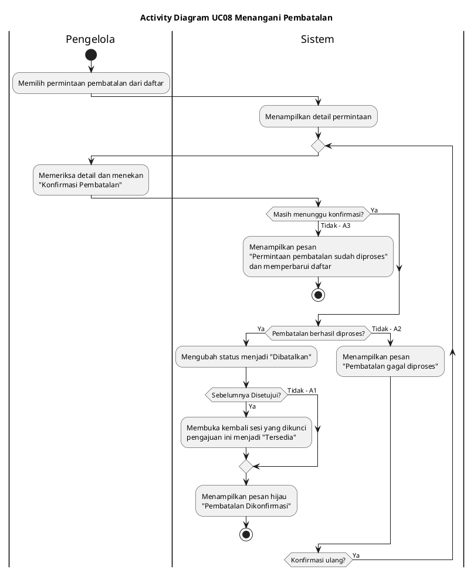

[Kembali ke daftar isi](../README.md)

**UC08**  
**MENANGANI PEMBATALAN**

1. **Use case Spesifikasi**

| Kode Usecase | UC08 |  |
| :---- | :---- | :---- |
| Nama Usecase | Menangani Pembatalan |  |
| Deskripsi | Pengelola memeriksa permintaan pembatalan yang diajukan pengguna, lalu mengonfirmasinya sehingga pengajuan menjadi dibatalkan dan sesi jadwalnya tersedia kembali. |  |
| Aktor | Pengelola |  |
| Relasi | \- |  |
| Kondisi Awal | Pengelola sudah masuk ke sistem dan berada pada halaman penanganan pembatalan yang menampilkan daftar permintaan berstatus “Menunggu Konfirmasi Pembatalan”, diurutkan berdasarkan waktu permintaan (bila tidak ada, sistem menampilkan pemberitahuan “Tidak ada permintaan pembatalan yang menunggu”). |  |
| Kondisi Akhir | Pengajuan berstatus “Dibatalkan” dan sesinya tersedia kembali bagi pengguna lain. |  |
| Alur Normal | Aktor | Sistem |
|  | 1\. Pengelola memilih satu permintaan pembatalan dari daftar | 1.1 Sistem menampilkan detail permintaan (pemohon, fasilitas, tanggal, sesi, alasan pembatalan) |
|  | 2\. Pengelola memeriksa detail dan menekan tombol “Konfirmasi Pembatalan” | 2.1 A3 Sistem memeriksa pengajuan masih berstatus “Menunggu Konfirmasi Pembatalan” |
|  |  | 2.2 A2 Sistem memproses pembatalan |
|  |  | 2.3 Sistem mengubah status pengajuan menjadi “Dibatalkan” |
|  |  | 2.4 A1 Sistem memeriksa apakah status pengajuan sebelum pembatalan adalah “Disetujui” (pengajuan ini mengunci sesi) |
|  |  | 2.5 Sistem membuka kembali sesi yang dikunci pengajuan ini sehingga berstatus “Tersedia” |
|  |  | 2.6 Sistem menampilkan pesan hijau “Pembatalan Dikonfirmasi” |
|  |  | 2.7 Sistem mengembalikan pengelola ke daftar permintaan pembatalan |
|  | 3\. Selesai |  |
| Alur Alternatif |  |  |
|  | A1. Pengajuan Belum Pernah Disetujui (*dari langkah 2.4*) \- A1.1 Sistem tidak mengubah status sesi karena pengajuan belum mengunci sesi (status sebelum pembatalan “Menunggu Verifikasi”). \- A1.2 Kembali ke alur normal langkah 2.6. A2. Pembatalan Gagal Diproses (*dari langkah 2.2*) \- A2.1 Sistem menampilkan pesan “Pembatalan gagal diproses, silakan coba lagi”. Status pengajuan tetap “Menunggu Konfirmasi Pembatalan” dan sesi tidak berubah. \- A2.2 Pengelola menekan kembali tombol “Konfirmasi Pembatalan”. \- A2.3 Kembali ke alur normal langkah 2. A3. Permintaan Sudah Diproses (*dari langkah 2.1*) \- A3.1 Sistem tidak mengubah apa pun, menampilkan pesan “Permintaan pembatalan sudah diproses”, dan memperbarui daftar permintaan. \- A3.2 Pengelola memilih permintaan lain. \- A3.3 Kembali ke alur normal langkah 1. A4. Pengelola Menyaring Daftar Menurut Fasilitas (opsional, dari Kondisi Awal) A4.1 Pengelola memilih satu fasilitas pada filter fasilitas. A4.2 A5 Sistem memeriksa ada tidaknya permintaan pembatalan pada fasilitas itu. A4.3 Sistem menampilkan hanya permintaan fasilitas tersebut, tetap berurutan menurut waktu permintaan, dan menutup detail yang terbuka. A4.4 Pengelola memilih “Semua Fasilitas” untuk menampilkan seluruh daftar, atau kembali ke alur normal langkah 1. A5. Tidak Ada Permintaan pada Fasilitas Terpilih (cabang dari A4.2) A5.1 Sistem menampilkan pesan “Tidak ada pengajuan yang sesuai dengan filter” (pemberitahuan “Tidak ada permintaan pembatalan yang menunggu” hanya tampil bila daftar kosong tanpa filter). A5.2 Pengelola memilih fasilitas lain atau “Semua Fasilitas”. A5.3 Kembali ke A4.1. |  |

2. Activity Diagram

*Catatan: alur opsional A4–A5 (filter fasilitas) belum digambar pada diagram di bawah.*

*(Belum digambar di Miro. Kode PlantUML di bawah dipakai sebagai acuan urutan dan label. Jalur: Pengelola | Sistem.)*

3. User Story  
   Sebagai pengelola fasilitas, saya ingin menangani permintaan pembatalan dari pengguna, sehingga jadwal yang dibatalkan segera tersedia kembali untuk pengguna lain.  

   Kriteria diterima:  
1. Pengelola melihat daftar permintaan berstatus “Menunggu Konfirmasi Pembatalan” yang diurutkan berdasarkan waktu permintaan.  
2. Pengelola dapat melihat detail permintaan beserta alasan pembatalan dari pengguna.  
3. Setelah pembatalan dikonfirmasi, status pengajuan berubah menjadi “Dibatalkan”.  
4. Jika pengajuan sebelumnya berstatus “Disetujui”, sesi yang dikunci pengajuan tersebut kembali berstatus “Tersedia” dan dapat dipilih pengguna lain.  
5. Setelah pembatalan dikonfirmasi, muncul pesan hijau “Pembatalan Dikonfirmasi”.  
6. Jika pembatalan gagal diproses, sistem menampilkan pesan dan status pengajuan tidak berubah.
7. Jika tidak ada permintaan pembatalan yang menunggu, sistem menampilkan pemberitahuan “Tidak ada permintaan pembatalan yang menunggu”.
8. Jika permintaan sudah diproses sejak dibuka pengelola (misalnya sudah dikonfirmasi otomatis), konfirmasi tidak diproses dan sistem menampilkan pesan “Permintaan pembatalan sudah diproses”.
9. Pengelola dapat menyaring daftar menurut fasilitas; daftar tetap berurutan menurut waktu permintaan, dan filter tetap aktif setelah pengelola mengonfirmasi pembatalan.  
10. Jika tidak ada permintaan pada fasilitas yang dipilih, sistem menampilkan pemberitahuan “Tidak ada pengajuan yang sesuai dengan filter”.

4. EARS

1. **Pola Dasar**  
   Sistem harus menampilkan daftar permintaan pembatalan berstatus “Menunggu Konfirmasi Pembatalan” kepada pengelola, diurutkan berdasarkan waktu permintaan.  
   Kriteria Penerimaan:

* Daftar hanya memuat pengajuan berstatus “Menunggu Konfirmasi Pembatalan”.  
* Pengajuan berstatus “Menunggu Verifikasi”, “Disetujui”, “Ditolak”, atau “Dibatalkan” tidak tampil pada daftar.  
* Permintaan yang tanggal peminjamannya sudah lewat tidak tampil karena sudah dikonfirmasi otomatis oleh sistem.  
* Permintaan yang paling lama diajukan berada paling atas.  
* Jika tidak ada permintaan pembatalan yang menunggu, sistem menampilkan pemberitahuan “Tidak ada permintaan pembatalan yang menunggu”.  
  Penjelasan: Pola dasar dipakai untuk kebutuhan yang selalu berlaku tanpa syarat atau pemicu. Daftar permintaan merupakan isi tetap halaman penanganan pembatalan dan bukan respons atas tindakan pengelola. Kebutuhan ini terletak pada Kondisi Awal di spesifikasi UC08.

2. **Pola When (Event-Driven)**  
   Ketika pengelola menekan tombol “Konfirmasi Pembatalan”, sistem harus mengubah status pengajuan menjadi “Dibatalkan”, mengembalikan sesi yang dikunci pengajuan tersebut menjadi “Tersedia”, dan menampilkan pesan hijau “Pembatalan Dikonfirmasi”.  
   Kriteria Penerimaan:

* Status pengajuan berubah menjadi “Dibatalkan”.  
* Jika pengajuan sebelumnya berstatus “Disetujui”, sesi yang dikunci pengajuan tersebut kembali berstatus “Tersedia” dan dapat dipilih pengguna lain.  
* Jika pengajuan sebelumnya berstatus “Menunggu Verifikasi”, status sesi tidak berubah.  
* Sesi yang dikunci oleh pengajuan lain tidak ikut dilepas.  
* Pesan hijau “Pembatalan Dikonfirmasi” muncul setelah tombol ditekan.  
* Permintaan tidak lagi tampil pada daftar “Menunggu Konfirmasi Pembatalan”.  
  Penjelasan: Pola When dipakai karena respons sistem dipicu oleh suatu kejadian, yaitu pengelola menekan tombol “Konfirmasi Pembatalan”. Perubahan status, pelepasan sesi, dan pesan muncul setelah kejadian tersebut. Kebutuhan ini terletak pada langkah 2 dan langkah 2.3–2.6 di alur normal, dengan percabangan pengajuan yang belum pernah disetujui pada alur alternatif A1.

3. **Pola If-Then (Unwanted Behaviour)**  
   Jika pembatalan gagal diproses ketika pengelola menekan tombol “Konfirmasi Pembatalan”, maka sistem harus menampilkan pesan “Pembatalan gagal diproses, silakan coba lagi” dan mempertahankan status pengajuan serta status sesi.  
   Kriteria Penerimaan:

* Pesan “Pembatalan gagal diproses, silakan coba lagi” ditampilkan.  
* Status pengajuan tetap “Menunggu Konfirmasi Pembatalan”.  
* Sesi tidak berubah dan tidak terbuka kembali sebagian.  
* Pengelola dapat menekan kembali tombol “Konfirmasi Pembatalan”.  
  Penjelasan: Pola If-Then dipakai karena kebutuhan ini menangani keadaan yang tidak diinginkan, yaitu kegagalan pemrosesan yang dapat membuat status pengajuan dan status sesi tidak sinkron. Sistem melakukan *error handling* dengan mempertahankan data dan memberi kesempatan mencoba lagi. Kebutuhan ini terletak pada alur alternatif A2, yang berasal dari langkah 2.2 di alur normal.

4. **Pola If-Then (Unwanted Behaviour)**  
   Jika permintaan yang diproses sudah tidak berstatus “Menunggu Konfirmasi Pembatalan” ketika pengelola menekan tombol “Konfirmasi Pembatalan”, maka sistem harus membatalkan konfirmasi itu dan menampilkan pesan “Permintaan pembatalan sudah diproses”.  
   Kriteria Penerimaan:

* Status pengajuan dan status sesi tidak berubah oleh konfirmasi pengelola, sehingga sesi tidak dilepas dua kali.  
* Pesan “Permintaan pembatalan sudah diproses” ditampilkan.  
* Daftar permintaan diperbarui sehingga permintaan itu tidak lagi tampil.  
  Penjelasan: Pola If-Then dipakai karena permintaan dapat sudah diproses setelah pengelola membukanya, misalnya dikonfirmasi otomatis oleh sistem karena tanggalnya lewat. Sistem melakukan *error handling* dengan tidak mengubah data lagi. Kebutuhan ini terletak pada alur alternatif A3, yang berasal dari langkah 2.1 di alur normal.

5. **Pola When (Event-Driven)**  
   Ketika pengelola memilih satu fasilitas pada filter fasilitas, sistem harus menampilkan hanya permintaan berstatus “Menunggu Konfirmasi Pembatalan” pada fasilitas tersebut, tetap diurutkan menurut waktu permintaan.  
   Kriteria Penerimaan:

* Pilihan filter berisi “Semua Fasilitas” dan setiap fasilitas yang ada; bawaan awal adalah “Semua Fasilitas”.  
* Daftar hanya memuat permintaan fasilitas yang dipilih, dengan permintaan terlama di atas.  
* Detail yang sedang terbuka ditutup ketika filter berubah.  
* Setelah pengelola mengonfirmasi pembatalan, filter yang dipilih tetap aktif.  
* Lencana jumlah permintaan di menu samping tetap menghitung seluruh permintaan, bukan hasil filter.  
  Penjelasan: Pola When dipakai karena respons dipicu oleh tindakan pengelola memilih fasilitas. Filter hanya menyaring tampilan dan tidak mengubah data, pelepasan sesi, atau pemeriksaan status. Kebutuhan ini berkaitan dengan alur alternatif A4.

6. **Pola If-Then (Unwanted Behaviour)**  
   Jika daftar permintaan berisi data tetapi tidak ada yang berasal dari fasilitas yang dipilih, maka sistem harus menampilkan pemberitahuan “Tidak ada pengajuan yang sesuai dengan filter” dan bukan pemberitahuan “Tidak ada permintaan pembatalan yang menunggu”.  
   Kriteria Penerimaan:

* Pemberitahuan “Tidak ada pengajuan yang sesuai dengan filter” ditampilkan.  
* Pemberitahuan “Tidak ada permintaan pembatalan yang menunggu” hanya tampil bila tidak ada permintaan sama sekali.  
* Pengelola dapat memilih fasilitas lain atau “Semua Fasilitas”.  
  Penjelasan: Pola If-Then dipakai karena hasil kosong akibat filter berbeda artinya dengan daftar yang benar-benar kosong. Kebutuhan ini berkaitan dengan alur alternatif A5.

**Catatan rancangan UC08 (keputusan dan asumsi)**

* Pengelola hanya mengonfirmasi pembatalan, tidak menolaknya (keputusan). Tidak ada status “pembatalan ditolak” dari lima status yang disepakati.  
* A1 (pengajuan belum pernah disetujui) muncul karena pengajuan “Menunggu Verifikasi” juga bisa dibatalkan, sedangkan sesi baru terkunci saat pengajuan Disetujui. UC08 memakai status sebelum pembatalan (`previous_status`, diisi UC04) untuk menentukan apakah pengajuan mengunci sesi; memeriksa status sesi saja tidak cukup karena sesi yang sama bisa dikunci pengajuan lain.  
* A2 (gagal diproses) dipakai sebagai kebutuhan If-Then karena kegagalan dapat membuat status pengajuan dan status sesi tidak sinkron.  
* UC04 sudah disesuaikan memakai status “Menunggu Konfirmasi Pembatalan” (sebelumnya “Menunggu Konfirmasi”).  
* Pesan “Pembatalan Dikonfirmasi” memakai toast hijau seperti use case lain, tanpa popup; teks pesan mengikuti katalog di [pesan-sistem.md](../03-desain/pesan-sistem.md).  
* Tidak ada notifikasi ke pengguna; pengguna melihat statusnya lewat UC03 (pengajuan “Dibatalkan” tetap terlihat di UC03 selama tanggal peminjaman belum lewat).
* Permintaan pembatalan yang tanggal peminjamannya sudah lewat dikonfirmasi otomatis oleh sistem (perintah terjadwal harian; status menjadi “Dibatalkan”, sesi dilepas hanya bila `previous_status` = 2), sehingga tidak muncul di daftar UC08 dan pengelola tidak perlu memprosesnya (keputusan). Permintaan yang tanggalnya belum lewat tetap menunggu pengelola.
* Keputusan: konfirmasi hanya diproses bila permintaan masih berstatus “Menunggu Konfirmasi Pembatalan” saat diproses (A3), supaya sesi tidak dilepas dua kali bila sistem sudah mengonfirmasinya otomatis. Pemeriksaan dilakukan dalam transaksi yang mengunci baris `bookings`, dan pesan memakai P32.
* Keputusan: filter daftar hanya menurut fasilitas (daftar hanya berisi satu status). Filter dikirim lewat parameter alamat halaman dan dibawa ulang setelah konfirmasi, lencana menu samping tidak mengikuti filter, dan nilai fasilitas yang tidak dikenal diabaikan.
