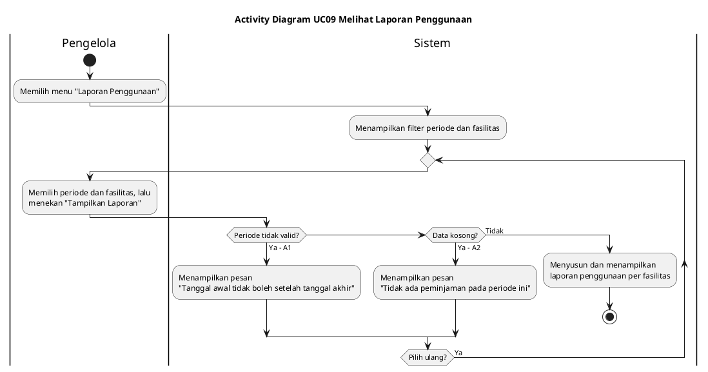

[Kembali ke daftar isi](../README.md)

**UC09**  
**MELIHAT LAPORAN PENGGUNAAN**

1. **Use case Spesifikasi**

| Kode Usecase | UC09 |  |
| :---- | :---- | :---- |
| Nama Usecase | Melihat Laporan Penggunaan |  |
| Deskripsi | Pengelola memilih periode dan fasilitas, lalu melihat laporan penggunaan fasilitas yang disusun dari data peminjaman di sistem tanpa rekap manual. |  |
| Aktor | Pengelola |  |
| Relasi | \- |  |
| Kondisi Awal | Pengelola sudah masuk ke sistem. |  |
| Kondisi Akhir | Sistem menampilkan laporan penggunaan sesuai periode dan fasilitas yang dipilih. Data peminjaman tidak berubah. |  |
| Alur Normal | Aktor | Sistem |
|  | 1\. Pengelola memilih menu “Laporan Penggunaan” | 1.1 Sistem menampilkan filter laporan (periode dan fasilitas) |
|  | 2\. Pengelola memilih periode dan fasilitas, lalu menekan tombol “Tampilkan Laporan” | 2.1 A1 Sistem memeriksa periode yang dipilih |
|  |  | 2.2 A2 Sistem memeriksa ketersediaan data peminjaman pada periode tersebut |
|  |  | 2.3 Sistem menyusun laporan penggunaan |
|  |  | 2.4 Sistem menampilkan laporan per fasilitas (jumlah peminjaman, jumlah sesi terisi, dan persentase penggunaan) |
|  | 3\. Selesai |  |
| Alur Alternatif |  |  |
|  | A1. Periode Tidak Valid (*dari langkah 2.1*) \- A1.1 Sistem menampilkan pesan “Tanggal awal tidak boleh setelah tanggal akhir”. \- A1.2 Pengelola memperbaiki periode. \- A1.3 Kembali ke alur normal langkah 2. A2. Tidak Ada Data Peminjaman (*dari langkah 2.2*) \- A2.1 Sistem menampilkan pesan “Tidak ada peminjaman pada periode ini”. \- A2.2 Pengelola memilih periode atau fasilitas lain. \- A2.3 Kembali ke alur normal langkah 2. |  |

2. Activity Diagram

*(Belum digambar di Miro. Kode PlantUML di bawah dipakai sebagai acuan urutan dan label. Jalur: Pengelola | Sistem.)*

3. User Story  
   Sebagai pengelola fasilitas, saya ingin melihat laporan penggunaan fasilitas pada periode tertentu, sehingga saya dapat mengetahui tingkat penggunaan setiap fasilitas tanpa merekap data secara manual.  

   Kriteria diterima:  
1. Pengelola dapat memilih periode dan fasilitas (atau semua fasilitas) untuk laporan.  
2. Laporan hanya memuat peminjaman berstatus “Disetujui” pada periode yang dipilih.  
3. Laporan menampilkan per fasilitas: jumlah peminjaman, jumlah sesi terisi, dan persentase penggunaan.  
4. Jika periode tidak valid, sistem menampilkan pesan dan laporan tidak disusun.  
5. Jika tidak ada peminjaman pada periode, sistem menampilkan pesan “Tidak ada peminjaman pada periode ini”.  
6. Hanya pengelola yang dapat melihat laporan penggunaan.

4. EARS

1. **Pola Dasar**  
   Sistem harus hanya mengizinkan pengelola melihat laporan penggunaan fasilitas.  
   Kriteria Penerimaan:

* Menu “Laporan Penggunaan” hanya tampil untuk pengelola.  
* Pengguna tidak dapat membuka halaman laporan, termasuk lewat tautan langsung.  
* Akses oleh akun selain pengelola ditolak.  
  Penjelasan: Pola dasar dipakai karena pembatasan akses ini selalu berlaku tanpa syarat atau pemicu tambahan, dan sejalan dengan kebutuhan non-fungsional Security (akses sesuai peran). Kebutuhan ini terletak pada Kondisi Awal di spesifikasi UC09.

2. **Pola When (Event-Driven)**  
   Ketika pengelola menekan tombol “Tampilkan Laporan” dengan periode yang valid, sistem harus menampilkan laporan penggunaan per fasilitas yang memuat jumlah peminjaman, jumlah sesi terisi, dan persentase penggunaan.  
   Kriteria Penerimaan:

* Laporan hanya memuat peminjaman berstatus “Disetujui” pada periode dan fasilitas yang dipilih.  
* Pengajuan berstatus “Menunggu Verifikasi”, “Ditolak”, “Menunggu Konfirmasi Pembatalan”, atau “Dibatalkan” tidak dihitung.  
* Persentase penggunaan dihitung dari sesi terisi dibagi sesi yang dapat dipinjam pada periode (sesi “Ditutup” tidak dihitung); sesi terisi adalah sesi milik pengajuan “Disetujui”, sedangkan sesi milik pengajuan “Menunggu Konfirmasi Pembatalan” tidak dihitung walau belum dilepas.  
* Data laporan sesuai dengan data peminjaman yang tersimpan di sistem.  
  Penjelasan: Pola When dipakai karena respons sistem dipicu oleh suatu kejadian, yaitu pengelola menekan tombol “Tampilkan Laporan”. Penyusunan dan penampilan laporan terjadi setelah kejadian tersebut dan hanya jika periode valid. Kebutuhan ini terletak pada langkah 2 dan langkah 2.3–2.4 di alur normal.

3. **Pola If-Then (Unwanted Behaviour)**  
   Jika tanggal awal periode setelah tanggal akhir ketika pengelola menekan tombol “Tampilkan Laporan”, maka sistem harus menampilkan pesan “Tanggal awal tidak boleh setelah tanggal akhir” dan tidak menyusun laporan.  
   Kriteria Penerimaan:

* Pesan “Tanggal awal tidak boleh setelah tanggal akhir” ditampilkan.  
* Laporan tidak disusun maupun ditampilkan.  
* Pengelola dapat memperbaiki periode dan menampilkan laporan kembali.  
* Bila tanggal awal atau tanggal akhir belum diisi, sistem memperlakukannya sebagai periode tidak valid: pesan yang sama ditampilkan dan laporan tidak disusun.  
  Penjelasan: Pola If-Then dipakai karena kebutuhan ini menangani keadaan yang tidak diinginkan, yaitu periode yang tidak masuk akal sehingga laporan tidak bermakna. Sistem melakukan *error handling* dengan menampilkan pesan dan tidak menyusun laporan. Kebutuhan ini terletak pada alur alternatif A1, yang berasal dari langkah 2.1 di alur normal.

**Catatan rancangan UC09 (keputusan dan asumsi)**

* Bentuk laporan berupa ringkasan per fasilitas (jumlah peminjaman, jumlah sesi terisi, persentase penggunaan), bukan daftar rinci per pengajuan; daftar rinci sudah ada di UC05 untuk pengelola.  
* Rumus persentase penggunaan (keputusan): sesi terisi ÷ sesi yang dapat dipinjam × 100%, dengan sesi “Ditutup” tidak dihitung. Sesi terisi adalah sesi milik pengajuan “Disetujui”; sesi milik pengajuan “Menunggu Konfirmasi Pembatalan” tidak dihitung walau sesinya belum dilepas (keputusan).  
* Yang dihitung hanya pengajuan berstatus “Disetujui”. Periode bebas dan boleh mencakup tanggal yang belum terjadi (keputusan): karena tidak ada status “Selesai”, sistem tidak dapat membedakan sesi yang sudah dipakai dari yang masih terjadwal, sehingga laporan memakai istilah “sesi terisi”, bukan “sesi terpakai”.  
* Filter: periode wajib (tanggal awal dan akhir); fasilitas boleh “Semua Fasilitas” atau satu fasilitas.  
* Tidak ada ekspor atau cetak; laporan ditampilkan di layar.  
* EARS If-Then memakai A1 (periode tidak valid); A2 (tidak ada data) tetap ada di spesifikasi dan kriteria diterima. Pola dasar memakai pembatasan akses karena terkait kebutuhan non-fungsional Security.  
* Teks pesan mengikuti katalog di [pesan-sistem.md](../03-desain/pesan-sistem.md).
* Keputusan: tanggal awal dan tanggal akhir wajib diisi. Bila salah satunya kosong, sistem memperlakukannya seperti periode tidak valid (A1, pesan P19) tanpa pesan baru.
