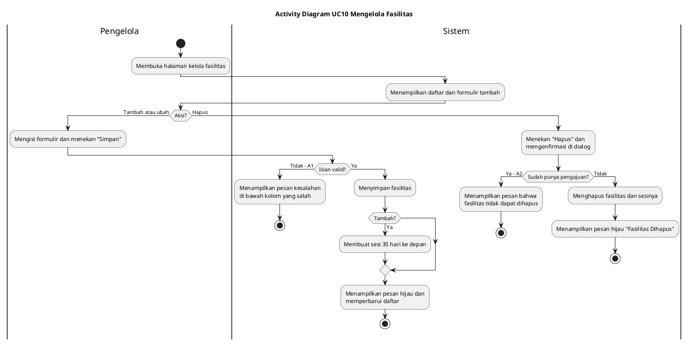

[Kembali ke daftar isi](../README.md)

**UC10**  
**MENGELOLA FASILITAS DAN JENIS**

*Fitur tambahan di luar rancangan awal (UC01-UC09), dibutuhkan agar sistem punya CRUD lengkap. Layarnya adalah S11 Kelola Fasilitas, rute `/manage-facilities`.*

1. **Use case Spesifikasi**

| Kode Usecase | UC10 |  |
| :---- | :---- | :---- |
| Nama Usecase | Mengelola Fasilitas dan Jenis |  |
| Deskripsi | Pengelola menambah, mengubah, dan menghapus fasilitas olahraga, serta menambah, mengganti nama, dan menghapus jenis fasilitas, sehingga daftar fasilitas yang bisa dipinjam selalu sesuai kenyataan. |  |
| Aktor | Pengelola |  |
| Relasi | \- |  |
| Kondisi Awal | Pengelola sudah masuk ke sistem dan berada pada halaman kelola fasilitas. |  |
| Kondisi Akhir | Data fasilitas, jenis, dan sesinya sesuai dengan perubahan yang disimpan. |  |
| Alur Normal | Aktor | Sistem |
|  | 1\. Pengelola membuka halaman kelola fasilitas | 1.1 Sistem menampilkan daftar fasilitas dengan nama, jenis, keterangan, jumlah sesi, dan jumlah pengajuan, beserta tombol "Tambah fasilitas" dan "Kelola jenis" |
|  | 2\. Pengelola menekan "Tambah fasilitas", mengisi nama, memilih jenis dari daftar jenis, dan mengisi keterangan (boleh kosong), lalu menekan "Simpan" | 2.1 A1 Sistem memeriksa nama, jenis, dan keterangan |
|  |  | 2.2 Sistem menyimpan fasilitas dan langsung membuat sesi untuk 35 hari ke depan mulai hari ini, empat sesi per hari, berstatus "Tersedia" |
|  |  | 2.3 Sistem menampilkan pesan hijau "Fasilitas Ditambahkan" dan memperbarui daftar |
|  | 3\. Pengelola menekan "Ubah" pada satu fasilitas, mengubah isian, lalu menekan "Simpan" | 3.1 Sistem menampilkan formulir dengan isian fasilitas tersebut |
|  |  | 3.2 A1 A3 Sistem memeriksa isian |
|  |  | 3.3 Sistem menyimpan perubahan tanpa mengubah sesi |
|  |  | 3.4 Sistem menampilkan pesan hijau "Fasilitas Diperbarui" dan memperbarui daftar |
|  | 4\. Pengelola menekan "Hapus" pada satu fasilitas yang belum punya pengajuan (tombol nonaktif disertai alasan bila sudah punya) | 4.1 Sistem menampilkan dialog konfirmasi dengan nama fasilitas |
|  | 5\. Pengelola menekan "Hapus" pada dialog | 5.1 A2 A3 Sistem memeriksa apakah ada pengajuan, dengan status apa pun, pada sesi fasilitas tersebut |
|  |  | 5.2 Sistem menghapus fasilitas beserta seluruh sesinya |
|  |  | 5.3 Sistem menampilkan pesan hijau "Fasilitas Dihapus" dan memperbarui daftar |
|  | 6\. Pengelola menekan "Kelola jenis" | 6.1 Sistem menampilkan daftar jenis, masing-masing dengan jumlah fasilitas yang memakainya, dan formulir nama jenis |
|  | 7\. Pengelola mengisi nama jenis lalu menekan "Tambah jenis", atau menekan "Ganti nama" pada satu jenis, mengubah nama, lalu menekan "Simpan" | 7.1 Sistem merapikan nama (spasi di tepi dibuang dan spasi berlebih di tengah jadi satu) |
|  |  | 7.2 A4 A5 Sistem memeriksa nama |
|  |  | 7.3 Sistem menyimpan jenis dan menampilkan pesan hijau "Jenis Ditambahkan" atau "Jenis Diperbarui" |
|  | 8\. Pengelola menekan "Hapus" pada satu jenis yang tidak dipakai | 8.1 Sistem memeriksa apakah ada fasilitas yang memakai jenis tersebut |
|  |  | 8.2 A6 Sistem menghapus jenis |
|  |  | 8.3 Sistem menampilkan pesan hijau "Jenis Dihapus" dan memperbarui daftar |
|  | 9\. Selesai |  |
| Alur Alternatif |  |  |
|  | A1. Isian Tidak Valid (*dari langkah 2.1 dan 3.2*) \- A1.1 Sistem tidak menyimpan apa pun. \- A1.2 Sistem menampilkan pesan kesalahan di bawah kolom yang salah: "Nama fasilitas wajib diisi dan paling banyak 50 karakter", "Jenis fasilitas wajib dipilih", atau "Keterangan paling banyak 200 karakter". \- A1.3 Sistem mempertahankan isian di formulir. \- A1.4 Selesai. |  |
|  | A2. Fasilitas Sudah Memiliki Pengajuan (*dari langkah 5.1*) \- A2.1 Sistem tidak menghapus fasilitas maupun sesinya. \- A2.2 Sistem menampilkan pesan "Fasilitas sudah memiliki pengajuan sehingga tidak dapat dihapus". \- A2.3 Selesai. |  |
|  | A3. Fasilitas Sudah Tidak Ada (*dari langkah 3.2 dan 5.1*) \- A3.1 Sistem menampilkan pesan "Informasi belum tersedia" dan memperbarui daftar. \- A3.2 Selesai. |  |
|  | A4. Nama Jenis Tidak Valid (*dari langkah 7.2*) \- A4.1 Sistem tidak menyimpan apa pun. \- A4.2 Sistem menampilkan "Nama jenis wajib diisi, paling banyak 30 huruf, angka, spasi, atau tanda hubung" dan mempertahankan isian. \- A4.3 Selesai. |  |
|  | A5. Nama Jenis Sudah Ada (*dari langkah 7.2*) \- A5.1 Sistem membandingkan nama tanpa membedakan huruf besar dan kecil. \- A5.2 Sistem tidak menyimpan dan menampilkan "Jenis ini sudah ada". \- A5.3 Selesai. |  |
|  | A6. Jenis Masih Dipakai (*dari langkah 8.2*) \- A6.1 Sistem tidak menghapus jenis. \- A6.2 Sistem menampilkan "Jenis ini dipakai fasilitas dan tidak dapat dihapus". \- A6.3 Selesai. |  |

2. Activity Diagram

3. User Story  
   Sebagai pengelola, saya ingin menambah, mengubah, dan menghapus fasilitas, sehingga daftar fasilitas selalu sesuai kenyataan.  

   Kriteria diterima:  
1. Daftar fasilitas menampilkan nama, jenis, dan keterangan.  
2. Tambah dan ubah memvalidasi nama (wajib, paling banyak 50 karakter), jenis (wajib, salah satu jenis yang ada), dan keterangan (boleh kosong, paling banyak 200 karakter).  
3. Menambah fasilitas langsung membuat sesi 35 hari ke depan, empat sesi per hari, berstatus "Tersedia".  
4. Mengubah fasilitas tidak mengubah sesinya.  
5. Menghapus fasilitas meminta konfirmasi, dan ditolak bila sudah ada pengajuan pada salah satu sesinya, apa pun status pengajuan itu.  
6. Menghapus fasilitas tanpa pengajuan juga menghapus seluruh sesinya.  
7. Daftar fasilitas menampilkan jumlah sesi dan pengajuan tiap fasilitas, dan tombol Hapus nonaktif disertai alasan bila fasilitas sudah punya pengajuan.  
8. Pengelola dapat menambah jenis baru, mengganti nama jenis, dan menghapus jenis yang tidak dipakai fasilitas mana pun.  
9. Nama jenis wajib, paling banyak 30 karakter berupa huruf, angka, spasi, dan tanda hubung, dan unik tanpa membedakan huruf besar dan kecil.

4. EARS

1. **Pola Dasar**  
   Sistem harus menampilkan daftar fasilitas beserta nama, jenis, dan keterangannya kepada pengelola.  
   Kriteria Penerimaan:

* Setiap fasilitas tampil dengan nama, jenis, dan keterangan.  
* Setiap fasilitas punya aksi "Ubah" dan "Hapus".  
  Penjelasan: Pola dasar dipakai karena daftar adalah perilaku tetap halaman. Kebutuhan ini terletak pada langkah 1.1.

2. **Pola When (Event-Driven)**  
   Ketika pengelola menekan "Simpan" pada formulir tambah dengan isian valid, sistem harus menyimpan fasilitas, membuat sesi 35 hari ke depan, dan menampilkan pesan hijau "Fasilitas Ditambahkan".  
   Kriteria Penerimaan:

* Fasilitas tersimpan dengan nama, jenis, dan keterangan yang diisi.  
* Terbentuk 140 sesi berstatus "Tersedia", mulai hari ini sampai 34 hari ke depan.  
* Penyimpanan fasilitas dan pembuatan sesi terjadi bersama: bila salah satunya gagal, tidak ada yang tersimpan.  
  Penjelasan: Pola When dipakai karena respons dipicu oleh satu kejadian, yaitu penekanan "Simpan". Kebutuhan ini terletak pada langkah 2.2-2.3.

3. **Pola If-Then (Unwanted Behaviour)**  
   Jika isian tidak valid ketika pengelola menekan "Simpan", maka sistem harus tidak menyimpan apa pun dan menampilkan pesan kesalahan di bawah kolom yang salah dengan isian tetap di formulir.  
   Kriteria Penerimaan:

* Nama kosong, hanya spasi, atau lebih dari 50 karakter menampilkan "Nama fasilitas wajib diisi dan paling banyak 50 karakter".  
* Jenis kosong atau tidak dikenal menampilkan "Jenis fasilitas wajib dipilih".  
* Keterangan lebih dari 200 karakter menampilkan "Keterangan paling banyak 200 karakter".  
  Penjelasan: Pola If-Then dipakai karena kebutuhan ini menangani isian yang salah. Kebutuhan ini terletak pada alur alternatif A1.

4. **Pola If-Then (Unwanted Behaviour)**  
   Jika fasilitas sudah memiliki pengajuan ketika pengelola mengonfirmasi hapus, maka sistem harus tidak menghapus fasilitas maupun sesinya dan menampilkan "Fasilitas sudah memiliki pengajuan sehingga tidak dapat dihapus".  
   Kriteria Penerimaan:

* Pengajuan berstatus apa pun, termasuk Ditolak dan Dibatalkan, menghalangi penghapusan.  
* Pengajuan yang sedang disimpan pada saat yang sama tetap dihitung: penghapusan menunggu lalu ditolak.  
  Penjelasan: Pola If-Then dipakai karena kebutuhan ini melindungi riwayat peminjaman. Sesi yang masih dipakai pengajuan tidak boleh hilang. Kebutuhan ini terletak pada alur alternatif A2.

5. **Pola When (Event-Driven)**  
   Ketika pengelola menekan "Tambah jenis" atau "Simpan" pada penggantian nama dengan nama yang valid dan belum dipakai, sistem harus menyimpan jenis dan menampilkan pesan hijau "Jenis Ditambahkan" atau "Jenis Diperbarui".  
   Kriteria Penerimaan:

* Spasi di tepi dibuang dan spasi berlebih di tengah dijadikan satu spasi.  
* Fasilitas yang memakai jenis yang diganti namanya langsung menampilkan nama baru.  
* Jenis yang baru ditambahkan langsung dapat dipilih di formulir fasilitas.  
  Penjelasan: Pola When dipakai karena respons dipicu oleh penekanan tombol. Kebutuhan ini terletak pada langkah 7.1-7.3.

6. **Pola If-Then (Unwanted Behaviour)**  
   Jika nama jenis tidak valid, sudah ada, atau jenis masih dipakai fasilitas ketika pengelola menyimpan atau menghapusnya, maka sistem harus tidak mengubah apa pun dan menampilkan pesan kesalahan yang sesuai.  
   Kriteria Penerimaan:

* Nama kosong, lebih dari 30 karakter, atau memuat karakter selain huruf, angka, spasi, dan tanda hubung menampilkan P41.  
* Nama yang sama dengan jenis lain tanpa membedakan huruf besar dan kecil menampilkan P42, termasuk saat dua permintaan menambah nama yang sama bersamaan.  
* Jenis yang masih dipakai fasilitas menampilkan P43 dan tidak terhapus.  
  Penjelasan: Pola If-Then dipakai karena kebutuhan ini menangani keadaan yang tidak diinginkan. Kebutuhan ini terletak pada alur alternatif A4, A5, dan A6.

**Catatan rancangan UC10 (keputusan dan asumsi)**

* Jenis fasilitas disimpan di tabel `facility_types` dan dikelola pengelola. Seeder mengisi empat jenis awal (Futsal, Basketball, Badminton, Tennis); keempatnya biasa saja dan dapat diganti nama atau dihapus bila tidak dipakai.  
* Jenis hanya berupa nama, tanpa ikon dan tanpa warna: font ikon hanya memuat sebagian glyph, dan warna sudah dipakai sebagai penanda status (keputusan).  
* Pengelola menambah jenis lewat dialog "Kelola jenis", bukan dari dalam formulir fasilitas, supaya isian fasilitas tidak hilang dan tidak ada dialog bersarang (keputusan).  
* Panel di halaman login memakai daftar olahraga tetap (teks `ui_auth_*`), bukan jenis dari basis data (keputusan).  
* Menambah, mengubah, dan menghapus dilakukan lewat dialog yang dirender server (`?add`, `?edit=ID`, `?delete=ID`, `?types`), sehingga berfungsi tanpa JavaScript.  
* Hapus dilarang bila ada pengajuan apa pun, bukan hanya yang masih aktif, supaya riwayat dan laporan (UC05, UC09) tidak kehilangan data (keputusan).  
* Sesi awal fasilitas baru sebanyak 35 hari mengikuti seeder. Penambahan sesi seterusnya adalah tugas terjadwal terpisah (issue S3.7), bukan bagian UC10.  
* Nama fasilitas tidak harus unik; tidak ada aturan itu di kamus data.  
* Teks pesan mengikuti katalog di [pesan-sistem.md](../03-desain/pesan-sistem.md) (P34-P40). Wireframe S11 belum digambar; tampilan memakai komponen yang sudah ada (kartu, tabel, formulir, dialog).
