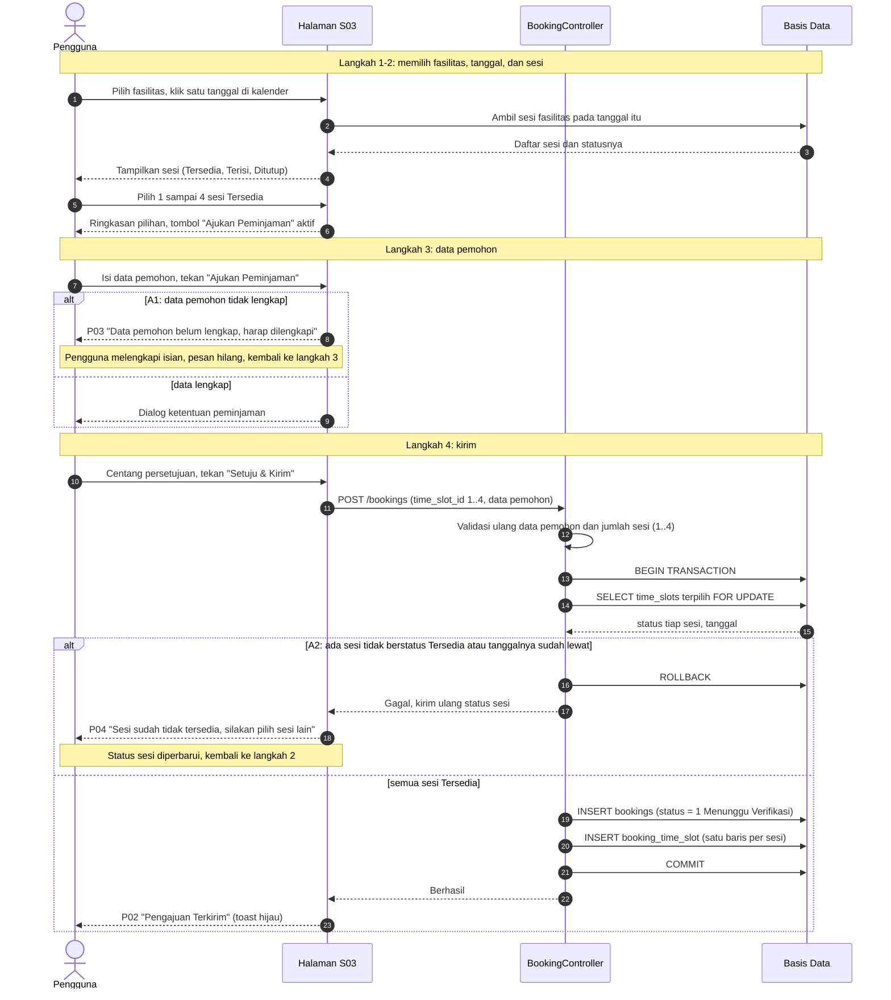
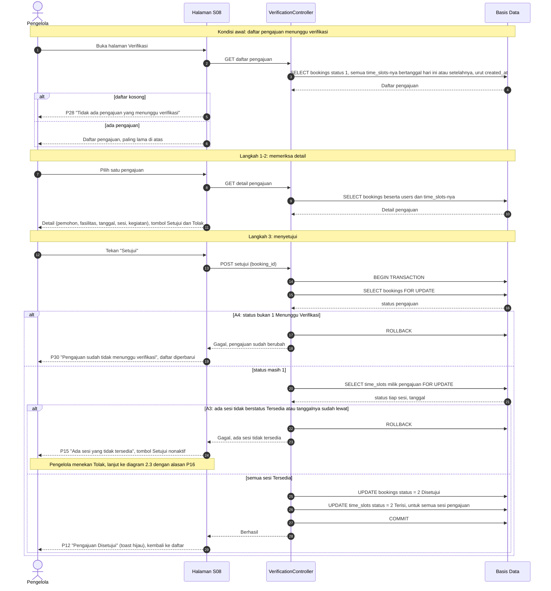
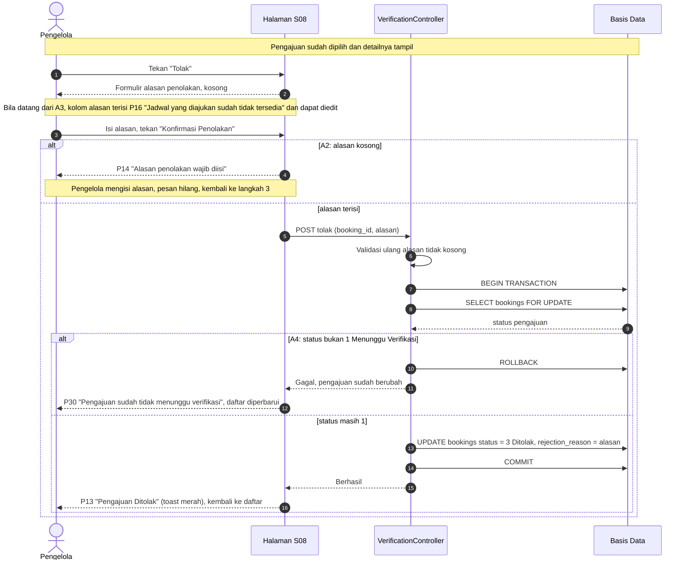
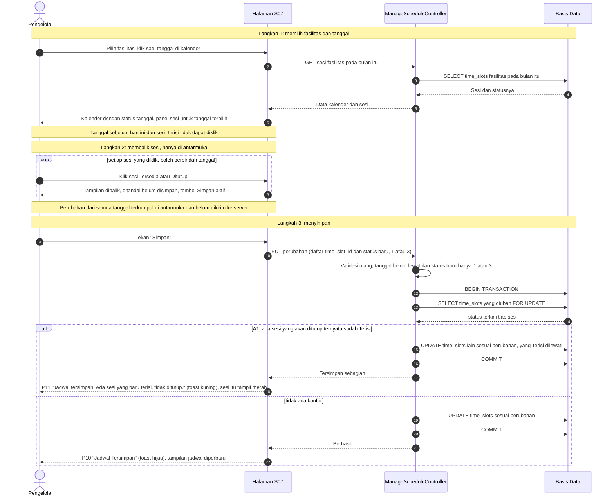

[Kembali ke daftar isi](../README.md)

# Diagram Sekuens

Menunjukkan urutan interaksi antara aktor, antarmuka, controller, dan basis data untuk alur inti. Bagian ini memuat **UC02**, **UC07 beserta UC07.1**, dan **UC06**.

Nama controller dan model adalah **usulan** dan akan dikonfirmasi di `arsitektur.md` (belum dibuat). Nama tabel dan kolom mengikuti [model-data.md](model-data.md), teks pesan mengikuti [pesan-sistem.md](pesan-sistem.md), dan langkah mengikuti [uc02.md](../02-use-case/uc02.md). Kode Mermaid belum dirender; bila ada yang gagal tampil, tempel ke editor Mermaid.

## 1. UC02 Mengajukan Peminjaman

### 1.1 Peserta

| Peserta | Peran |
|---|---|
| Pengguna | Aktor |
| Halaman S03 | Antarmuka "Jadwal dan Peminjaman" (wireframe S03) |
| BookingController | Menerima pengiriman pengajuan (usulan `BookingController@store`) |
| Basis Data | Tabel `time_slots`, `bookings`, `booking_time_slot` |

### 1.2 Alur normal dan alternatif

### 1.3 Catatan pembacaan

| Langkah diagram | Langkah UC02 | Keterangan |
|---|---|---|
| 1-6 | 1, 1.1, 2, 2.1 | Pembacaan data saja; tidak ada perubahan di basis data |
| 7-9 (A1 di 8) | 3, 3.1, 3.2 | Validasi kelengkapan dilakukan di antarmuka sebelum dialog ketentuan tampil (P03); pesan hilang saat pengguna mengubah isian ([wireframe.md](wireframe.md), keputusan 14) |
| 10-15 | 4 | Server memvalidasi ulang, tidak hanya mengandalkan antarmuka, lalu memulai transaksi dan mengunci baris `time_slots` |
| 16-18 (A2) | 4.1 | Pemeriksaan ketersediaan dan penulisan berada dalam satu transaksi |
| 19-23 | 4.2, 4.3 | Pengajuan dan relasi sesinya tersimpan bersama atau tidak sama sekali |

### 1.4 Keputusan yang tercermin di diagram

- **Pengajuan tidak mengunci sesi.** Setelah `INSERT`, tidak ada `UPDATE time_slots`; sesi baru menjadi Terisi saat UC07 menyetujui ([state-diagram.md](state-diagram.md), invarian). Karena itu beberapa pengguna dapat mengajukan sesi yang sama.
- **Pemeriksaan ulang saat kirim (A2) tetap ada** walau pengajuan tidak mengunci sesi: sesi bisa berubah menjadi Terisi atau Ditutup, atau tanggalnya lewat, sejak pengguna memilihnya (aturan integritas 12, sesi lampau turunan).
- **`FOR UPDATE`** mencegah status sesi berubah di antara pemeriksaan dan penyimpanan. Penguncian yang sama dipakai UC07 saat menyetujui; rinciannya dibahas di `arsitektur.md`.
- **Satu transaksi** untuk `bookings` dan `booking_time_slot` menjaga integritas: tidak ada pengajuan tanpa sesi.
- **Dialog ketentuan** tidak punya tombol "Batal" (wireframe, keputusan 10), jadi tidak ada cabang pembatalan di diagram.
- **Nama pemohon** diambil dari akun yang login, bukan dari isian; `user_id` diambil dari sesi autentikasi, bukan dari permintaan.

## 2. UC07 Memverifikasi Pengajuan dan UC07.1 Memberikan Alasan Penolakan

Dibagi dua diagram supaya terbaca: 2.2 untuk melihat daftar, memilih pengajuan, dan menyetujui (termasuk A3); 2.3 untuk menolak (A1, A2, dan jalur masuk dari A3).

### 2.1 Peserta

| Peserta | Peran |
|---|---|
| Pengelola | Aktor |
| Halaman S08 | Antarmuka "Verifikasi Pengajuan" (wireframe S08) |
| VerificationController | Mengambil daftar dan detail, memproses persetujuan dan penolakan (usulan `VerificationController@index`, `@show`, `@approve`, `@reject`) |
| Basis Data | Tabel `bookings`, `booking_time_slot`, `time_slots`, `users` |

### 2.2 Daftar, detail, dan persetujuan (alur normal dan A3)

### 2.3 Penolakan (UC07.1: A1, A2, dan jalur dari A3)

### 2.4 Catatan pembacaan

Nomor di bawah adalah nomor otomatis pada masing-masing diagram.

| Diagram | Langkah diagram | Langkah UC07 | Keterangan |
|---|---|---|---|
| 2.2 | 1-6 | Kondisi Awal | Daftar hanya memuat status 1 dengan semua sesi bertanggal hari ini atau setelahnya; pengajuan kedaluwarsa sudah ditolak otomatis oleh sistem ([wireframe.md](wireframe.md), keputusan 13). Kosong: P28 |
| 2.2 | 7-11 | 1, 1.1, 2, 2.1 | Pembacaan saja, tidak ada perubahan data |
| 2.2 | 12-16 | 3, 3.1, 3.2 | Transaksi dimulai, baris `bookings` dikunci dengan `FOR UPDATE`, statusnya dibaca |
| 2.2 | 17-19 (A4) | A4.1 | Pengajuan sudah berubah (misalnya pengguna sudah mengajukan pembatalan): tidak ada perubahan data, tampil P30, daftar diperbarui |
| 2.2 | 20-21 | 3.3 | Baris sesi dikunci dan statusnya dibaca |
| 2.2 | 22-24 (A3) | A3.1 | Tidak ada perubahan data, transaksi dibatalkan; alasan baku P16 dipakai di 2.3 (A3.3) |
| 2.2 | 25-29 (normal) | 3.4-3.7 | Status pengajuan dan status semua sesi berubah dalam satu transaksi (persetujuan berlaku untuk semua sesi sekaligus) |
| 2.3 | 1-3 | A1.1-A1.3 | Formulir tampil di panel detail menggantikan tombol Setujui dan Tolak (wireframe, keputusan 11) |
| 2.3 | 4 (A2) | A1.4, A2.1 | Pemeriksaan kolom alasan; pesan hilang saat pengelola mengubah isian (wireframe, keputusan 14) |
| 2.3 | 5-6 | A1.4 | Server memvalidasi ulang alasan |
| 2.3 | 7-9 | A1.5 | Transaksi dimulai, baris `bookings` dikunci dan statusnya dibaca |
| 2.3 | 10-12 (A4) | A4.1 | Pengajuan sudah berubah: tidak ada perubahan data, tampil P30 |
| 2.3 | 13-16 | A1.6, A1.7 | Status menjadi Ditolak beserta alasannya, lalu pesan merah |

### 2.5 Keputusan yang tercermin di diagram

- **Persetujuan mengunci sesi.** Ini satu-satunya langkah yang mengubah sesi menjadi Terisi; UC06 hanya menutup atau membuka sesi, dan UC08 hanya melepas sesi. Karena pengajuan menunggu tidak mengunci sesi, dua pengajuan untuk sesi yang sama bisa sama-sama menunggu; yang disetujui lebih dulu menang, dan yang kedua kena A3.
- **Pemeriksaan A4 mendahului A3.** Baris pengajuan dikunci dan diperiksa masih berstatus 1 sebelum sesi diperiksa, supaya keputusan pengelola tidak menimpa status baru dari UC04 (pengguna mengajukan pembatalan) atau penolakan otomatis. Urutan penguncian dibuat tetap, pengajuan dahulu baru sesi, di semua alur (termasuk UC08) supaya dua proses tidak saling menunggu (deadlock); aturan ini ditulis lagi di `arsitektur.md`.
- **Pemeriksaan A3 dan penguncian berada dalam satu transaksi** dengan pembaruan status. `FOR UPDATE` mencegah dua persetujuan serentak mengunci sesi yang sama; yang kedua menunggu, lalu membaca status Terisi dan masuk A3.
- **A3 tidak mengubah data.** Sistem hanya menampilkan peringatan dan mengarahkan pengelola ke penolakan; pengelola yang memutuskan menolak, bukan sistem otomatis.
- **Penolakan tidak menyentuh `time_slots`**, tetapi tetap memakai transaksi pendek untuk mengunci dan memeriksa baris `bookings` (A4).
- **Pengelola tidak dapat menarik keputusan** (Disetujui atau Ditolak tidak kembali ke Menunggu Verifikasi), jadi tidak ada alur pembatalan keputusan di diagram ([state-diagram.md](state-diagram.md), bagian 3).

## 3. UC06 Mengelola Jadwal Fasilitas

### 3.1 Peserta

| Peserta | Peran |
|---|---|
| Pengelola | Aktor |
| Halaman S07 | Antarmuka "Kelola Jadwal" (wireframe S07) |
| JadwalController | Mengambil sesi per bulan dan menyimpan perubahan (usulan `ManageScheduleController@index` dan `@update`) |
| Basis Data | Tabel `time_slots` |

### 3.2 Alur normal dan alternatif

### 3.3 Catatan pembacaan

| Langkah diagram | Langkah UC06 | Keterangan |
|---|---|---|
| 1-6 | 1, 1.1 | Pembacaan data saja; status tanggal turunan dihitung dari status sesi ([wireframe.md](wireframe.md), bagian 1.3) |
| 7-8 | 2, 2.1, 2.2 | Tidak ada panggilan ke server; membalik sesi hanya mengubah tampilan sampai tombol Simpan ditekan |
| 9-14 | 3, 3.1 | Satu permintaan memuat perubahan dari semua tanggal; server memvalidasi ulang, memulai transaksi, dan mengunci baris `time_slots` yang diubah |
| 15-18 (A1) | A1.1-A1.3 | Sesi yang sudah Terisi dilewati, perubahan lain tetap tersimpan, dan pesan kuning tampil |
| 19-22 (normal) | 3.2-3.4 | Semua perubahan tersimpan bersama dalam satu transaksi, lalu pesan hijau |

### 3.4 Keputusan yang tercermin di diagram

- **Yang sudah terisi menang.** Sesi Terisi tidak pernah diubah menjadi Ditutup, walau antarmuka sudah menampilkannya hijau saat dibalik. Tampilan tidak real-time, jadi pemeriksaan sesungguhnya terjadi saat Simpan ([uc06.md](../02-use-case/uc06.md), catatan rancangan).
- **Penyebab konflik adalah UC07.** Bila persetujuan UC07 mengunci sesi lebih dulu, `FOR UPDATE` membuat UC06 membaca status Terisi dan masuk A1. Bila UC06 menutup lebih dulu, UC07 membaca status Ditutup dan masuk A3. Siapa pun yang lebih dulu, hasilnya konsisten.
- **Hanya satu arah yang bisa berkonflik.** Membuka sesi Ditutup menjadi Tersedia tidak pernah bentrok, karena sesi Ditutup tidak dapat disetujui UC07.
- **Pembukaan dan penutupan tidak menyentuh pengajuan.** Pengajuan yang menunggu pada sesi yang ditutup tetap di antrian UC07 dan ditangani alur A3 di sana.
- **Validasi ulang di server** (tanggal belum lewat, status baru hanya Tersedia atau Ditutup) bersifat pengaman; antarmuka tidak memungkinkan pelanggarannya, sehingga tidak ada pesan khusus.
- **Tidak ada dialog konfirmasi dan tidak ada alasan penutupan**; tombol Simpan menjadi titik komit.
