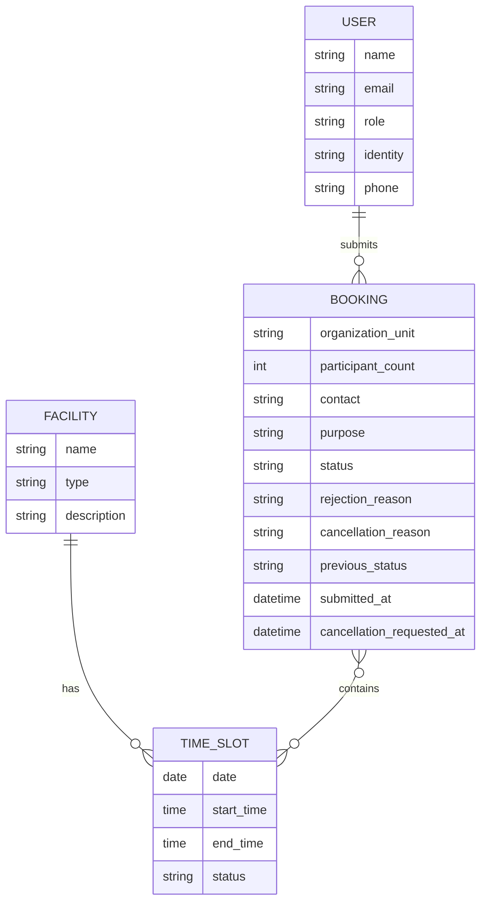
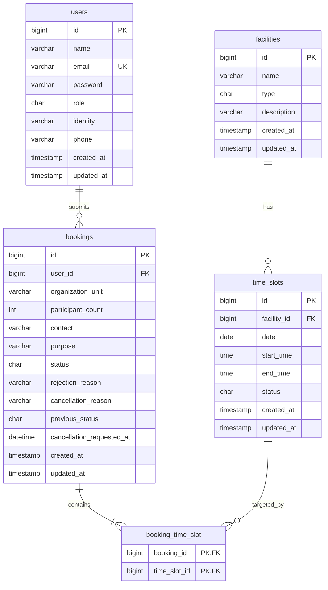

[Kembali ke daftar isi](../README.md)

# Model Data

Model data untuk Sistem Peminjaman Fasilitas Olahraga Kampus, diturunkan dari use case UC01–UC09 dan keputusan yang sudah diambil (lima status pengajuan, tiga status sesi). Berisi ERD konseptual, ERD fisik, kamus data, aturan integritas, dan pemetaan ke use case.

Kode Mermaid di dokumen ini belum dirender. Bila ada yang gagal tampil, tempel kodenya ke editor Mermaid atau Miro untuk diperiksa.

## 1. Keputusan yang melandasi model

| No | Keputusan | Alasan |
|---|---|---|
| 1 | Sesi dibuat oleh **seeder** (data awal) dan diperpanjang otomatis oleh perintah terjadwal `slots:generate` sehingga selalu ada sesi 35 hari ke depan; UC06 hanya mengubah status sesi (Tersedia atau Ditutup) dan tidak menambah sesi. Jam sesi ada di satu tempat, `config/slots.php`, dan dipakai seeder serta perintah itu. Keputusan pemilik produk 21 November 2026 | UC06 dibatasi pada membuka dan menutup sesi, demo cepat, dan pengelola tidak kehabisan jadwal tanpa fitur pembuatan sesi di antarmuka |
| 2 | Status "Terisi" **disimpan di tabel time_slots** | Kueri jadwal (UC01, UC02, UC06) menjadi sederhana; konsistensinya dijaga dengan transaksi database |
| 3 | **Tidak ada tabel log status** | Tidak diminta use case mana pun; dapat ditambahkan nanti sebagai pengembangan |
| 4 | Primary key memakai **BIGINT auto-increment** (bawaan Laravel `id()`) | Lebih sederhana daripada kode tetap seperti `CHAR(7)` dan cocok dengan Eloquent |
| 5 | Nama tabel, kolom, dan semua identifier kode memakai **snake_case bahasa Inggris** (tabel jamak, kunci utama `id`, kunci asing `<model>_id`); teks yang tampil ke pengguna tetap bahasa Indonesia | Konvensi Laravel; kamus data memakai nama yang sama dengan migrasi; daftar padanan ada di [penamaan.md](penamaan.md) |
| 6 | Satu pengajuan memuat **satu sampai empat sesi** pada satu fasilitas dan satu tanggal (relasi banyak ke banyak lewat `booking_time_slot`) | Mengikuti batas UNAIR (4 sesi); disetujui atau ditolak untuk semua sesi sekaligus |
| 7 | Pengelola **tidak mendaftar sendiri**; akunnya dibuat lewat seeder | Registrasi hanya untuk pengguna (mahasiswa, dosen, organisasi mahasiswa) |
| 8 | Kolom `identity` (NRP, NIP, atau nama organisasi) **dipertahankan** dan wajib diisi saat registrasi pengguna | Pengelola membutuhkan penanda pasti untuk memverifikasi pemohon (UC07, UC05); email tidak diverifikasi |
| 9 | Sesi pada tanggal sebelum hari ini otomatis dianggap tidak tersedia oleh sistem (aturan turunan dari tanggal, tidak mengubah kolom `status` dan tidak perlu diatur pengelola) | Pengelola tidak perlu menutup sesi lampau satu per satu; tidak ada status tersimpan baru |
| 10 | Pengajuan Menunggu Verifikasi yang tanggal peminjamannya sudah lewat ditolak otomatis oleh sistem (alasan baku P26), dan permintaan pembatalan yang tanggalnya sudah lewat dikonfirmasi otomatis | Pengelola tidak perlu memproses pengajuan kedaluwarsa; di UC08 pengelola hanya mengonfirmasi, jadi menunggunya untuk tanggal lampau tidak memberi keputusan apa pun |

## 2. ERD konseptual

Entitas dan relasi tanpa tipe data.



### 2.1 Entitas

| Entitas | Deskripsi |
|---|---|
| USER | Akun yang masuk ke sistem. Mencakup pengguna (mahasiswa, dosen, organisasi mahasiswa) dan pengelola, dibedakan hanya oleh atribut `role`. Mahasiswa, dosen, dan organisasi mahasiswa diperlakukan sebagai satu aktor "Pengguna" sehingga tidak dibedakan di data. |
| FACILITY | Lapangan olahraga yang dapat dipinjam (futsal, basket, badminton, tenis). |
| TIME_SLOT | Satu sesi waktu pada satu fasilitas di satu tanggal, dengan status Tersedia, Terisi, atau Ditutup. |
| BOOKING | Permintaan peminjaman oleh pengguna, dengan status yang berubah menurut alur UC02–UC08. |

### 2.2 Relasi

| Relasi | Kardinalitas | Penjelasan |
|---|---|---|
| USER submits BOOKING | 1 : N | Satu pengguna dapat mengajukan banyak peminjaman; satu pengajuan dimiliki satu pengguna. |
| FACILITY has TIME_SLOT | 1 : N | Satu fasilitas memiliki banyak sesi; satu sesi milik satu fasilitas. |
| BOOKING contains TIME_SLOT | N : M | Satu pengajuan dapat memuat beberapa sesi; satu sesi dapat dituju oleh beberapa pengajuan (pengajuan Menunggu Verifikasi tidak mengunci sesi). Relasi ini dipecah menjadi tabel `booking_time_slot` pada model fisik. |

## 3. ERD fisik

Tabel, tipe data, primary key (PK), dan foreign key (FK).



### 3.1 Foreign key

| Foreign key | Mengacu ke | Saat dihapus | Keterangan |
|---|---|---|---|
| `time_slots.facility_id` | `facilities.id` | RESTRICT | Fasilitas tidak dapat dihapus selama masih punya sesi |
| `bookings.user_id` | `users.id` | RESTRICT | Pengguna tidak dapat dihapus selama masih punya pengajuan |
| `booking_time_slot.booking_id` | `bookings.id` | CASCADE | Rincian sesi ikut terhapus bila pengajuan dihapus |
| `booking_time_slot.time_slot_id` | `time_slots.id` | RESTRICT | Sesi tidak dapat dihapus selama masih dituju pengajuan |

Syarat WebPro (minimal satu foreign key) terpenuhi oleh empat foreign key di atas.

## 4. Kamus data

Kolom: Nama Atribut, Tipe Data, Panjang, Keterangan. Kolom kode ditulis dengan daftar nilainya.

### 4.1 users

| Nama Atribut | Tipe Data | Panjang | Keterangan |
|---|---|---|---|
| id | BIGINT | 20 | Primary Key, auto-increment, kode unik pengguna |
| name | VARCHAR | 50 | Nama lengkap pengguna |
| email | VARCHAR | 50 | Email akun, unik, dipakai untuk login |
| password | VARCHAR | 100 | Password akun (terenkripsi) |
| role | CHAR | 1 | Peran akun (1=Pengguna, 2=Pengelola) |
| identity | VARCHAR | 30 | NRP, NIP, atau nama organisasi; wajib diisi untuk pengguna (peran 1), boleh kosong untuk pengelola (peran 2) |
| phone | VARCHAR | 20 | Nomor kontak aktif |
| created_at | TIMESTAMP | - | Waktu akun dibuat |
| updated_at | TIMESTAMP | - | Waktu akun terakhir diubah |

### 4.2 facilities

| Nama Atribut | Tipe Data | Panjang | Keterangan |
|---|---|---|---|
| id | BIGINT | 20 | Primary Key, auto-increment, kode unik fasilitas |
| name | VARCHAR | 50 | Nama lapangan (mis. Lapangan Futsal A) |
| type | CHAR | 1 | Jenis fasilitas (1=Futsal, 2=Basket, 3=Badminton, 4=Tenis) |
| description | VARCHAR | 200 | Informasi tambahan fasilitas; boleh kosong |
| created_at | TIMESTAMP | - | Waktu data dibuat |
| updated_at | TIMESTAMP | - | Waktu data terakhir diubah |

### 4.3 time_slots

| Nama Atribut | Tipe Data | Panjang | Keterangan |
|---|---|---|---|
| id | BIGINT | 20 | Primary Key, auto-increment, kode unik sesi |
| facility_id | BIGINT | 20 | Foreign Key ke facilities.id |
| date | DATE | - | Tanggal sesi |
| start_time | TIME | - | Jam mulai sesi |
| end_time | TIME | - | Jam selesai sesi |
| status | CHAR | 1 | Status sesi (1=Tersedia, 2=Terisi, 3=Ditutup), bawaan 1 |
| created_at | TIMESTAMP | - | Waktu data dibuat |
| updated_at | TIMESTAMP | - | Waktu status terakhir berubah |

Batas unik: kombinasi (`facility_id`, `date`, `start_time`) tidak boleh berulang.

### 4.4 bookings

| Nama Atribut | Tipe Data | Panjang | Keterangan |
|---|---|---|---|
| id | BIGINT | 20 | Primary Key, auto-increment, kode unik pengajuan |
| user_id | BIGINT | 20 | Foreign Key ke users.id (pemohon) |
| organization_unit | VARCHAR | 50 | Unit atau organisasi pemohon |
| participant_count | INT | 11 | Jumlah peserta kegiatan |
| contact | VARCHAR | 20 | Kontak aktif pemohon |
| purpose | VARCHAR | 200 | Keperluan peminjaman |
| status | CHAR | 1 | Status pengajuan (1=Menunggu Verifikasi, 2=Disetujui, 3=Ditolak, 4=Menunggu Konfirmasi Pembatalan, 5=Dibatalkan), bawaan 1 |
| rejection_reason | VARCHAR | 255 | Alasan dari pengelola, atau teks baku P26 bila ditolak otomatis oleh sistem; wajib diisi bila status 3, selain itu kosong |
| cancellation_reason | VARCHAR | 255 | Alasan dari pengguna saat meminta pembatalan; wajib diisi bila status 4 atau 5, selain itu kosong |
| previous_status | CHAR | 1 | Status pengajuan sebelum permintaan pembatalan (1=Menunggu Verifikasi, 2=Disetujui); diisi saat UC04, kosong bila tidak ada permintaan; dipakai UC08 untuk menentukan apakah sesi dilepas |
| cancellation_requested_at | DATETIME | - | Waktu permintaan pembatalan dikirim; kosong bila tidak ada permintaan |
| created_at | TIMESTAMP | - | Waktu pengajuan dikirim (dipakai untuk mengurutkan antrean UC07 dan riwayat UC03/UC05) |
| updated_at | TIMESTAMP | - | Waktu pengajuan terakhir diubah |

### 4.5 booking_time_slot

| Nama Atribut | Tipe Data | Panjang | Keterangan |
|---|---|---|---|
| booking_id | BIGINT | 20 | Primary Key (gabungan), Foreign Key ke bookings.id |
| time_slot_id | BIGINT | 20 | Primary Key (gabungan), Foreign Key ke time_slots.id |

## 5. Aturan integritas dan kendala

| No | Aturan | Cara menjamin |
|---|---|---|
| 1 | `role` hanya 1 atau 2; `status` pengajuan 1–5; `status` sesi 1–3; `type` fasilitas 1–4 | CHECK constraint atau validasi aplikasi |
| 2 | `email` unik | Batas unik pada kolom |
| 3 | Satu sesi tidak boleh dobel untuk fasilitas, tanggal, dan jam yang sama | Batas unik (`facility_id`, `date`, `start_time`) |
| 4 | `rejection_reason` wajib bila status pengajuan 3; `cancellation_reason` dan `previous_status` wajib bila status 4 atau 5 | Validasi aplikasi |
| 5 | Pengajuan "Menunggu Verifikasi" tidak mengunci sesi; sesi baru menjadi "Terisi" saat pengajuan "Disetujui" (UC07) | Logika aplikasi di dalam transaksi |
| 6 | Dua pengajuan tidak boleh sama-sama menguasai satu sesi (yang sudah terisi menang, UC07 A3 dan UC06 A1) | Transaksi database dengan penguncian baris (`lockForUpdate`) saat menyetujui pengajuan dan saat menyimpan jadwal |
| 7 | Saat pembatalan dikonfirmasi (UC08), status pengajuan menjadi 5; sesi dilepas (kembali menjadi 1) hanya bila `previous_status` = 2, dan hanya sesi yang dikunci pengajuan itu | Transaksi yang mengubah `bookings` dan `time_slots` bersama |
| 8 | Sesi berstatus 2 (Terisi) tidak dapat diubah menjadi 3 (Ditutup) | Validasi aplikasi di UC06 |
| 9 | `identity` wajib diisi bila `role` = 1 (pengguna), boleh kosong bila `role` = 2 (pengelola) | Validasi aplikasi saat registrasi |
| 10 | Satu pengajuan memuat 1 sampai 4 baris `booking_time_slot`, dan semua sesinya milik fasilitas dan tanggal yang sama | Validasi aplikasi saat UC02 |
| 11 | Pengajuan berstatus 1 yang tanggal sesinya sudah lewat ditolak otomatis (`status` menjadi 3, `rejection_reason` berisi teks baku P26); pengajuan berstatus 4 yang tanggal sesinya sudah lewat dibatalkan otomatis (`status` menjadi 5, sesi dilepas hanya bila `previous_status` = 2) | Perintah terjadwal harian (scheduler Laravel), dalam satu transaksi |
| 12 | Sesi pada tanggal sebelum hari ini tidak dapat dipilih pengguna, tidak dapat disetujui di UC07, dan tidak dapat diubah pengelola di UC06 | Aturan turunan dari `date` di aplikasi; tidak mengubah kolom `status` |
| 13 | Setiap perubahan status oleh pengguna atau pengelola hanya berlaku bila `status` pengajuan masih sesuai saat diproses: UC07 (setujui, tolak) bila status 1 (pesan P30), UC04 bila status 1 atau 2 dan tanggal sesinya belum lewat (P31), UC08 bila status 4 (P32). Pengajuan yang sudah berubah (karena pengguna, pengelola, atau perintah terjadwal) tidak diubah | Transaksi yang mengunci baris `bookings` (`lockForUpdate`) lebih dulu, lalu memeriksa `status` |

## 6. Pemetaan use case ke tabel

| Use case | Membaca | Menulis |
|---|---|---|
| UC01 Melihat Informasi Fasilitas dan Jadwal | facilities, time_slots | - |
| UC02 Mengajukan Peminjaman | facilities, time_slots | bookings (status 1), booking_time_slot |
| UC03 Memantau Status Pengajuan | bookings, booking_time_slot, time_slots, facilities | - |
| UC04 Mengajukan Pembatalan | bookings | bookings (status 4, cancellation_reason, previous_status, cancellation_requested_at) |
| UC05 Melihat Riwayat Peminjaman | bookings, booking_time_slot, time_slots, facilities, users | - |
| UC06 Mengelola Jadwal Fasilitas | time_slots | time_slots (status 1 atau 3) |
| UC07 / UC07.1 Memverifikasi Pengajuan | bookings, booking_time_slot, time_slots, users | bookings (status 2 atau 3, rejection_reason), time_slots (status 2) |
| UC08 Menangani Pembatalan | bookings, booking_time_slot, time_slots | bookings (status 5), time_slots (status 1 bila sebelumnya 2) |
| UC09 Melihat Laporan Penggunaan | bookings, booking_time_slot, time_slots, facilities | - |
| Penolakan dan pembatalan otomatis (perintah terjadwal) | bookings, booking_time_slot, time_slots | bookings (status 3 dengan rejection_reason, atau status 5), time_slots (status 1 bila previous_status = 2) |
| Autentikasi (login, registrasi, logout) | users | users |

## 7. Skrip DDL (MySQL)

Acuan untuk migrasi Laravel. Nama kolom mengikuti kamus data.

```sql
CREATE TABLE users (
  id          BIGINT UNSIGNED AUTO_INCREMENT PRIMARY KEY,
  name        VARCHAR(50)  NOT NULL,
  email       VARCHAR(50)  NOT NULL UNIQUE,
  password    VARCHAR(100) NOT NULL,
  role        CHAR(1)      NOT NULL DEFAULT '1',
  identity    VARCHAR(30)  NULL,
  phone       VARCHAR(20)  NULL,
  created_at  TIMESTAMP    NULL,
  updated_at  TIMESTAMP    NULL,
  CHECK (role IN ('1','2'))
);

CREATE TABLE facilities (
  id          BIGINT UNSIGNED AUTO_INCREMENT PRIMARY KEY,
  name        VARCHAR(50)  NOT NULL,
  type        CHAR(1)      NOT NULL,
  description VARCHAR(200) NULL,
  created_at  TIMESTAMP    NULL,
  updated_at  TIMESTAMP    NULL,
  CHECK (type IN ('1','2','3','4'))
);

CREATE TABLE time_slots (
  id          BIGINT UNSIGNED AUTO_INCREMENT PRIMARY KEY,
  facility_id BIGINT UNSIGNED NOT NULL,
  date        DATE      NOT NULL,
  start_time  TIME      NOT NULL,
  end_time    TIME      NOT NULL,
  status      CHAR(1)   NOT NULL DEFAULT '1',
  created_at  TIMESTAMP NULL,
  updated_at  TIMESTAMP NULL,
  UNIQUE (facility_id, date, start_time),
  CHECK (status IN ('1','2','3')),
  FOREIGN KEY (facility_id) REFERENCES facilities (id) ON DELETE RESTRICT
);

CREATE TABLE bookings (
  id                        BIGINT UNSIGNED AUTO_INCREMENT PRIMARY KEY,
  user_id                   BIGINT UNSIGNED NOT NULL,
  organization_unit         VARCHAR(50)  NOT NULL,
  participant_count         INT          NOT NULL,
  contact                   VARCHAR(20)  NOT NULL,
  purpose                   VARCHAR(200) NOT NULL,
  status                    CHAR(1)      NOT NULL DEFAULT '1',
  rejection_reason          VARCHAR(255) NULL,
  cancellation_reason       VARCHAR(255) NULL,
  previous_status           CHAR(1)      NULL,
  cancellation_requested_at DATETIME     NULL,
  created_at                TIMESTAMP    NULL,
  updated_at                TIMESTAMP    NULL,
  CHECK (status IN ('1','2','3','4','5')),
  CHECK (previous_status IN ('1','2')),
  FOREIGN KEY (user_id) REFERENCES users (id) ON DELETE RESTRICT
);

CREATE TABLE booking_time_slot (
  booking_id BIGINT UNSIGNED NOT NULL,
  time_slot_id        BIGINT UNSIGNED NOT NULL,
  PRIMARY KEY (booking_id, time_slot_id),
  FOREIGN KEY (booking_id) REFERENCES bookings (id) ON DELETE CASCADE,
  FOREIGN KEY (time_slot_id)        REFERENCES time_slots (id)        ON DELETE RESTRICT
);
```

## 8. Catatan untuk implementasi Laravel

- Nama tabel (jamak, bahasa Inggris) dan kunci utama `id` mengikuti konvensi Laravel, sehingga model `User`, `Facility`, `TimeSlot`, dan `Booking` tidak perlu `$table` maupun `$primaryKey`; tabel pivot `booking_time_slot` juga sesuai konvensi (nama model tunggal berurutan abjad).
- `created_at` dan `updated_at` dibuat otomatis lewat `$table->timestamps()`; pivot `booking_time_slot` tidak memerlukannya.
- Kode nilai (CHAR 1) bisa dibungkus sebagai konstanta atau enum PHP agar kode tidak berisi angka mentah.
- Relasi Eloquent: `User hasMany Booking`, `Facility hasMany TimeSlot`, `Booking belongsToMany TimeSlot` (pivot `booking_time_slot`).
- Penolakan dan pembatalan otomatis: buat perintah Artisan (mis. `bookings:expire-overdue`) dan jalankan harian lewat service cron Railway (lihat [arsitektur.md](arsitektur.md), bagian 8); perintah mengubah pengajuan berstatus 1 yang tanggal sesinya sebelum hari ini menjadi status 3 dengan alasan P26, dan pengajuan berstatus 4 yang tanggal sesinya sebelum hari ini menjadi status 5 (melepas sesi hanya bila `previous_status` = 2), dalam satu transaksi.
- Seeder: satu akun pengelola, beberapa akun pengguna uji, empat fasilitas, dan sesi (mis. 4 sesi per hari) untuk beberapa minggu ke depan.

## 9. Pengembangan opsional

- Tabel `status_histories` (booking_id, old_status, new_status, actor, created_at) bila ingin jejak audit.
- Kolom `manager_id` pada `bookings` bila ingin mencatat pengelola yang memutuskan atau mengonfirmasi pembatalan.
- Tabel master sesi bila jam sesi ingin dibuat per jenis fasilitas secara terpusat.
