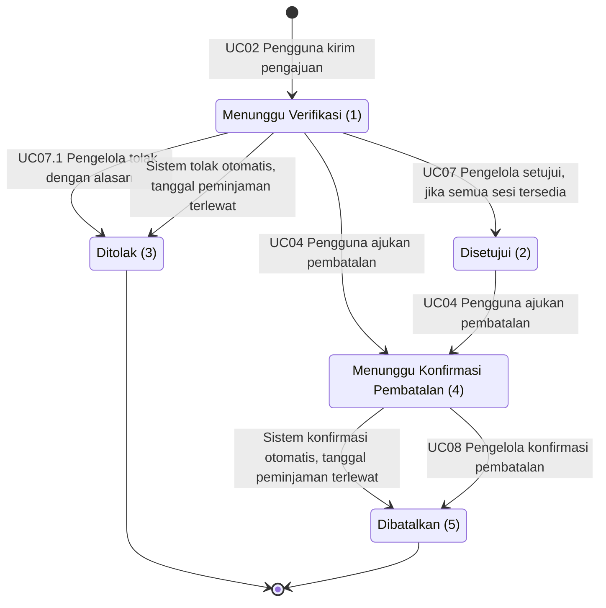
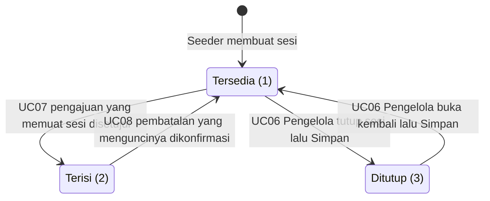

[Kembali ke daftar isi](../README.md)

# State Diagram

Merangkum semua aturan perubahan status yang tersebar di UC02–UC09. Ada dua objek yang berstatus: **pengajuan** (lima status) dan **sesi jadwal** (tiga status). Keduanya saling memengaruhi, jadi dibahas bersama.

Kode status mengikuti kamus data di [model-data.md](model-data.md). Kode Mermaid belum dirender; bila ada yang gagal tampil, tempel ke editor Mermaid atau Miro.

## 1. State diagram Pengajuan

Kolom `bookings.status`: 1=Menunggu Verifikasi, 2=Disetujui, 3=Ditolak, 4=Menunggu Konfirmasi Pembatalan, 5=Dibatalkan.

### 1.1 Tabel transisi pengajuan

| Dari | Ke | Pemicu | Aktor | Syarat (guard) | Efek pada sesi | Use case |
|---|---|---|---|---|---|---|
| (awal) | Menunggu Verifikasi | Tekan "Setuju & Kirim" | Pengguna | Data pemohon lengkap; semua sesi yang dipilih masih tersedia saat kirim | Tidak ada (sesi tidak dikunci) | UC02 |
| Menunggu Verifikasi | Disetujui | Tekan "Setujui" | Pengelola | Pengajuan masih berstatus Menunggu Verifikasi (UC07 A4); semua sesi pengajuan masih tersedia | Setiap sesi menjadi Terisi | UC07 |
| Menunggu Verifikasi | Ditolak | Tekan "Tolak" lalu "Konfirmasi Penolakan" | Pengelola | Pengajuan masih berstatus Menunggu Verifikasi (UC07 A4); alasan penolakan terisi; wajib ditolak bila ada sesi tidak tersedia (UC07 A3) | Tidak ada | UC07.1 |
| Menunggu Verifikasi | Ditolak | Tanggal peminjaman terlewat (hari ini lebih besar dari tanggal pengajuan) | Sistem (perintah terjadwal harian) | Status masih Menunggu Verifikasi; alasan penolakan diisi otomatis (P26) | Tidak ada | Penolakan otomatis |
| Menunggu Konfirmasi Pembatalan | Dibatalkan | Tanggal peminjaman terlewat (hari ini lebih besar dari tanggal pengajuan) | Sistem (perintah terjadwal harian) | Permintaan pembatalan masih menunggu | Sesi yang dikunci pengajuan ini kembali Tersedia bila `previous_status` = 2 | Pembatalan otomatis |
| Menunggu Verifikasi | Menunggu Konfirmasi Pembatalan | Tekan "Ajukan Pembatalan" | Pengguna | Formulir pembatalan lengkap; pengajuan masih berstatus Menunggu Verifikasi dan tanggal peminjamannya belum lewat (UC04 A2) | Tidak ada (sesi belum terkunci). Status sebelumnya (1) disimpan di `previous_status` | UC04 |
| Disetujui | Menunggu Konfirmasi Pembatalan | Tekan "Ajukan Pembatalan" | Pengguna | Formulir pembatalan lengkap; pengajuan masih berstatus Disetujui dan tanggal peminjamannya belum lewat (UC04 A2) | Tidak ada; sesi tetap Terisi sampai pembatalan dikonfirmasi. Status sebelumnya (2) disimpan di `previous_status` | UC04 |
| Menunggu Konfirmasi Pembatalan | Dibatalkan | Tekan "Konfirmasi Pembatalan" | Pengelola | Permintaan masih berstatus Menunggu Konfirmasi Pembatalan (UC08 A3); pembatalan berhasil diproses | Sesi yang dikunci pengajuan ini kembali Tersedia bila `previous_status` = 2 (UC08 A1 bila 1) | UC08 |

Status **Ditolak** dan **Dibatalkan** adalah status akhir: tidak ada transisi keluar.

### 1.2 Transisi yang tidak diizinkan

| Transisi | Alasan |
|---|---|
| Ditolak atau Dibatalkan ke status lain | Status akhir; pengguna yang ingin meminjam lagi membuat pengajuan baru (UC02) |
| Disetujui atau Ditolak kembali ke Menunggu Verifikasi | Keputusan pengelola tidak dapat ditarik oleh UC07 |
| Menunggu Konfirmasi Pembatalan kembali ke Disetujui atau Menunggu Verifikasi | Pengelola hanya mengonfirmasi, tidak menolak pembatalan (keputusan UC08) |
| Ditolak atau Dibatalkan menjadi Menunggu Konfirmasi Pembatalan | UC04 hanya menampilkan pengajuan "Menunggu Verifikasi" atau "Disetujui" |
| Disetujui langsung ke Dibatalkan | Harus lewat permintaan pengguna (UC04) dan konfirmasi pengelola (UC08) |

## 2. State diagram Sesi

Kolom `time_slots.status`: 1=Tersedia, 2=Terisi, 3=Ditutup.

### 2.1 Tabel transisi sesi

| Dari | Ke | Pemicu | Aktor | Syarat (guard) | Use case |
|---|---|---|---|---|---|
| (awal) | Tersedia | Seeder membuat jadwal | Sistem | Sesi baru untuk tanggal yang akan datang | Seeder |
| Tersedia | Terisi | Pengajuan disetujui | Pengelola | Sesi masih Tersedia saat persetujuan | UC07 |
| Terisi | Tersedia | Pembatalan dikonfirmasi | Pengelola | Sesi ini dikunci oleh pengajuan yang dibatalkan | UC08 |
| Tersedia | Ditutup | Tekan "Simpan" setelah sel dibalik | Pengelola | Sesi masih Tersedia saat Simpan | UC06 |
| Ditutup | Tersedia | Tekan "Simpan" setelah sel dibalik | Pengelola | - | UC06 |

### 2.2 Transisi yang tidak diizinkan

| Transisi | Alasan |
|---|---|
| Terisi ke Ditutup | Sel merah tidak dapat diklik; bila sesi baru terisi saat Simpan, sesi tetap Terisi (UC06 A1, "yang sudah terisi menang") |
| Ditutup ke Terisi | Pengajuan hanya dapat memilih sesi Tersedia (UC02); sesi yang ditutup tidak bisa disetujui untuk pengajuan baru |

## 3. Hubungan antara kedua diagram

| Peristiwa | Status pengajuan | Status sesi |
|---|---|---|
| Pengajuan dikirim (UC02) | (awal) menjadi Menunggu Verifikasi | Tetap Tersedia |
| Pengajuan disetujui (UC07) | Menunggu Verifikasi menjadi Disetujui | Tersedia menjadi Terisi |
| Pengajuan ditolak (UC07.1) | Menunggu Verifikasi menjadi Ditolak | Tidak berubah |
| Tanggal peminjaman terlewat saat pengajuan masih Menunggu Verifikasi | Menunggu Verifikasi menjadi Ditolak (oleh sistem) | Tidak berubah |
| Tanggal peminjaman terlewat saat permintaan masih Menunggu Konfirmasi Pembatalan | Menunggu Konfirmasi Pembatalan menjadi Dibatalkan (oleh sistem) | Terisi menjadi Tersedia bila status sebelumnya Disetujui; selain itu tidak berubah |
| Permintaan pembatalan (UC04) | Menunggu Verifikasi atau Disetujui menjadi Menunggu Konfirmasi Pembatalan | Tidak berubah |
| Pembatalan dikonfirmasi (UC08), pengajuan sebelumnya Disetujui | Menunggu Konfirmasi Pembatalan menjadi Dibatalkan | Terisi menjadi Tersedia |
| Pembatalan dikonfirmasi (UC08), pengajuan sebelumnya Menunggu Verifikasi | Menunggu Konfirmasi Pembatalan menjadi Dibatalkan | Tidak berubah (UC08 A1) |
| Sesi ditutup (UC06) | Pengajuan yang menunggu tetap Menunggu Verifikasi | Tersedia menjadi Ditutup |

## 4. Invarian (aturan yang selalu benar)

1. Sebuah sesi berstatus **Terisi** bila dan hanya bila ada tepat **satu** pengajuan yang menguncinya, yaitu pengajuan "Disetujui", atau "Menunggu Konfirmasi Pembatalan" yang sebelumnya "Disetujui".
2. Pengajuan "Menunggu Verifikasi" **tidak pernah** mengunci sesi, sehingga beberapa pengajuan menunggu boleh menuju sesi yang sama.
3. Dua pengajuan tidak boleh sama-sama menguasai satu sesi. Bila bentrok, yang sudah terisi menang (UC07 A3, UC06 A1).
4. Sesi "Terisi" tidak dapat ditutup oleh pengelola.
5. Pengajuan "Ditolak" dan "Dibatalkan" tidak menguasai sesi apa pun.
6. Tidak ada pengajuan "Menunggu Verifikasi" atau "Menunggu Konfirmasi Pembatalan" yang tanggal peminjamannya sudah lewat: yang pertama ditolak otomatis dan yang kedua dibatalkan otomatis oleh sistem (perintah terjadwal harian). Sebelum perintah berjalan, UC07 menganggap sesi pada tanggal lampau tidak tersedia sehingga pengajuan menunggu itu tidak dapat disetujui.

Invarian 1 dan 3 hanya terjamin bila perubahan status pengajuan dan status sesi dilakukan **dalam satu transaksi database** dengan penguncian baris (lihat aturan integritas nomor 5–7 dan 13 di `model-data.md`).

## 5. Keputusan: UC08 melepas sesi berdasarkan `previous_status`

UC08 hanya boleh melepas sesi yang dikunci oleh pengajuan yang dibatalkan. Memeriksa status sesi saja tidak cukup: bila pengajuan A (Disetujui) mengunci sesi X dan pengajuan B (Menunggu Verifikasi) juga menuju X lalu dibatalkan, UC08 yang hanya melihat "X berstatus Terisi" akan melepas sesi yang masih dikunci A, sehingga invarian 1 dan 3 rusak.

Diputuskan: UC04 menyimpan status sebelum pembatalan di kolom `bookings.previous_status` (1 atau 2), dan UC08 melepas sesi hanya bila nilainya 2. Perubahan sudah diterapkan di `model-data.md`, `uc04.md`, dan `uc08.md`.

## 6. Asumsi dan hal yang perlu diputuskan

- **Pengajuan dengan beberapa sesi (diputuskan).** Satu pengajuan memuat satu sampai empat sesi pada satu fasilitas dan satu tanggal. Persetujuan (UC07) berlaku untuk **semua sesi sekaligus**: bila ada satu sesi yang tidak tersedia, pengajuan tidak dapat disetujui dan masuk alur A3 (harus ditolak). Pengguna mengajukan ulang untuk sesi yang masih tersedia.
- **Tidak ada status "Selesai".** Pengajuan "Disetujui" tetap berstatus itu walaupun tanggalnya sudah lewat. Lima status adalah keputusan yang sudah disepakati; filter tanggal di UC03 dan UC05 yang membedakan pengajuan lama.
- **Sesi ditutup saat ada pengajuan menunggu (diputuskan).** Pengajuan itu tetap "Menunggu Verifikasi". Saat diverifikasi, UC07 A3 memperlakukan "tidak tersedia" sebagai satu kondisi (sesi terisi atau ditutup), sehingga persetujuan diblokir dan pengelola harus menolak dengan alasan otomatis.
- **Sesi pada tanggal lampau (diputuskan).** Sistem otomatis menganggap sesi pada tanggal sebelum hari ini tidak tersedia. Ini aturan turunan dari tanggal, bukan status yang disimpan, dan pengelola tidak perlu mengaturnya (UC06 tidak dapat memilih tanggal lampau).
- **Pembatalan otomatis (diputuskan).** Permintaan pembatalan ("Menunggu Konfirmasi Pembatalan") yang tanggal peminjamannya sudah lewat dikonfirmasi otomatis oleh sistem lewat perintah terjadwal yang sama: status menjadi "Dibatalkan", dan sesi dilepas hanya bila `previous_status` = 2 (sama seperti UC08). Alasannya: di UC08 pengelola hanya mengonfirmasi dan tidak pernah menolak, jadi menunggu pengelola untuk tanggal yang sudah lewat tidak memberi keputusan apa pun. Permintaan yang tanggalnya belum lewat tetap menunggu pengelola.
- **Penolakan otomatis (diputuskan).** Pengajuan "Menunggu Verifikasi" yang tanggal peminjamannya sudah lewat (hari ini lebih besar dari tanggal pengajuan) ditolak otomatis oleh sistem lewat perintah terjadwal harian, dengan alasan baku P26. Pengajuan "Disetujui" yang tanggalnya lewat tidak diubah.

## 7. Status tanggal (turunan untuk kalender bulanan)

Kalender bulanan di halaman Jadwal dan Peminjaman (UC01, UC02) dan Kelola Jadwal (UC06) mewarnai setiap tanggal. Status tanggal **bukan status yang disimpan** dan tidak punya transisi sendiri: ia dihitung dari status sesi pada tanggal itu.

| Status tanggal | Aturan dari status sesi | Warna |
|---|---|---|
| Tersedia | Semua sesi Tersedia | Hijau |
| Sebagian | Ada sesi Tersedia dan ada sesi yang bukan Tersedia | Kuning |
| Penuh | Tidak ada sesi Tersedia dan ada sesi Terisi | Merah |
| Ditutup | Semua sesi Ditutup | Abu-abu gelap |

Karena turunan, status tanggal otomatis ikut berubah setiap kali status sesi berubah lewat transisi di bagian 2 (UC06, UC07, UC08). Tanggal yang sudah lewat atau belum punya sesi tidak dapat dipilih; sesi pada tanggal lampau otomatis dianggap tidak tersedia oleh sistem, tanpa mengubah status tersimpan dan tanpa perlu diatur pengelola. Rincian tampilan ada di [wireframe.md](wireframe.md), bagian 1.3.
