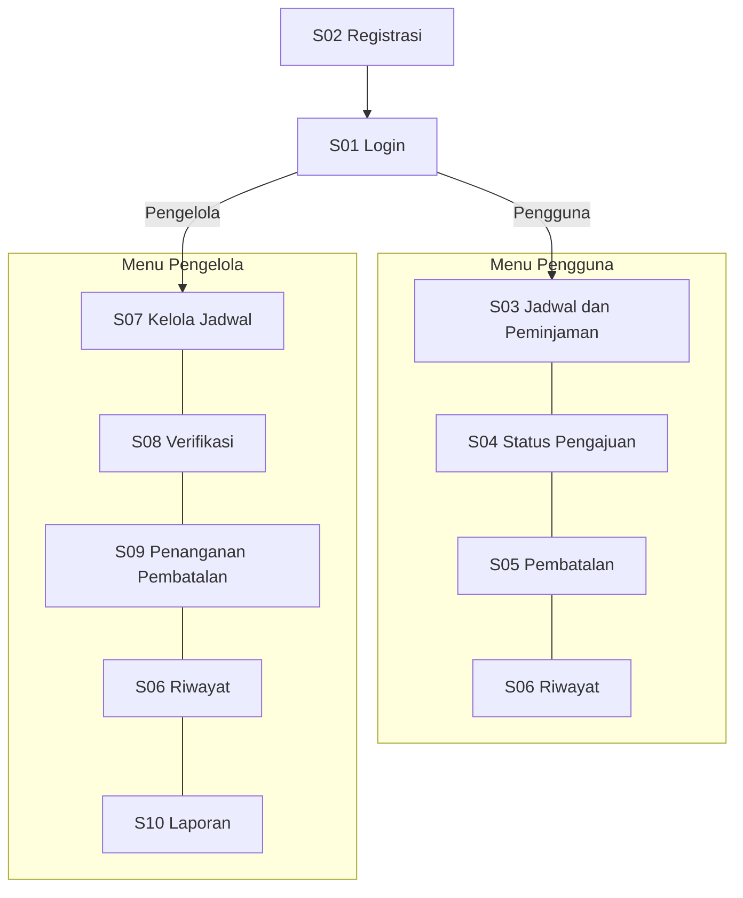

[Kembali ke daftar isi](../README.md)

# Wireframe

Desain antarmuka semua layar Sistem Peminjaman Fasilitas Olahraga Kampus. Setiap layar ditulis sebagai wireframe teks, lengkap dengan elemen, keadaan, dan pesan yang tampil. Semua teks pesan merujuk ke [pesan-sistem.md](pesan-sistem.md) lewat ID (P01–P33), dan semua status memakai kamus data di [model-data.md](model-data.md).

Wireframe ini menggambarkan tata letak dan perilaku, bukan tampilan visual akhir (warna dan gaya menyusul saat implementasi). Acuan tata letak halaman peminjaman adalah PIPTP UNAIR (kalender bulanan, langkah "Pilih Jadwal" dan "Detail Peminjaman" dalam satu halaman); acuan grid dan warna sesi adalah Fasor ITS.

## 1. Konvensi

### 1.1 Notasi wireframe

| Simbol | Arti |
|---|---|
| `[ Tombol ]` | Tombol |
| `(nonaktif)` | Tombol atau elemen yang tidak dapat ditekan |
| `[__________]` | Kolom isian teks |
| `[ pilihan v ]` | Dropdown |
| `[x]` dan `[ ]` | Kotak centang terisi dan kosong |
| `<...>` | Data dari sistem (bukan isian) |
| `{PNN}` | Pesan dari katalog dengan ID PNN |

### 1.2 Warna dan label status

| Objek | Status | Warna | Label teks |
|---|---|---|---|
| Sesi | Tersedia | Hijau | Tersedia |
| Sesi | Terisi | Merah | Terisi |
| Sesi | Ditutup | Abu-abu | Ditutup |
| Pengajuan | Menunggu Verifikasi | Kuning | Menunggu Verifikasi |
| Pengajuan | Disetujui | Hijau | Disetujui |
| Pengajuan | Ditolak | Merah | Ditolak |
| Pengajuan | Menunggu Konfirmasi Pembatalan | Oranye | Menunggu Konfirmasi Pembatalan |
| Pengajuan | Dibatalkan | Abu-abu | Dibatalkan |

Status selalu ditulis sebagai teks di sel atau lencana, tidak hanya warna.

### 1.3 Status tanggal pada kalender bulanan

Kalender bulanan (S03 dan S07) mewarnai setiap tanggal. Karena satu tanggal berisi beberapa sesi dengan status berbeda, status tanggal adalah **status turunan**: dihitung dari status sesi pada tanggal itu, tidak disimpan di basis data.

| Status tanggal | Aturan (dari status sesi pada tanggal itu) | Warna | Dapat dipilih |
|---|---|---|---|
| Tersedia | Semua sesi Tersedia | Hijau | Ya |
| Sebagian | Ada sesi Tersedia dan ada sesi yang bukan Tersedia | Kuning | Ya |
| Penuh | Tidak ada sesi Tersedia dan ada sesi Terisi | Merah | Ya (untuk melihat sesi) |
| Ditutup | Semua sesi Ditutup | Abu-abu gelap | Ya (untuk melihat sesi) |
| Dipilih | Tanggal yang sedang dipilih | Garis tebal | - |
| Lampau atau tanpa sesi | Tanggal sebelum hari ini, atau tanggal yang belum punya sesi | Abu-abu pucat | Tidak |

Warna tanggal selalu disertai keterangan (legenda) di bawah kalender.

**Sesi pada tanggal lampau otomatis dianggap tidak tersedia oleh sistem.** Ini aturan turunan dari tanggal (bukan status yang disimpan): sesi lampau tidak dapat dipilih pengguna, tidak dapat disetujui, dan tidak dapat diubah pengelola, sehingga pengelola tidak perlu menutupnya.

### 1.4 Kerangka halaman dan menu

Login dan Registrasi tidak memakai kerangka. Halaman lain memakai salah satu dari dua kerangka sesuai peran. Pesan toast muncul di pojok kanan atas pada keduanya.

Kerangka pengguna (bar atas, gaya situs):

```
+------------------------------------------------------------------------+
| Fasor Hub                [Jadwal dan Peminjaman] [Status Pengajuan]    |
| Fasilitas Olahraga       [Pembatalan] [Riwayat]      <Nama>  [Keluar]  |
+------------------------------------------------------------------------+
|                                                    [ toast pesan ]     |
|  <konten halaman>                                                      |
|                                                                        |
+------------------------------------------------------------------------+
```

Kerangka pengelola (menu samping, gaya admin panel):

```
+----------------------+-------------------------------------------------+
| Fasor Hub            |                                [ toast pesan ]  |
| Fasilitas Olahraga   |                                                 |
| Pengelola            |  <konten halaman>                               |
|                      |                                                 |
| > Kelola Jadwal      |                                                 |
|   Verifikasi    (3)  |                                                 |
|   Pembatalan    (1)  |                                                 |
|   Riwayat            |                                                 |
|   Laporan            |                                                 |
|                      |                                                 |
| <Nama>   [Keluar]    |                                                 |
+----------------------+-------------------------------------------------+
```

| Peran | Kerangka | Menu |
|---|---|---|
| Pengguna | Bar atas | Jadwal dan Peminjaman, Status Pengajuan, Pembatalan, Riwayat |
| Pengelola | Menu samping | Kelola Jadwal, Verifikasi Pengajuan, Pembatalan, Riwayat, Laporan |

Lencana jumlah pada menu pengelola:

| Menu | Isi lencana |
|---|---|
| Verifikasi Pengajuan | Jumlah pengajuan Menunggu Verifikasi, sama dengan isi antrian S08 (pengajuan kedaluwarsa tidak dihitung karena sudah ditolak otomatis) |
| Pembatalan | Jumlah permintaan Menunggu Konfirmasi Pembatalan, sama dengan isi daftar S09 |

Lencana disembunyikan bila jumlahnya 0 dan dihitung ulang setiap halaman dimuat (tidak real-time, sama seperti tampilan lain). Pada layar sempit, menu samping berpindah ke bagian atas halaman.

Teks yang tertulis di wireframe adalah teks Indonesia (acuan desain); aplikasi menampilkan teks Inggris.

### 1.5 Peta navigasi



Garis tanpa panah menunjukkan item menu yang sejajar (dapat dibuka kapan saja dari kerangka halaman).

### 1.6 Keputusan desain antarmuka

| No | Keputusan | Alasan |
|---|---|---|
| 1 | Semua halaman memerlukan login, kecuali Login dan Registrasi | Sesuai kebutuhan Security (akses sesuai peran) dan UC05 A3 (sesi tidak valid mengarah ke login) |
| 2 | Setelah login, pengguna masuk ke S03 dan pengelola ke S07 | Layar pertama sesuai tugas utama masing-masing peran |
| 3 | **UC01 (melihat jadwal) dan UC02 (mengajukan peminjaman) tampil di satu halaman, S03**; use case tetap dua | Mengikuti PIPTP UNAIR: pengguna melihat jadwal dan langsung mengajukan tanpa pindah halaman; use case diagram dan laporan tidak berubah |
| 4 | Kalender bulanan dengan status tanggal turunan (bagian 1.3) dipakai di S03 dan S07 | Mengikuti PIPTP UNAIR; grid mingguan tidak dipakai lagi |
| 5 | Tanggal sebelum hari ini dan tanggal tanpa sesi tidak dapat dipilih; sesi lampau otomatis tidak tersedia oleh sistem dan tidak perlu diatur pengelola | Menutup celah pengajuan untuk tanggal lampau (temuan prototipe) tanpa beban kerja pengelola |
| 6 | Fasilitas pertama dan bulan berjalan tampil otomatis di S03 dan S07 | Menangani UC01 A2 (belum memilih) tanpa pesan tambahan |
| 7 | Satu pengajuan memakai satu tanggal; pengguna mengklik satu tanggal di kalender | Keputusan UC02: satu fasilitas dan satu tanggal per pengajuan |
| 8 | Isi sesi (jam) ditentukan `config/slots.php`, dipakai seeder dan perintah `slots:generate` (model-data.md, keputusan 1); wireframe memakai contoh empat sesi per hari (08.00–10.00, 10.00–12.00, 13.00–15.00, 15.00–17.00) | Model data menyimpan jam per sesi, jadi jam bukan bagian desain tetap |
| 9 | Nama pemohon di form diambil dari akun dan tidak dapat diedit; kontak aktif terisi awal dari telepon akun tetapi dapat diubah | Pengguna sudah login; data pemohon lain mengikuti form UNAIR |
| 10 | Dialog ketentuan hanya dapat ditutup dengan ikon silang (tanpa tombol "Batal") | Konsisten dengan keputusan tidak memodelkan tombol Batal di UC02 |
| 11 | Pada Verifikasi (UC07), form alasan penolakan tampil di panel detail menggantikan tombol Setujui/Tolak | Satu layar, tanpa dialog tambahan |
| 12 | Pada Kelola Jadwal (UC06), pengelola memilih satu tanggal di kalender lalu membalik sesi di panel; perubahan dari beberapa tanggal terkumpul dan disimpan sekaligus dengan satu tombol Simpan | Mengikuti kalender bulanan tanpa mengubah aturan UC06 (balik per sel, simpan sekali, yang sudah terisi menang) |
| 13 | Pengajuan Menunggu Verifikasi yang tanggalnya sudah lewat ditolak otomatis oleh sistem (alasan baku P26), dan permintaan pembatalan yang tanggalnya sudah lewat dikonfirmasi otomatis (menjadi Dibatalkan); antrian S08 dan daftar S09 tidak memuatnya, dan pengajuan itu terlihat di S06 Riwayat (tidak di S04, yang hanya menampilkan tanggal hari ini atau mendatang) | Pengelola tidak perlu memproses pengajuan kedaluwarsa; pengguna tetap dapat melihat hasilnya di riwayat |
| 14 | **Pesan kesalahan validasi hilang begitu pengguna mengubah isian di formulir yang sama** (P03, P07, P14, P19, P21, P22, P23); jika masih tidak valid, pesan muncul lagi saat tombol ditekan | Pesan tidak basi setelah pengguna memperbaiki isian, dan tidak berkedip karena validasi tetap hanya saat tombol ditekan. Pesan hasil proses sistem tidak mengikuti aturan ini: P04 hilang saat pengguna memilih fasilitas, tanggal, atau sesi lain, dan P18 tetap sampai pengelola mencoba lagi |
| 15 | **Dua kerangka halaman:** bar atas untuk pengguna, menu samping dengan lencana jumlah untuk pengelola; tidak ada halaman dasbor | Pengguna hanya punya empat menu dan halaman utamanya kalender yang lebar (acuan UNAIR). Pengelola berpindah antar lima layar kerja, dan lencana memberi tahu pekerjaan yang menunggu tanpa layar dasbor tambahan (tidak ada use case yang memintanya) |
| 16 | **Aturan isian formulir:** isian berisi spasi saja dianggap kosong, jumlah peserta bilangan bulat 1 atau lebih, dan batas panjang mengikuti kamus data lewat batas karakter di formulir | Hasil validasi tidak ambigu dan tidak butuh pesan baru ([pesan-sistem.md](pesan-sistem.md), bagian 4) |
| 17 | **Nama aplikasi: Fasor Hub.** "Fasor" adalah singkatan umum dari fasilitas olahraga. Nama tampil di kerangka halaman dan layar Login, dengan keterangan "Peminjaman Fasilitas Olahraga Kampus"; judul dokumen tetap memakai nama deskriptif sistem | Nama pendek yang mudah diingat dan menyebut fungsinya, serta berbeda dari nama situs yang diobservasi (Fasor ITS) karena memakai penanda "Hub" |
| 18 | **Bahasa antarmuka: Inggris.** Teks di wireframe ini adalah teks Indonesia sebagai acuan desain; teks yang tampil di aplikasi adalah terjemahan Inggrisnya, ada di [pesan-sistem.md](pesan-sistem.md) dan berkas bahasa `lang/en` | Keputusan tim: satu bahasa antarmuka |
| 19 | **Filter daftar pengelola dan riwayat:** S06 punya filter fasilitas (hanya pengelola), status, dan rentang tanggal peminjaman dengan tombol Terapkan dan Atur Ulang; S08 dan S09 hanya punya filter fasilitas yang langsung berlaku. Filter dikirim lewat parameter alamat halaman, tetap aktif setelah Setujui, Tolak, atau Konfirmasi Pembatalan, dan tidak mengubah lencana menu samping. Hasil kosong karena filter memakai {P33}, bukan {P08}, {P28}, atau {P29} | Pengelola dengan banyak fasilitas dapat memeriksa antrian per fasilitas; pesan yang berbeda mencegah salah mengira data hilang. S04, S05, dan S10 tidak butuh filter (daftar pendek atau sudah punya filter sendiri) |

---

## 2. Layar autentikasi

### 2.1 S01 Login

```
+--------------------------------------+
|              Fasor Hub               |
|    Peminjaman Fasilitas Olahraga     |
|                                      |
|  Email     [____________________]    |
|  Password  [____________________]    |
|                                      |
|  {P21 pesan kesalahan bila gagal}    |
|                                      |
|  [ Masuk ]                           |
|                                      |
|  Belum punya akun?  Daftar           |
+--------------------------------------+
```

| Elemen | Perilaku |
|---|---|
| Email, Password | Wajib diisi |
| Masuk | Peran pengguna masuk ke S03; peran pengelola masuk ke S07 |
| Gagal login | Tampil {P21} di atas tombol |
| Daftar | Menuju S02 |

### 2.2 S02 Registrasi

```
+--------------------------------------------+
|                 Daftar Akun                |
|                                            |
|  Nama lengkap  [______________________]   |
|  Email         [______________________]   |
|  Password      [______________________]   |
|  Identitas     [______________________]   |
|     (NRP, NIP, atau nama organisasi)      |
|  Telepon       [______________________]   |
|                                            |
|  {P22 / P23 pesan kesalahan bila ada}      |
|                                            |
|  [ Daftar ]       Sudah punya akun? Masuk  |
+--------------------------------------------+
```

| Elemen | Perilaku |
|---|---|
| Semua kolom | Wajib diisi (pengguna; peran otomatis 1) |
| Email sudah ada | Tampil {P22} |
| Kolom kosong | Tampil {P23} |
| Berhasil | Kembali ke S01 dengan toast hijau {P24} |

---

## 3. Layar pengguna

### 3.1 S03 Jadwal dan Peminjaman (UC01 dan UC02)

Satu halaman dengan dua langkah, mengikuti PIPTP UNAIR. Langkah 1 (kiri) memilih fasilitas dan tanggal pada kalender bulanan. Langkah 2 (kanan) menampilkan sesi tanggal itu, ringkasan, dan data pemohon.

Keadaan awal (fasilitas pertama dan bulan berjalan tampil; tanggal belum dipilih):

```
+------------------------------------------------------------------------+
| Jadwal dan Peminjaman                                                  |
|                                                                        |
| Langkah 1: Pilih Jadwal              Langkah 2: Detail Peminjaman      |
|                                                                        |
| Fasilitas [ Lapangan Basket A v ]    Sesi (pilih 1 sampai 4)           |
|  Jenis: Basket                        {P25 pilih tanggal dahulu}       |
|                                                                        |
|  [<]      Oktober 2026      [>]      Ringkasan                         |
|  Sen  Sel  Rab  Kam  Jum  Sab  Min    Belum ada sesi dipilih           |
|   -    -    -    -    -    -   25                                      |
|  26 T 27 T 28 S 29 T 30 P 31 T  1 X  Data pemohon                      |
|   2 T  3 T  4 T  5 T  6 T  7 T 8 T   Nama      <nama dari akun>        |
|   ...                                 Unit/Org. [________________]     |
|                                       Peserta   [____]                 |
|  T Tersedia  S Sebagian  P Penuh      Kontak    [<telepon akun>__]     |
|  X Ditutup  [..] Dipilih  - Lampau    Keperluan [________________]     |
|                                                                        |
|                              [ Ajukan Peminjaman ] (nonaktif)          |
+------------------------------------------------------------------------+
```

Keadaan setelah memilih tanggal 28 Okt dan dua sesi:

```
| Langkah 1: Pilih Jadwal              Langkah 2: Detail Peminjaman      |
|  ...                                                                   |
|  26 T 27 T [28 S] 29 T 30 P 31 T      Sesi (pilih 1 sampai 4)          |
|                                        [x] 08.00-10.00   Tersedia      |
|                                        [ ] 10.00-12.00   Terisi        |
|                                            (nonaktif)                  |
|                                        [ ] 13.00-15.00   Ditutup       |
|                                            (nonaktif)                  |
|                                        [x] 15.00-17.00   Tersedia      |
|                                       Ringkasan                        |
|                                        Lapangan Basket A, 28 Okt 2026  |
|                                        Sesi dipilih: 2 dari 4          |
|                                       {P03 / P04 pesan kesalahan}      |
|                              [ Ajukan Peminjaman ] (aktif)             |
```

Dialog ketentuan peminjaman (setelah menekan Ajukan Peminjaman dan data lengkap):

```
+--------------------------------------------------+
| Konfirmasi Persetujuan                       [x] |
|                                                  |
| Sebelum pengajuan diproses, harap membaca dan    |
| menyetujui ketentuan berikut:                    |
|  - Pengajuan dilakukan sebelum tanggal           |
|    penggunaan agar pengelola sempat memverifikasi|
|  - Kontak aktif wajib diisi untuk konfirmasi     |
|    status pengajuan                              |
|  - Sesi baru terkunci setelah pengajuan          |
|    disetujui pengelola                           |
|  - Peminjam bertanggung jawab atas ketertiban,   |
|    kebersihan, dan kelengkapan fasilitas         |
|  - Peminjam mematuhi aturan penggunaan fasilitas |
|    (mis. berpakaian dan bersepatu olahraga)      |
|  - Pembatalan diajukan lewat sistem              |
|                                                  |
| [ ] Saya menyatakan setuju dan akan mematuhi     |
|     ketentuan penggunaan fasilitas               |
|                                                  |
|                   [ Setuju & Kirim ] (nonaktif)  |
+--------------------------------------------------+
```

| Elemen | Perilaku |
|---|---|
| Fasilitas | Dropdown; fasilitas pertama terpilih otomatis; mengganti fasilitas mereset tanggal dan sesi terpilih; menampilkan jenis fasilitas |
| Kalender bulanan | Menampilkan status setiap tanggal sesuai bagian 1.3; panah mengganti bulan; tanggal lampau atau tanpa sesi tidak dapat dipilih; mengklik satu tanggal memilihnya (Dipilih) |
| Data tidak tersedia | Tampil {P01} bila fasilitas tidak punya sesi pada bulan itu |
| Sesi (langkah 2) | Sebelum tanggal dipilih tampil {P25}; setelah tanggal dipilih tampil empat sesi dengan statusnya; hanya "Tersedia" dapat dipilih; "Terisi" dan "Ditutup" nonaktif; setelah 4 sesi terpilih sesi lain nonaktif |
| Ringkasan | Menampilkan fasilitas, tanggal, dan jumlah sesi terpilih |
| Ajukan Peminjaman | Nonaktif sampai minimal satu sesi dipilih; saat ditekan, data diperiksa |
| Data tidak lengkap | Tampil {P03}; dialog tidak muncul |
| Dialog | Tombol Setuju & Kirim nonaktif sampai kotak dicentang; ikon silang menutup dialog tanpa mengirim |
| Sesi tidak lagi tersedia saat kirim | Tampil {P04}; kalender dan daftar sesi diperbarui |
| Berhasil | Toast hijau {P02} |

Bagian UC01 (melihat jadwal) adalah fasilitas, kalender, dan daftar sesi beserta statusnya; bagian UC02 (mengajukan) adalah pemilihan sesi, data pemohon, dialog, dan pengiriman.

### 3.2 S04 Status Pengajuan (UC03)

```
+------------------------------------------------------------------------+
| Status Pengajuan                                                       |
|                                                                        |
| +----------------------+----------+-----------+---------------+--------+|
| | Fasilitas            | Tanggal  | Sesi      | Status        |        ||
| +----------------------+----------+-----------+---------------+--------+|
| | Lapangan Basket A    | 28 Okt   | 08-10,    | Ditolak       |[Detail]||
| |                      |          | 15-17     |               |        ||
| | Lapangan Futsal A    | 29 Okt   | 10-12     | Menunggu Ver. |[Detail]||
| | Lapangan Tenis 1     | 30 Okt   | 13-15     | Disetujui     |[Detail]||
| +----------------------+----------+-----------+---------------+--------+|
|                                                                        |
| Detail pengajuan (setelah memilih satu pengajuan)                      |
|  Fasilitas: Lapangan Basket A     Tanggal: 28 Okt 2026                 |
|  Sesi: 08.00-10.00, 15.00-17.00   Peserta: 12                          |
|  Keperluan: <keperluan>           Diajukan: <waktu pengajuan>          |
|  Status: Ditolak                                                       |
|  Alasan penolakan: <alasan dari pengelola>   (hanya bila Ditolak)      |
+------------------------------------------------------------------------+
```

| Elemen | Perilaku |
|---|---|
| Daftar | Hanya pengajuan milik pengguna dengan tanggal hari ini atau mendatang; urut waktu pengajuan terbaru |
| Detail | Muncul setelah memilih satu pengajuan; alasan penolakan hanya tampil bila status Ditolak |
| Kosong | Tampil {P05} |

### 3.3 S05 Pembatalan Pengguna (UC04)

```
+------------------------------------------------------------------------+
| Pembatalan Pengajuan                                                   |
|                                                                        |
| Pengajuan yang dapat dibatalkan (Menunggu Verifikasi atau Disetujui)   |
| +---------------------+----------+-----------+----------------+------+ |
| | Fasilitas           | Tanggal  | Sesi      | Status         |      | |
| | Lapangan Futsal A   | 29 Okt   | 10-12     | Menunggu Ver.  |[Pilih]| |
| | Lapangan Tenis 1    | 30 Okt   | 13-15     | Disetujui      |[Pilih]| |
| +---------------------+----------+-----------+----------------+------+ |
|                                                                        |
| Detail pengajuan terpilih                                              |
|  <fasilitas, tanggal, sesi, keperluan, status>                         |
|                                                                        |
| Alasan pembatalan                                                      |
|  [______________________________________________________]             |
|                                                                        |
|  {P07 pesan kesalahan bila formulir tidak lengkap}                     |
|                                        [ Ajukan Pembatalan ]           |
+------------------------------------------------------------------------+
```

| Elemen | Perilaku |
|---|---|
| Daftar | Pengajuan milik pengguna berstatus Menunggu Verifikasi atau Disetujui dan bertanggal hari ini atau mendatang; peminjaman yang sudah lewat tidak dapat dibatalkan |
| Kosong | Tampil {P27} |
| Pilih | Menampilkan detail dan formulir alasan |
| Ajukan Pembatalan | Alasan kosong menampilkan {P07}; berhasil mengubah status menjadi Menunggu Konfirmasi Pembatalan |
| Berhasil | Toast hijau {P06} |
| Pengajuan sudah berubah status | Tampil {P31} di atas daftar, tidak ada perubahan data, panel detail ditutup, dan daftar diperbarui |

### 3.4 S06 Riwayat Peminjaman (UC05)

Tampilan pengguna (hanya milik sendiri):

```
+------------------------------------------------------------------------+
| Riwayat Peminjaman                                                     |
|                                                                        |
| +-------------------+----------+-----------+-----------+--------------+|
| | Fasilitas         | Tanggal  | Sesi      | Status    | Diajukan     ||
| | Lapangan Futsal A | 20 Okt   | 08-10     | Disetujui | 18 Okt 09.10 ||
| | Lapangan Tenis 1  | 15 Okt   | 13-15     | Ditolak   | 13 Okt 14.22 ||
| +-------------------+----------+-----------+-----------+--------------+|
|   (klik baris untuk melihat detail)                                    |
|                                                                        |
| Detail: <fasilitas, tanggal, sesi, keperluan, status, waktu pengajuan, |
|          alasan penolakan bila Ditolak>                                |
+------------------------------------------------------------------------+
```

Tampilan pengelola (semua pengguna, ada kolom pemohon):

```
| +-----------------+-------------------+----------+------+----------+  |
| | Pemohon         | Fasilitas         | Tanggal  | Sesi | Status   |  |
| | Ani (5025...)   | Lapangan Futsal A | 20 Okt   | 8-10 | Disetujui|  |
```

Baris filter di atas tabel (kedua tampilan; kolom Fasilitas hanya untuk pengelola):

```
| Fasilitas [ Semua Fasilitas v ]   Status [ Semua Status v ]            |
| Tanggal awal [ __ ]  Tanggal akhir [ __ ]   [ Atur Ulang ] [ Terapkan ]|
| {P19 pesan kesalahan bila tanggal awal setelah tanggal akhir}          |
| {P33 pemberitahuan bila tidak ada riwayat yang sesuai filter}          |
```

| Elemen | Perilaku |
|---|---|
| Daftar | Pengguna melihat milik sendiri; pengelola melihat semua pengguna; urut waktu pengajuan terbaru; mencakup tanggal yang sudah lewat |
| Detail | Muncul setelah memilih satu riwayat; alasan penolakan hanya di detail, berupa alasan pengelola atau {P26} bila ditolak otomatis oleh sistem |
| Kosong | Tampil {P08} hanya bila tidak ada riwayat sama sekali tanpa filter; bila filter aktif dan riwayat ada tetapi tidak ada yang cocok, tampil {P33} |
| Gagal memuat | Tampil {P09} dengan tombol "Coba lagi" |
| Filter | Fasilitas (hanya pengelola; "Semua Fasilitas" atau satu fasilitas), Status (lima status pengajuan, atau semua), dan tanggal awal dan akhir (tanggal peminjaman, batas termasuk; boleh dikosongkan). Semua filter berlaku bersamaan dan dikirim lewat parameter alamat halaman |
| Terapkan | Tanggal awal setelah tanggal akhir menampilkan {P19} dan daftar tidak berubah; selain itu daftar disaring, tetap urut terbaru, dan detail yang terbuka ditutup. Pesan {P19} hilang begitu isian filter diubah |
| Atur Ulang | Menghapus semua filter dan menampilkan seluruh riwayat |

---

## 4. Layar pengelola

### 4.1 S07 Kelola Jadwal (UC06)

Kalender bulanan (kiri) memilih tanggal; panel sesi (kanan) menampilkan empat sesi tanggal itu dan membaliknya. Perubahan dari beberapa tanggal terkumpul sampai Simpan ditekan.

```
+------------------------------------------------------------------------+
| Kelola Jadwal                                                          |
|                                                                        |
| Fasilitas [ Lapangan Basket A v ]                                      |
|                                                                        |
|  [<]      Oktober 2026      [>]      Sesi tanggal 28 Okt 2026          |
|  Sen  Sel  Rab  Kam  Jum  Sab  Min    {P25 pilih tanggal dahulu}       |
|   -    -    -    -    -    -   25                                      |
|  26 T 27 T[28 S*]29 T 30 P 31 T  1 X   08.00-10.00 [ Tersedia ]        |
|   2 T  3 T  4 T  5 T  6 T  7 T 8 T    10.00-12.00 [ Terisi ] (nonaktif)|
|   ...                                 13.00-15.00 [ Ditutup * ]        |
|                                       15.00-17.00 [ Tersedia ]         |
|  T Tersedia  S Sebagian  P Penuh                                       |
|  X Ditutup  [..] Dipilih  - Lampau                                     |
|  * tanggal atau sesi yang diubah       Sesi yang diklik dibalik antara |
|    dan belum disimpan                  Tersedia dan Ditutup            |
|                                                                        |
|                                                  [ Simpan ] (nonaktif) |
+------------------------------------------------------------------------+
```

| Elemen | Perilaku |
|---|---|
| Fasilitas | Dropdown; mengganti fasilitas membuang perubahan yang belum disimpan |
| Kalender bulanan | Status tanggal sesuai bagian 1.3 (dihitung termasuk perubahan yang belum disimpan); tanggal lampau atau tanpa sesi tidak dapat dipilih; tanggal yang punya perubahan belum disimpan diberi tanda * |
| Panel sesi | Sebelum tanggal dipilih tampil {P25}; sesudahnya empat sesi dengan statusnya; klik membalik Tersedia dan Ditutup (hanya tampilan, belum tersimpan); sel Terisi tidak dapat diubah; sesi yang diubah diberi tanda * |
| Simpan | Nonaktif sampai ada sesi yang diubah (pada tanggal mana pun); saat ditekan, semua perubahan dari semua tanggal disimpan sekaligus |
| Berhasil | Toast hijau {P10} |
| Ada sesi yang baru terisi | Sesi itu tetap Terisi, perubahan lain tersimpan, toast kuning {P11} |

### 4.2 S08 Verifikasi Pengajuan (UC07 dan UC07.1)

Keadaan awal (belum memilih pengajuan):

```
+------------------------------------------------------------------------+
| Verifikasi Pengajuan                                                   |
|                                                                        |
| Fasilitas [ Semua Fasilitas v ]                                        |
|                                                                        |
| Antrian (Menunggu Verifikasi, urut waktu pengajuan)                    |
| +----------------+-------------------+----------+--------------+------+|
| | Diajukan       | Pemohon           | Fasilitas| Tanggal      |      ||
| | 24 Okt 08.15   | Ani (5025...)     | Futsal A | 29 Okt       |[Pilih]|
| | 24 Okt 09.40   | Budi (5025...)    | Basket A | 28 Okt       |[Pilih]|
| +----------------+-------------------+----------+--------------+------+|
+------------------------------------------------------------------------+
```

Detail pengajuan terpilih dengan tombol keputusan:

```
| Detail pengajuan                                                       |
|  Pemohon: Ani (5025...)      Unit/Organisasi: <unit>                   |
|  Kontak: <kontak>            Jumlah peserta: 12                        |
|  Fasilitas: Lapangan Futsal A    Tanggal: 29 Okt 2026                  |
|  Sesi: 08.00-10.00, 10.00-12.00                                        |
|  Keperluan: <keperluan>                                                |
|                                                                        |
|                                    [ Setujui ]   [ Tolak ]             |
```

Keadaan sesi tidak tersedia (A3): peringatan, Setujui nonaktif.

```
|  {P15 peringatan: Ada sesi yang tidak tersedia}                        |
|                                    [ Setujui ] (nonaktif)  [ Tolak ]   |
```

Form alasan penolakan (setelah menekan Tolak):

```
|  Alasan penolakan                                                      |
|  [<terisi otomatis {P16} bila berasal dari A3, dapat diedit>_____]     |
|  {P14 pesan kesalahan bila alasan kosong}                              |
|                                         [ Konfirmasi Penolakan ]       |
```

| Elemen | Perilaku |
|---|---|
| Antrian | Hanya pengajuan Menunggu Verifikasi; urut waktu pengajuan terlama di atas. Pengajuan yang tanggalnya sudah lewat tidak tampil karena sudah ditolak otomatis oleh sistem |
| Kosong | Tampil {P28} hanya bila tidak ada pengajuan Menunggu Verifikasi sama sekali; bila antrian berisi tetapi tidak ada yang cocok dengan filter fasilitas, tampil {P33} |
| Filter fasilitas | Dropdown "Semua Fasilitas" atau satu fasilitas, langsung berlaku saat dipilih (tanpa tombol Terapkan); detail yang terbuka ditutup; urutan tetap terlama di atas. Filter tetap aktif setelah Setujui atau Konfirmasi Penolakan (dibawa lewat parameter alamat halaman). Lencana Verifikasi di menu samping tetap menghitung seluruh antrian |
| Pilih | Menampilkan detail pengajuan |
| Setujui | Memeriksa seluruh sesi; bila semuanya tersedia (belum terisi, tidak ditutup, dan tanggalnya belum lewat), status menjadi Disetujui, sesi menjadi Terisi, toast hijau {P12} |
| Setujui (ada sesi tidak tersedia) | Tampil {P15}; tombol Setujui nonaktif; pengelola hanya dapat menolak |
| Tolak | Form alasan tampil di panel; terisi otomatis {P16} bila berasal dari A3 |
| Konfirmasi Penolakan | Alasan kosong menampilkan {P14}; bila terisi, status menjadi Ditolak dan toast merah {P13} |
| Setujui atau Konfirmasi Penolakan (pengajuan sudah berubah status) | Tampil {P30} di atas antrian, tidak ada perubahan data, panel detail ditutup, dan antrian diperbarui |

### 4.3 S09 Penanganan Pembatalan (UC08)

```
+------------------------------------------------------------------------+
| Penanganan Pembatalan                                                  |
|                                                                        |
| Fasilitas [ Semua Fasilitas v ]                                        |
|                                                                        |
| Permintaan (Menunggu Konfirmasi Pembatalan, urut waktu permintaan)     |
| +----------------+-------------------+----------+--------------+------+|
| | Diminta        | Pemohon           | Fasilitas| Tanggal      |      ||
| | 25 Okt 07.30   | Citra (5025...)   | Tenis 1  | 30 Okt       |[Pilih]|
| +----------------+-------------------+----------+--------------+------+|
|                                                                        |
| Detail permintaan                                                      |
|  Pemohon: Citra (5025...)     Fasilitas: Lapangan Tenis 1              |
|  Tanggal: 30 Okt 2026         Sesi: 13.00-15.00                        |
|  Status sebelum pembatalan: Disetujui                                  |
|  Alasan pembatalan: <alasan dari pengguna>                             |
|                                                                        |
|  {P18 pesan kesalahan bila gagal diproses}                             |
|                                   [ Konfirmasi Pembatalan ]            |
+------------------------------------------------------------------------+
```

| Elemen | Perilaku |
|---|---|
| Daftar | Hanya pengajuan Menunggu Konfirmasi Pembatalan; urut waktu permintaan terlama di atas. Permintaan yang tanggalnya sudah lewat tidak tampil karena sudah dikonfirmasi otomatis oleh sistem |
| Kosong | Tampil {P29} hanya bila tidak ada permintaan sama sekali; bila daftar berisi tetapi tidak ada yang cocok dengan filter fasilitas, tampil {P33} |
| Filter fasilitas | Sama seperti S08: dropdown yang langsung berlaku, menutup detail, urutan tetap terlama di atas, tetap aktif setelah Konfirmasi Pembatalan, dan lencana Pembatalan di menu samping tidak mengikuti filter |
| Detail | Menampilkan alasan pembatalan dan status sebelum pembatalan |
| Konfirmasi Pembatalan | Status menjadi Dibatalkan; sesi yang dikunci pengajuan ini kembali Tersedia hanya bila status sebelumnya Disetujui; toast hijau {P17} |
| Gagal diproses | Tampil {P18}; status dan sesi tidak berubah; tombol dapat ditekan lagi |
| Permintaan sudah diproses | Tampil {P32} di atas daftar, tidak ada perubahan data, panel detail ditutup, dan daftar diperbarui |

### 4.4 S10 Laporan Penggunaan (UC09)

```
+------------------------------------------------------------------------+
| Laporan Penggunaan                                                     |
|                                                                        |
| Tanggal awal  [ 1 Okt 2026 ]   Tanggal akhir [ 31 Okt 2026 ]          |
| Fasilitas     [ Semua Fasilitas v ]                                    |
|                                          [ Tampilkan Laporan ]         |
|                                                                        |
| {P19 pesan kesalahan bila periode tidak valid}                         |
| {P20 pemberitahuan bila tidak ada peminjaman}                          |
|                                                                        |
| +--------------------+------------+--------------+-------------------+ |
| | Fasilitas          | Peminjaman | Sesi terisi  | Penggunaan        | |
| | Lapangan Futsal A  |         14 |           22 |             35%   | |
| | Lapangan Basket A  |          9 |           12 |             19%   | |
| +--------------------+------------+--------------+-------------------+ |
|  Penggunaan = sesi terisi / sesi yang dapat dipinjam (tidak termasuk   |
|  sesi Ditutup)                                                         |
+------------------------------------------------------------------------+
```

| Elemen | Perilaku |
|---|---|
| Tanggal awal dan akhir | Wajib; periode boleh mencakup tanggal mendatang |
| Fasilitas | Semua Fasilitas atau satu fasilitas |
| Tampilkan Laporan | Tanggal awal setelah akhir menampilkan {P19}; tanpa data menampilkan {P20}; selain itu tabel laporan tampil |
| Tabel | Hanya pengajuan Disetujui; kolom Peminjaman, Sesi terisi, dan Penggunaan |
| Akses | Hanya pengelola |

---

## 5. Pemetaan layar ke use case dan data

| Layar | Use case | Peran | Tabel yang dibaca | Tabel yang ditulis |
|---|---|---|---|---|
| S01 Login | Autentikasi | Semua | users | - |
| S02 Registrasi | Autentikasi | Calon pengguna | users | users |
| S03 Jadwal dan Peminjaman | UC01, UC02 | Pengguna | facilities, time_slots, users | bookings, booking_time_slot |
| S04 Status Pengajuan | UC03 | Pengguna | bookings, booking_time_slot, time_slots, facilities | - |
| S05 Pembatalan Pengguna | UC04 | Pengguna | bookings, booking_time_slot, time_slots, facilities | bookings |
| S06 Riwayat Peminjaman | UC05 | Pengguna, Pengelola | bookings, booking_time_slot, time_slots, facilities, users | - |
| S07 Kelola Jadwal | UC06 | Pengelola | facilities, time_slots | time_slots |
| S08 Verifikasi Pengajuan | UC07, UC07.1 | Pengelola | bookings, booking_time_slot, time_slots, users | bookings, time_slots |
| S09 Penanganan Pembatalan | UC08 | Pengelola | bookings, booking_time_slot, time_slots, users | bookings, time_slots |
| S10 Laporan Penggunaan | UC09 | Pengelola | bookings, booking_time_slot, time_slots, facilities | - |

## 6. Pesan yang tampil di tiap layar

| Layar | Pesan |
|---|---|
| S01 | P21 |
| S02 | P22, P23, P24 |
| S03 | P01, P25, P02, P03, P04 |
| S04 | P05 |
| S05 | P06, P07, P27, P31 |
| S06 | P08, P09, P19, P26, P33 |
| S07 | P25, P10, P11 |
| S08 | P12, P13, P14, P15, P16, P28, P30, P33 |
| S09 | P17, P18, P29, P32, P33 |
| S10 | P19, P20 |

## 7. Perubahan dari versi sebelumnya

Wireframe ini menggantikan versi dengan 11 layar. S03 (Jadwal Fasilitas) dan S04 (Ajukan Peminjaman) digabung menjadi S03, dan nomor layar sesudahnya bergeser satu (S05 menjadi S04, S06 menjadi S05, dan seterusnya sampai S11 menjadi S10). Grid mingguan diganti kalender bulanan di S03 dan S07. Aturan sesi lampau otomatis tidak tersedia dan penolakan otomatis pengajuan yang tanggalnya terlewat ditambahkan pada versi ini.
